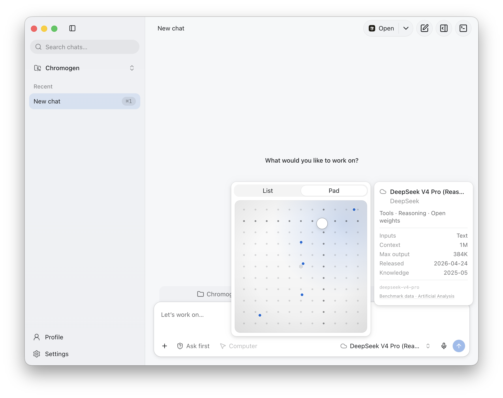

# Aiden Agent

<p align="center">
  
</p>

<p align="center">
  A native-feeling desktop workspace for chatting with local or hosted AI models and safely working inside the folders you choose.
</p>

```sh
curl -fsSL https://raw.githubusercontent.com/sambitcreate/aiden-agent/main/install.sh | sh
```

The installer selects the native package for macOS or a supported Linux family,
verifies the published checksum, authenticates Linux build provenance with the
GitHub CLI, and verifies Apple signing plus Gatekeeper acceptance on macOS.
Homebrew remains available with `brew install --cask sambitcreate/tap/aiden-agent`.
Intel Mac installation will become available when a signed x64 DMG is published;
the installer currently fails rather than selecting the incompatible arm64 DMG.

Each release publishes the arm64 Mac DMG plus Linux x64 and arm64 AppImage,
`.deb`, and `.rpm` packages. See the
[Linux install and compatibility guide](docs/linux.md).



## Why Aiden

I don't come from a coding background. I'd been bouncing between the coding agents that exist, and each one had a piece of what I wanted without any of them being the whole thing. I loved **Codex** for its restrained, lovely desktop UX, **Opencode** for letting me bring whatever model and provider I wanted and also looking great in both the terminal and desktop, and **Cursor** for its nimbleness and UI, and I used **Claude Code** for the models lol. But the one terminal agent kept coming back to was **Pi**, by **Mario Zechner**, for the plugin system I could shape to my own workflow. What **Pi** lacked was a GUI, and I wanted the extensibility with a real interface on top of it. The first version was a native **SwiftUI** app, but within two weeks it was clear that building a coding agent inside **SwiftUI** was the wrong fight for someone who doesn't already write code, so the project pivoted to **Electron**. I was playing around with **Glaze**, **Raycast**'s AI app maker. I figured, let me just recreate Aiden in Glaze, ran out of credits inside an hour, used **Codex** to grab the code out of Glaze, and a week later this is what happened. **Aiden** runs on the **Pi** agent runtime and gives it a native-feeling desktop workspace.

## Features

- **Aiden Live (Beta)** - use the blue orb for an explicitly started voice session with visible listening, thinking, speaking, approval, and error states. First use walks through model access, microphone, and Screen & Accessibility permissions once; computer actions and scheduled tasks retain Aiden's existing approval boundaries.
- **Command palette and shortcuts** - `⌘K` searches commands, chats, models, providers, Settings, appearance actions, Bots, places, workspace tools, and the open chat's actions. Back/forward, stop, attach, model, and approval keys, `F6` between areas, arrow keys in the sidebar, `⌘F` find in chat, `↑` to fix and resend your last message, and `⇧F10` row menus keep everyday work keyboard-only; `⌘/` lists every key, and the View, Go and Chat menus show them too; see [docs/keyboard.md](docs/keyboard.md). One typed command system also powers native menus, visible shortcut labels, transactional global hotkeys, and the searchable Keyboard Shortcuts editor.
- **Commands and explicit skills** - type `/` at the start of the composer to search Aiden app commands, or `$` to search the active workspace's available skills. Commands reuse canonical app workflows; an explicitly selected skill is revalidated for the active workspace, applies to one accepted message, and persists only safe display provenance.
- **Native Subagents** - a foreground chat can delegate up to four fresh `scout`, `planner`, `reviewer`, or `implementer` tasks. Children inherit the approved workspace and model, stop with the parent, and appear as a collapsible group in the transcript plus an inspectable **Subagents** view in Environment. While any child works, a pill above the composer (`⌘⇧S` opens its tray of runs, with Stop, Show in chat and the Subagents panel) and a count badge in the chat's top bar keep them visible even with every panel closed. The implementer can edit files and run commands within the parent permission ceiling.

  | Role defaults when capabilities are omitted | Full workspace access | Ask workspace access | None |
  | --- | --- | --- | --- |
  | Scout, planner, reviewer: read/search | Read/search | Read/search | No workspace tools |
  | Implementer: read/search, write/edit, shell | Writes and shell run under this child run without another card | One write grant and one separate shell grant per child run, requested on first use | No write or shell tools |

  Near its existing turn, tool, or time limit, a child reserves one text-only reporting turn; any partial report remains incomplete and unverified. Cancellation still stops it. Web and MCP calls keep their existing per-call approval behavior. Implementer cannot delegate to another subagent. Rollout flags and the parent capability ceiling can narrow every row.
- **Bots and Web Search** - macOS and Linux can create durable Bots with explicit capability grants, persistent conversations, image understanding, Telegram control, and [scheduled check-ins in the same chat](docs/bot-routines.md) with recovery for claimed fires, retries of passing failures, a pre-fire health check, one "Needs you" card when only you can fix something, and an automatic pause after three failures in a row; per-Bot quiet hours and a daily notification limit; follow-ups on dated promises; routines that learn from declined suggestions; and routines that run when a file changes in the Bot's folder or their own link is called; and Bots that learn: lessons from a routine's runs (kept only with your OK), how-to lessons from your corrections, skills they propose (a skill in a Bot's folder loads only after you approve it), memory tidying, and a What I've learned page with Undo (Linux needs an unlocked Secret Service keyring). A Bot can hand a step to you on a card, ask you to sign in inside its own browser profile (the model never sees your password), follow plain-language rules that only tighten what it may do ([docs/bot-rules.md](docs/bot-rules.md)), and be paused as a whole. Every desktop can configure explicit Web Search routes from the expanded provider catalog. While Web Search is on, the agent can also read a public page in your chats, and an opt-in extract mode returns only the values it asks for, each with the page line it came from ([docs/web-fetch-extract.md](docs/web-fetch-extract.md)).
- **Bot computers (Apple silicon):** an opt-in macOS VM per Bot, which the Bot uses with its own `computer` and `computer_shell` tools, routines included. Watch it live in the Bot panel's Computer tab, and click, type or choose Take over to use it yourself, then Give back. With element control, which you allow once for the base computer in Settings → Bot computers, the Bot can also read an app's buttons and fields and click them by number. A Bot can ask you to sign in to a site on its own computer: Open hands you the computer with Safari at that site, and the Bot's computer tools wait until you answer. See [docs/bot-computers.md](docs/bot-computers.md).
- **Headless durable Bots** - the standalone CLI can explicitly enable durable Bot sessions with `aiden bots enable-durable`, then restart its daemon. Migration preserves legacy conversations and journals in a private recovery backup. See [supported capabilities and recovery](docs/cli-durable-bots.md).
- **Workspaces and managed worktrees** - use folders, scratch workspaces, or isolated managed worktrees with three access levels, workspace-scoped tools, Ask-mode approvals, guarded creation/deletion, and crash-aware cleanup. If a workspace's folder is moved, renamed or deleted, Aiden names it above the composer and keeps your message until the folder is back.
- **Chats without a workspace** - choose **No workspace** to just chat with your global settings. The chat is listed under **Chats** in the sidebar and still runs in its own hidden folder in Aiden's app data, so files, skills and Git work; deleting the chat moves that folder to the Trash. Desktop only for now; see [chats without a workspace](docs/no-workspace-chats.md).
- **Models and the Model Pad** - choose from Pi's native hosted-provider catalog, local Ollama or LM Studio models, and declarative compatible endpoints. Arrange a personal capability-and-pace map, optionally enrich hosted models with explicitly fetched Artificial Analysis scores through a benchmark-only OpenRouter key, and keep benchmark evidence visibly separate from runtime limits and availability. Each chat keeps its own model: picking one in a chat that already has messages changes only that chat, while a pick in a new chat sets the model new chats start with. The iOS and Android apps follow the same rule for the Mac they are paired with.
- **Usage limits and spending limits** - when a provider's rate limit or plan window turns a reply away before it starts, chats, Bots and routines wait for the reset (up to a longest wait you choose, 6 hours by default), send one test request, then resume one at a time with the same model; a "Waiting for … usage limit · next try at 3:40 PM" row offers **Retry now**. Dollar limits per chat, per Bot per month and per routine run count only pay-as-you-go API keys, and a reached limit offers **Allow $X more**, also from Aiden On The Go. Desktop only; see [usage limits and spending limits](docs/usage-limits-and-spending.md).
- **Terminal, Git, and review** - keep a terminal drawer beside the conversation, inspect files and diffs in Environment, edit with dirty-file protection, compare branches, commit or push checked snapshots, and open the workspace in a discovered external editor.
- **Workspace artifacts** - ask Aiden for a page such as the open PRs or a release checklist and it keeps it in an **Artifacts** tab beside the chat, re-reading its data from commands or workspace files under the workspace's access setting, with buttons that ask Aiden, fill the composer, or run approved commands. Desktop only; see [workspace artifacts](docs/workspace-artifacts.md).
- **Coding follow-through** - the agent can leave a dev server or long test run going as a background job and hears when it ends; `/follow` keeps a chat on its pull request until it merges, reporting failed checks with the end of their logs, merge conflicts, and comments from people who can write to the repository; and `/until npm test` keeps the agent fixing until a check passes, five checks at most. macOS and Linux desktop; see [coding follow-through](docs/coding-follow-through.md).
- **Steady replies** - when a model request fails for a passing reason (a dropped connection, a server error, a timeout), Aiden sends it again up to five times with growing waits and shows "Trying again in 8s" in the working row; Stop cancels the wait. A reply cut off by the model's output limit, or by a connection that drops mid-answer, keeps what it wrote and continues on its own, up to twice. Reads the model asks for in one step (files, searches, web, read-only MCP tools) run side by side. A chat that was mid-answer when Aiden quit or crashed shows a Resume button on the next launch; it never resumes on its own. If Aiden was waiting on a question, the question comes back and the answers start a new turn; if it was waiting on an approval, the Resume card names what didn't run, and nothing is approved across a restart. Errors that cannot pass, such as a bad key, fail at once, and the failure card offers the next step that fits: Try again, Open Providers, Continue, or Compact and try again, plus Switch model. See [agent loop resilience](docs/plans/agent-loop-resilience-plan.md).
- **Rich responses and local diagnostics** - render sandboxed HTML, chart, math, and raster artifacts with recovery/export controls, and inspect or export bounded local diagnostics without an automatic upload path.
- **Desktop integration and appearance** - native menus, encrypted system credential storage, **Parakeet**, the dictation pill, semantic themes, high contrast, reduced motion, and consistent light/dark rendering. Apple **Foundation Models**, Accessibility auto-paste, and the signed **Rust** Computer Use broker remain macOS-only. On Apple silicon, Parakeet also runs on the GPU through **transcribe.cpp** (Metal) and shows dictated words in the pill and the composer as you speak; Intel Macs, Linux and the CLI keep sherpa-onnx.
- **Shared browser and annotations** - browse beside the chat in Environment, preview workspace HTML/PDF files, use isolated profiles and responsive viewports, and share selected text, elements, drawings, and image crops with Aiden. Aiden's browser tools operate on those same tabs. See [browser behavior and controls](docs/environment-browser.md).
- **Extensibility and background work** - use skills, **Connectors** (Aiden's catalog of hosted MCP services such as Linear, Notion, GitHub and Composio, the local Figma Desktop server, on a Mac the [iMCP](https://github.com/mattt/iMCP) app for Calendar, Contacts, Messages, Reminders and more, or any custom MCP server), **Exa** search, scheduled tasks, voice, and attachments through typed, allowlisted boundaries.
- **Aiden On The Go** - opt in to a pinned local-network connection or an explicit non-Funnel Tailscale Serve route, pair each iPhone, iPad, or Android device separately, and revoke devices from [Remote Access settings](docs/aiden-on-the-go-remote-access.md).
- **Updates and release safety** - signed builds use the verified GitHub release feed. Once an update is downloaded, Aiden shows the version above Profile with **Later** and **Restart now**, then follows the normal save and shutdown guards before relaunching.

## Upcoming

The roadmap is maintained in [the plan index](docs/plans/README.md). These bullets name only the unfinished parts of partially shipped work or features with no runtime implementation yet; they are directions, not release promises:

- **Design Studio and Create Images** - early work exists behind the default-off `AIDEN_EXPERIMENTAL_DESIGN_STUDIO` and `AIDEN_EXPERIMENTAL_CREATE_IMAGES` flags. The former Designer Mode flow (select UI in a local Vite app, request a bounded change, approve, review the diff) is now phase DS-4 "Connected app", and its Phase 0 go/no-go gate is a DS-4 entry criterion. See the [Design Studio + Create Images plan](docs/plans/design-studio-create-images-rebuild-plan.md).
- **Provider completion** - Pi built-in discovery, encrypted credentials, provider-owned authentication, native streaming, validated pi.dev catalog overlays with an offline cache, custom provider composition, canonical assistant provenance, and voice credential lookup already ship. Remaining work is scalable large-catalog UX and rollout cleanup. See the [Pi Provider Integration](docs/plans/pi-provider-integration-plan.md) plan.
- **Truthful generation progress notes** - no progress-note runtime exists yet. The plan would show one temporary acknowledgement after an otherwise-silent start, using an explicitly selected on-device or verified hosted route without exposing hidden reasoning. See the [Generation Progress Notes plan](docs/plans/generation-progress-notes-plan.md).
- **Long-session context** - model-aware compaction with Pi-native checkpoints, crash recovery, visible compaction activity, compaction when you return to a large chat whose prompt cache expired (automatic with pi-vcc, a "Compact first?" prompt with LLM compaction), and busy-composer Steer/Queue already ship. Remaining work includes durable-versus-working memory separation and provider-native compaction paths. See the [Compaction](docs/plans/compaction-plan.md) and [Pi Compaction and Durable Memory Upgrade](docs/plans/pi-compaction-memory-upgrade-plan.md) plans.
- **Simulator devices** - on macOS, the Environment **Simulator** tab streams and controls iOS Simulators and Android Emulators on this Mac, a paired Mac, or an SSH host, with optional procedural 3D frames and consent-gated `device_*` agent tools. On by default since 0.55.0; `AIDEN_EXPERIMENTAL_DEVICES=0` is the kill switch. Remaining work is real-Mac acceptance for agent tools, paired Macs and 3D frames. See [Simulator devices](docs/devices.md).
- **Whole-app performance, durability, and battery gates** - atomic/recoverable chat storage and several bounded lifecycles already ship. The broader program still needs production-equivalent baselines, recovery and hard bounds across the remaining stores and payloads, zero-idle Git/renderer scheduling, cancellable heavy helpers, and enforceable packaged release budgets. See the [Performance, Stability, Battery, and Efficiency plan](docs/plans/performance-stability-efficiency-plan.md).

## Privacy and trust

On macOS and Linux, portable configuration uses an owned private directory (`0700`) and config and migration/recovery files use `0600`. The `~/.aiden` folder may itself be a symlink to a folder you own (as dotfile managers make), and that folder is then made private; other symlinks, foreign ownership and linked config files block access rather than replacing data. A dedicated `AIDEN_CONFIG_DIR` may override `~/.aiden`; do not point it at home or a shared directory. Windows chmod does not provide an equivalent ACL guarantee.

Aiden stores chats, settings, workspace metadata, and downloaded speech models locally. Provider credentials, MCP OAuth sessions and custom MCP environment/header values use the operating system's encrypted credential storage. Pending local connectors are sealed before launch approval; copying portable config copies only their markers. In Settings, **Review and approve** opens an explicit native review of the exact command, arguments and saved environment overrides, then rechecks the effective launch before granting consent. A secure-storage failure leaves the connector blocked. Linux refuses to store secrets if only Electron's reversible `basic_text` backend is available. The renderer is sandboxed, has no direct Node.js access, and communicates with Electron through an allowlisted bridge.

Network access happens only when the selected feature needs it: hosted models receive the conversation content sent to them, cloud transcription receives selected audio, Exa receives search queries, sites the agent reads receive a plain page request (never one to this computer or a private network), Cloudflare receives the page text and field names when extract mode is on, remote MCP servers receive tool requests, model downloads contact their upstream host, and a pull request that a chat follows is read from GitHub every few minutes until the follow ends. A fully local session can use a local model, on-device voice, no remote MCP servers, and web search disabled.

On macOS, Computer Use is an opt-in beta with a global switch, permission checks, and exact target binding. The model's first Computer Use call in a chat raises one access card (Deny, Allow for this chat, or Always allow); an allowed chat then acts without per-action cards, and Settings can turn off Always allow or reset chat permissions. It is omitted from Linux builds. See the [Computer Use security design](docs/computer-use-integration.md) for the complete boundary.

## Architecture

```text
React renderer
    │ allowlisted context bridge
    ▼
Electron preload
    │ typed IPC and notifications
    ▼
Electron main process
    ├── Pi agent and model adapters
    ├── workspace-scoped tools, Git, review, and terminal
    ├── encrypted credentials and local JSON stores
    ├── MCP, attachments, search, and voice
    └── hardened native helpers, plus macOS-only Apple model and Computer Use helpers
```

Core technologies include Electron 43, React 19, TypeScript, Vite, Tailwind CSS, TanStack Router and Query, Radix UI, the Pi agent runtime, Swift, and Rust.

## Development

### Requirements

- macOS or a glibc 2.34+ x64/arm64 Linux desktop
- Node.js 22.19 or newer and npm (CI pins 22.23.4; use the newest release of your Node line)
- Rust and Cargo (rustup, in `~/.cargo/bin` or on `PATH`, or set `CARGO`) only for macOS Computer Use helper tests and packaged macOS builds
- A full Xcode 26 or newer only for macOS Apple Foundation Models builds
- An Apple signing identity only for packaged macOS distribution builds

### Run locally

```bash
npm install
npm run dev
```

The native Aiden On The Go iPhone and iPad client lives in [`ios/`](ios/README.md). It is not part of the Electron development command; open `ios/AidenOnTheGo.xcodeproj` or use the documented physical-device `xcodebuild` commands separately.

### Mobile distribution

The iPhone and iPad app is distributed through **TestFlight only**. GitHub releases do not publish an IPA; [`ios/README.md`](ios/README.md) documents local development and device validation. Android validation remains separate from the desktop release. Pull requests run the Android verification gates without retaining an installable artifact; relevant merges to `main` publish the debug APK and its checksum.

The development launcher prepares a platform-appropriate **Aiden Agent Dev** runtime that can run beside the installed **Aiden Agent** app. Development uses separate app-data, Chromium session, log, crash, and `~/.aiden-dev` roots; it does not copy production data, register global shortcuts, or check the production update feed by default. Set `AIDEN_DEV_GLOBAL_SHORTCUTS=1` only when a development run intentionally needs the global bindings.

Native builds discover the newest compatible full Xcode without changing the machine-wide `xcode-select` setting; `DEVELOPER_DIR` remains available as a per-command override.

### Verify changes

```bash
npm test
npm run test:native
npm run type-check
npm run lint
npm run build
```

### Package the app

```bash
npm run package
npm run package:verify
```

On Linux, use `npm run package:linux` and `npm run package:linux:verify` for an
unpacked development package, or `npm run dist:linux` for AppImage, Debian, and
RPM artifacts. Linux packages are built on their target architecture.

Distribution builds use `npm run dist`; macOS artifacts require Developer ID signing plus notarization. The release pipeline fails closed, verifies the platform artifacts, checks the deployed Homebrew and website consumers, and publishes updater metadata only with the matching verified artifacts. Read [macOS releases and automatic updates](docs/releasing.md) before enabling publication.

See [continuous integration](docs/ci.md) for change selection, test lanes, Electron shards, and the `CI required` gate.

The checked-in models.dev snapshot is refreshed only through `npm run models:refresh` or the guarded distribution path; Linux and macOS packaging invoke that explicit release step. Artificial Analysis credentials and data are never bundled. Direct Artificial Analysis suggestions require an explicit user fetch. OpenRouter benchmark insights use a separate encrypted Model Pad key only after an explicit Connect & fetch or Fetch latest action, then read normalized public scores from a device-local offline cache. That key never configures an inference provider or imports OpenRouter's model catalog.

## Project status

Aiden Agent is a beta desktop release for macOS and Linux. Each release publishes
signed macOS DMG/ZIP builds and verified Linux AppImage/DEB/RPM builds for x64 and
arm64, with checksums. A separate manual workflow builds non-release Linux
installers for testing. macOS and writable Linux AppImages update in-app; `.deb`
and `.rpm` installs update through their package manager. See
[the macOS release guide](docs/releasing.md) and [Linux guide](docs/linux.md).

The canonical website download is the stable
[`Aiden-Agent-Beta-arm64.dmg`](https://github.com/sambitcreate/aiden-agent/releases/latest/download/Aiden-Agent-Beta-arm64.dmg)
alias from the latest public release. The historical
`download.chatwithaiden.com/Aiden-Agent-Beta.dmg` URL is maintained by the
[`aiden-website`](https://github.com/sambitcreate/aiden-website) repository as a non-cacheable
redirect to that same alias; its R2 object is rollback fallback only. Release preflight checks both
paths so a stale legacy download fails closed before signing begins.

The project is MIT licensed (see [LICENSE](LICENSE)).
