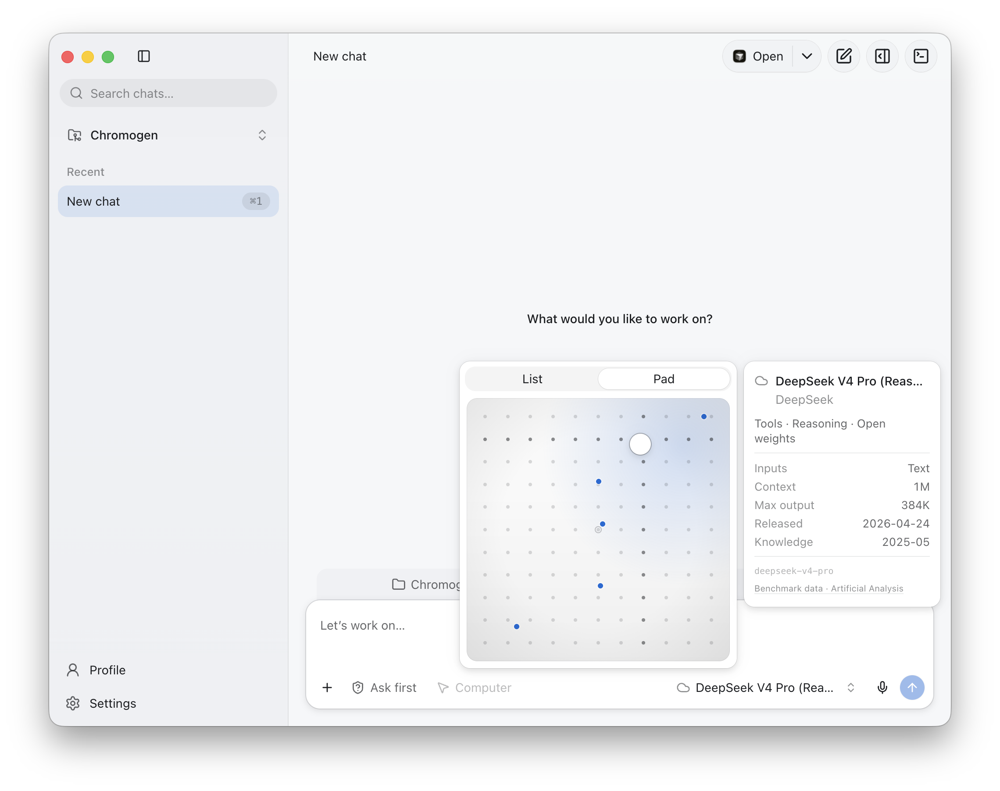

<p align="center">
  <a href="https://chatwithaiden.com">
    
  </a>
</p>

<h1 align="center">Aiden Agent</h1>

<p align="center">
  A native-feeling desktop workspace for chatting with local or hosted AI models, running autonomous Bots, and working safely inside the folders you choose.
</p>

<p align="center">
  <a href="https://chatwithaiden.com"><strong>Website</strong></a> ·
  <a href="https://github.com/sambitcreate/aiden-agent/releases">Releases</a> ·
  <a href="docs/README.md">Docs</a> ·
  <a href="packages/cli/README.md">Server CLI</a> ·
  <a href="ios/README.md">iOS</a> ·
  <a href="android/README.md">Android</a>
</p>

<p align="center">
  
</p>

Aiden runs on the [Pi](https://github.com/earendil-works/pi) agent runtime and gives it a restrained desktop workspace for macOS and Linux—with folder-scoped permissions, built-in Git and review, Design mode, voice sessions, autonomous Bots, and paired iPhone, iPad, and Android apps.

## Install

### Desktop app

```sh
curl -fsSL https://raw.githubusercontent.com/sambitcreate/aiden-agent/main/install.sh | sh
```

The installer selects the native package for your machine, checks its published SHA-256 checksum, verifies Apple signing/Gatekeeper on macOS, and verifies build provenance with `gh` on Linux.

| Surface | Install | Notes |
| --- | --- | --- |
| **macOS** (Apple silicon) | `brew install --cask sambitcreate/tap/aiden-agent` | Download `Aiden-Agent-Beta-arm64.dmg` from [Releases](https://github.com/sambitcreate/aiden-agent/releases) (signed Intel x64 DMGs are not published yet) |
| **Linux** (x64 & arm64) | `.deb`, `.rpm`, or `AppImage` | Download via `install.sh` or [Releases](https://github.com/sambitcreate/aiden-agent/releases); see the [Linux guide](docs/linux.md) |
| **Headless server** | Build `aiden serve` from clone | Runs chats, Bots, and schedules over SSH; see [Server guide](packages/cli/README.md) |
| **iOS / iPadOS & Android** | TestFlight / CI debug APK | Dev & test guides in [ios/README.md](ios/README.md) and [android/README.md](android/README.md); see [distribution notes](docs/development.md#companion-clients-and-headless-server) |

### First run

1. **Enter your name** and pick how you want to connect AI: **I have an account**, **I have an API key**, or **I run a local model** (Ollama or LM Studio). You can also choose **Set up later** and configure models in **Settings → Providers**.
2. **Finish setup**—Aiden creates your first Bot (**Chief**) with **Full access** (accepted when you click **Start using Aiden**, and narrowable anytime in Chief's **Advanced** tab), lets you choose your anonymous usage-data setting, and offers a quick feature tour.
3. **Open a chat or workspace**—start in **Chief**'s chat, open a project folder, or adjust approval modes (`Auto`, `Ask`, `Never ask`) and rules anytime in **Settings → Approvals**.

## What you get

- **Workspaces, Git, and follow-through** — Work inside folder workspaces (`Work in this folder` or `Chat only`), scratch workspaces, [No workspace](docs/no-workspace-chats.md) chats, or isolated Git worktrees under `Auto`, `Ask`, or `Never ask` approval modes. Inspect diffs, run a terminal beside the chat, delegate up to four native subagents per call (up to eight per reply), and use `/follow` or `/until` so Aiden watches PR checks and failing tests ([coding follow-through](docs/coding-follow-through.md)).
- **Autonomous Bots & Bot computers** — Create durable Bots with [scheduled routines](docs/bot-routines.md), [plain-language rules](docs/bot-rules.md), [open-work tracking](docs/bot-open-work.md), [peer collaboration](docs/bot-peers.md), and connected-app watches (Google Calendar; iMCP Mail on macOS). On Apple silicon (macOS 26+), each Bot can optionally run its own isolated macOS VM ([Bot computers](docs/bot-computers.md)).
- **Design mode & Artifacts** — Turn a workspace or No workspace chat into an infinite canvas beside the conversation (`⇧⌘L` on macOS, `Ctrl+Shift+L` on Linux, or `/design`), watch live HTML pages update as Aiden writes them, tweak controls and colors, comment on elements, or keep live [workspace artifacts](docs/workspace-artifacts.md) beside your chat.
- **Aiden Live & on-device voice** — Start a voice session with **Aiden Live (Beta)** to talk through tasks, navigate Aiden, and answer approvals by voice, or use **Parakeet** dictation locally (with Metal GPU acceleration on Apple silicon).
- **Aiden On The Go & headless server** — Pair iPhone, iPad, Android, or another Mac over your local Wi-Fi or Tailscale ([remote access guide](docs/aiden-on-the-go-remote-access.md)), or run [`aiden serve`](packages/cli/README.md) on a headless Linux/macOS box.
- **Extensibility & local-first privacy** — Bring your own hosted or local models, use `/commands`, `$skills` ([skills](docs/skills.md)), [hooks](docs/hooks.md), MCP connectors (including [Composio](docs/composio.md)), an embedded browser ([browser guide](docs/environment-browser.md)), and **Apps using Aiden** ([local MCP server](docs/aiden-mcp-server.md)). Chats stay local on disk and secrets live in OS encrypted storage; see [Privacy and trust](docs/privacy.md) and [Usage data](docs/analytics.md).

## Why Aiden

I don't come from a coding background. Bouncing between coding agents, each one had a piece of what I wanted—**Codex** for its restrained desktop UX, **OpenCode** for letting me bring any model and provider, **Cursor** for its nimbleness, and **Claude Code** for the models—while **Pi** (by Mario Zechner) had the extensible runtime I kept coming back to, just without a GUI.

After a brief native SwiftUI attempt, the project moved to Electron so I could pair Pi's agent runtime with a native-feeling desktop workspace, explicit permissions, and mobile companion apps.

## Documentation

- [All docs index](docs/README.md)
- [Linux install and compatibility guide](docs/linux.md)
- [Privacy and trust](docs/privacy.md)
- [Keyboard shortcuts & command palette](docs/keyboard.md)
- [Plans and roadmap](docs/plans/README.md)

## Development & Contributing

```bash
npm install
npm run dev
```

- [Development and architecture guide](docs/development.md) — requirements, verification commands, packaging, and release pipelines.
- [Contributing](CONTRIBUTING.md) — bug fixes are welcome; open a Feature Request issue to align before sending feature PRs.
- [Security policy](SECURITY.md) — threat model and private vulnerability reporting via GitHub Security Advisories.
- [License](LICENSE) — MIT.
