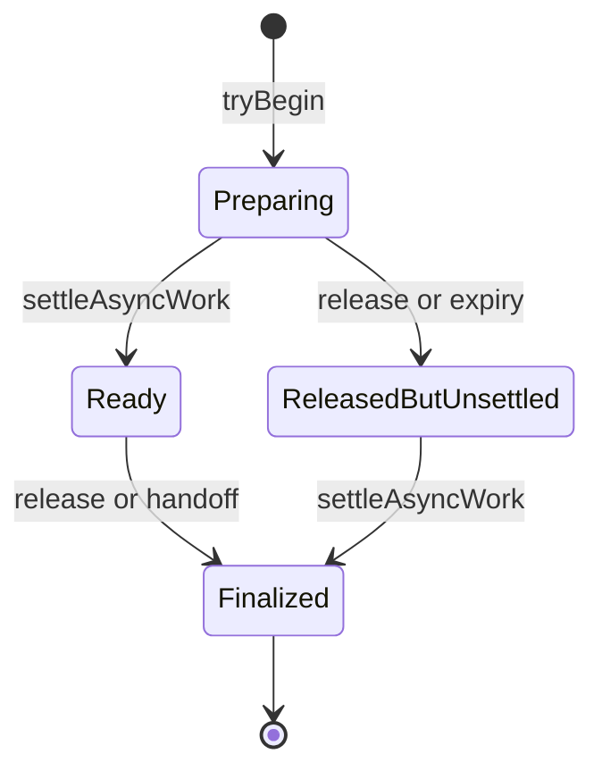

# Aiden implicit state-machine inventory

Audit date: 2026-11-04. Source snapshot: `581aee4f8282444e13e3db1a2d7fefceaae65de9` in the supplied `f07c` checkout. The checkout was clean when the audit started. This is an architecture inventory, not a defect report or a refactoring change.

The audit used the primary agent plus **two GPT-6 Astra subagents at high reasoning effort**, as requested. Work was divided into main-process/backend ownership; renderer, iOS and Android ownership; and CLI/native/runtime-support ownership, followed by consolidation.

## Result

**372 named machine-family entries** are catalogued with source links and state/transition evidence:

| Inventory | Families | Coverage accounting |
|---|---:|---|
| Backend/main process | 197 | 566 structural candidates: 287 narrative owners, 183 supporting owners, 96 exclusions or explicit/protocol boundaries |
| Renderer + iOS + Android | 125 | 530 candidates: 323 named owners, 169 grouped owners, 38 exclusions; 31 families marked direct transition reads (V), 94 owner/handler scans (S) |
| CLI + native helpers + runtime support | 50 | 106 CLI/native/public source entries classified; shared implementations and test/helper exclusions identified |

The number is an inventory size, **not 372 independent purely implicit automata**. It includes hybrid machines and separately identified protocol/transaction families; some rows include explicit reducers or closely related owners. Backend explicit comparison examples are also listed outside its numbered inventory. Repeated platform implementations and supporting files do not each inflate the family count.

Every candidate in the auditors' focused backend/client candidate sets has a disposition. That closes the candidate accounting; it does not prove lexical discovery found every possible machine. The broad repository scan uses a different, more inclusive filename filter, so its file totals differ from the focused auditors' totals.

[Searchable combined inventory](implicit-state-machine-inventory-2026-11-04.tsv) · [Backend candidate ledger](implicit-state-machine-backend-coverage-2026-11-04.tsv). The client candidate ledger is appended to its report, and the CLI/native file ledger is appended to its report.

## What counts

A machine has remembered state that changes which future events or operations are accepted, or how they are handled. State can live in enum fields, combinations of flags, map membership, object identity, abort signals, timers, pending promises, persisted checkpoints, filesystem names, and protocol cursors.

- **Implicit:** valid states/transitions are reconstructed from flags, callbacks, effects, guards and cleanup.
- **Hybrid:** state names are explicit, but transition rules remain distributed. An enum alone does not make a lifecycle explicit.
- **Explicit comparison:** an existing reducer, transition table or guarded transition API centralizes at least part of the lifecycle. Its surrounding asynchronous orchestration may still be implicit.
- **Protocol/transaction:** framing, staged filesystem commits, leases and recovery checkpoints are included separately from user-facing workflows.

Rows represent named machine families or owners, not every instance, every nested boolean, or a mathematically minimal automaton. Mirrored platform implementations are grouped where indicated. Different rows may compose into one larger workflow; their counts are not a count of independent global app states. Descriptive state names in the tables may be inferred, rather than literal enum values.

## Inventory documents

- [Backend and main-process inventory](implicit-state-machines-backend-2026-11-04.md)
- [Renderer and native-client inventory](implicit-state-machines-clients-2026-11-04.md)
- [CLI, native helpers and runtime support inventory](implicit-state-machines-cli-native-2026-11-04.md)
- [Per-file source scan](implicit-state-machine-source-scan-2026-11-04.tsv)

Each inventory supplies source locations and the state/transition information available from the inspected owner. Detailed read depth and exclusions are recorded in the corresponding document.

## Where explicit modeling would pay off first

These are architectural priorities inferred from the number of owners, side-effect boundaries and recovery paths, **not confirmed bugs**.

| Priority | Composed workflow | Why the boundaries matter |
|---|---|---|
| 1 | Chat admission → generation → live projection → persisted transcript → queue release | Admission, rendering, cancellation, persistence and physical settlement each carry independent state. A single “busy” flag cannot describe them. |
| 2 | Remote/native send → durable unknown outcome → same-key retry → receipt/live echo | A network error does not establish whether the host accepted a mutation; pairing and request ownership must survive navigation and restart. |
| 3 | Bot authority → approval → execution → pause/recovery | Durable pause, grant validity, current harness activity, unanswered attention and recovery are separate axes. Displayed session status is only a projection. |
| 4 | Child process/VM → stop request → descendant teardown → proof of exit | Logical cancellation is earlier than resource release. PID/group ownership, native supervision, timeout and retry machines must compose correctly. |
| 5 | File/worktree/artifact mutation → commit → durability → recovery cleanup | Once publication occurs, rollback and cancellation have different meanings; an indeterminate durability outcome cannot become a clean success or a fresh retry. |
| 6 | Provider/MCP auth or connection → configuration/credential change → replacement | In-flight attempts need incarnation/generation checks at asynchronous boundaries; stale results must not replace newer credentials or connections. |
| 7 | Device video/input, speech and live audio | Permission, capture, transport, decoder/playback, foreground ownership and cleanup form multiple interacting machines. |
| 8 | UI drafts, autosave, optimistic edits and undo | Current entity/field/revision ownership is required when late results or undo timers outlive the initiating view. |

Existing reducers/transition tables are useful local precedents; this report does not recommend mechanically replacing every loading flag or adopting a particular state-machine library.

## Coverage and limits

The repository-wide lexical scan enumerated **2,654 source-file entries / 723,688 lines**, of which **1,938 files** matched at least one discovery signal. These are scan metrics, not counts of state machines or a claim that every line received manual review.

| Area | Files in scan | Lines |
|---|---:|---:|
| Main process | 1,306 | 345,560 |
| Renderer/shared | 836 | 189,968 |
| iOS | 87 | 74,673 |
| Android | 191 | 69,803 |
| CLI/package source | 63 | 7,840 |
| Native helpers | 44 | 14,971 |
| Public audio worklet | 1 | 66 |
| Operational scripts | 126 | 20,807 |

Method: enumerate files with `rg --files --hidden`; include source extensions `.ts`, `.tsx`, `.js`, `.mjs`, `.cjs`, `.swift`, `.kt`, `.rs`, `.c`, `.h`, `.mm`, `.m`, `.sh`, `.py` under the listed roots; heuristically exclude tests, specs, fixture/build/dist directories; scan for state declarations, state storage, lifecycle terms, event/timer primitives and state assignments; inspect owning implementations and relevant callers/guards. Embedded Rust test modules remain within their source files, so line totals are not production-only LOC. The TSV preserves files with zero signals too: absence of a match does not establish statelessness.

The scan also checked `protocol/`, `resources/` and `prebuilt/`: the checked-in protocol resources are schemas/fixtures, and prebuilt artifacts are binaries. These do not add independently inspected transition owners. Vendor/dependency internals, OS/framework-owned machines, generated/bundled binaries, marketing assets, historical plans and every test/build/spike workflow are outside the runtime inventory. Operational support examples are explicitly marked.

A finite static review cannot prove the absence of further machines or enumerate every reachable interleaving in this codebase. This inventory is a broad, source-grounded discovery result; it must not be described as a formal proof of “all state machines.” No app behavior was changed and no runtime test suite was run. Source-link and documentation integrity checks are appropriate validation for this audit.

## A representative hidden product state

`ChatTurnAdmission` is not simply busy/idle. Its lease record combines `authorityActive` and `asyncSettled`, with independent append/skill slot and byte reservations. Expiring or releasing authority does not itself prove asynchronous work has stopped. The record stays admitted until both axes permit finalization.

Source: [chat-turn-admission.ts](../../main/services/chat-turn-admission.ts#L35), especially settlement/release at lines 188–230. Handoff additionally guards owner/turn identity; budget reservations are orthogonal to the simplified diagram.

This pattern repeats across the app: **logical cancellation, authority revocation, resource teardown, durable publication, and visible UI settlement are separate transitions**. Formalizing a workflow must preserve those boundaries rather than collapsing them into a single `loading` or `done` flag.

## Planning follow-up — 2026-11-04

The [risk-ranked migration plan](../plans/explicit-state-machines-migration-plan-2026-11-04.md) refines the initial priority shortlist above. Its [complete risk matrix](implicit-state-machine-risk-ranking-2026-11-04.tsv) assigns all 372 inventory IDs to 20 ordered risk groups, with phase dispositions and original evidence. The plan is proposed; no state-machine implementation or runtime validation has started.
