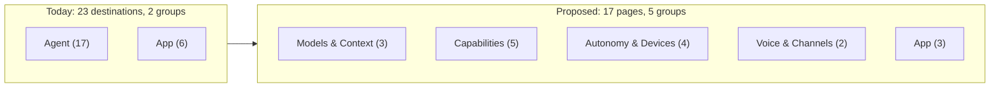

# Settings reorganization and InfoHint plan

Status: Proposed, revised 2026-11-05 after a code review of the first draft. Nothing here has shipped.

Prototype: [`assets/settings-reorg-prototype.html`](assets/settings-reorg-prototype.html). It's a static mock that runs in a browser, with no app code behind it.

## Summary

Settings has 23 destinations in two sidebar groups, 17 in Agent and 6 in App. Related controls sit far apart: what Aiden may do without asking is split across Bots, Tool approvals, Computer Use and Appearance, and voice is split across Voice, Text to Speech and Aiden Live. The Memory page opens with compaction and cache cards before it reaches memory. Only Model Pad and Connectors use the shared `InfoHint`, so most pages explain themselves in paragraphs.

This plan makes three changes:

1. Reduce the sidebar to 17 pages in 5 groups. Four merged pages use tabs. Links leaves the sidebar because Appearance already embeds it.
2. Keep every existing `section` ID working, in links, search, the command palette and the assistant.
3. Move explanation behind `InfoHint` where it's safe. Controls, privacy disclosures and safety notices stay on the page.

Out of scope: new settings, storage or schema changes, Aiden Remote protocol changes, and mobile Settings screens. Native apps don't mirror these sections; only two copy strings change (see [Docs and copy](#docs-and-copy)).

The regrouping covers `UI-55` in `.memory/ux-settings-sidebar-devices.md`, which asked for a prototype first, and `X-7` in `docs/performance/optimization-audit-2026-10-03.md`.

## Sidebar

### Pages

Titles stay as they are today unless a page's contents change. That keeps search terms and doc references stable, and leaves `UI-59`, the renames decision, with the owner.

| Group | Page | Tabs (`section` IDs) | Change |
|---|---|---|---|
| Models & Context | Providers | `providers` | None |
| | Model Pad | `modelData` | None |
| | Context & Limits | `limits` | Renamed from Limits & spending. Takes compaction, budgets and prompt cache from Memory |
| Capabilities | Skills | `skills` | None |
| | Connectors | `mcp` | None |
| | Web Search | `websearch` | None |
| | Image Generation | `imageGeneration` | None |
| | Memory | `memory` | Holds only memory settings |
| Autonomy & Devices | Bots & Approvals | Bots `bots`, Tool approvals `approvals`, Controls in chat `appControls` (new) | Merged. Controls in chat moves from Appearance |
| | Scheduled tasks | `scheduledTasks` | None |
| | Computers & VMs | Computer Use `computerUse`, Bot computers `botComputers` | Merged |
| | Simulator | `simulator` | None |
| Voice & Channels | Voice & Speech | Voice `voice`, Text to Speech `tts`, Aiden Live `geminiLive` | Merged |
| | Connections | Control this device `remoteAccess`, Control other devices `peerHosts` (new), Telegram `telegram` | Telegram joins as a third tab |
| App | Appearance | `appearance`, plus `links` as an anchor | Loses Controls in chat. `links` opens here |
| | Keyboard shortcuts | `shortcut` | None |
| | About | `about` | None |

That's 3 + 5 + 4 + 2 + 3 = 17 pages. Tab labels match today's destination titles and the existing Connections labels. The first draft's labels (Voice Input, Read Aloud, This Mac, Control this Mac) are dropped: they added renames without helping the regrouping, and "Mac" is wrong on Linux.

The page stays **Connections**, not the draft's Remote & Channels. It avoids a rename, and the page still makes sense if Telegram goes away (see [Owner decisions](#owner-decisions)).

The two new IDs exist because each tab needs a `section` value. Controls in chat has no ID today, and Connections switches segments with local state. Adding them takes `SETTINGS_SECTIONS` from 23 to 25 entries.



### Open PRs that add destinations

Three open PRs edit the same lists in `renderer/shared/settings-section.ts` and `renderer/main/settings-view.tsx`:

| PR | Adds | Group today | Place in this plan |
|---|---|---|---|
| [#731](https://github.com/sambitcreate/aiden-agent/pull/731), [#773](https://github.com/sambitcreate/aiden-agent/pull/773) | `storage` ("Storage") | App | App, before About |
| [#687](https://github.com/sambitcreate/aiden-agent/pull/687) | `hooks` ("Hooks"), gated by `capabilities.hooks` | Agent | Capabilities, after Connectors |

If both land, the sidebar has 19 pages. Whichever PR merges second resolves the conflict: the destination goes into `SETTINGS_PAGES` with the group above, and a `hooks` gate stays in the shared availability filter. The coverage test below fails if a new section has no page.

## Navigation contract

### Data model

`section` stays the only URL state and selects a tab. The existing per-section entries stay, so search and the palette keep their inventory. Pages are a layer on top:

```ts
type SettingsGroup = "Models & Context" | "Capabilities" | "Autonomy & Devices" | "Voice & Channels" | "App";

export const SETTINGS_PAGES: ReadonlyArray<{
  id: string;
  title: string;
  group: SettingsGroup;
  tabs: readonly SettingsSection[]; // first available tab is the default
}>;

export function pageFor(section: SettingsSection): SettingsPage;
export function availableSettingsPages(capabilities): SettingsPage[]; // tabs filtered, empty pages removed
```

`SETTINGS_DESTINATIONS` drops `group` and derives it from the page. `links` is the one section that isn't a tab: `pageFor("links")` returns Appearance, and it's handled as an anchor.

### Behavior

- **Links in.** All 23 existing IDs and both new ones parse, and `parseSettingsSearch` keeps dropping other keys. Existing callers need no change, including `section: "remoteAccess"` from `chat-sidebar.tsx:871`, `remote-new-chat-view.tsx:602` and `remote-chat-view.tsx:1295`.
- **Sidebar click.** Opens the page's first available tab. There's no remembered tab; Settings doesn't persist a section today and this doesn't add that.
- **Tab switch.** Navigates with `replace: true`, as the sidebar already does. Otherwise **Back to app** (`router.history.back()`) would walk back through every tab.
- **Selection and headings.** The sidebar highlights `pageFor(section)`. The heading uses the page title and the description stays `DESCRIPTIONS[section]`, so it changes with the tab. Today both key on `section` (`settings-view.tsx:238,285,286`). `CONTENT` stays keyed by section.
- **One tab available.** The strip is hidden, and both the sidebar row and heading use the tab's own title. An Intel Mac sees "Computer Use", not "Computers & VMs".
- **Unavailable section.** If the page has another available tab, open the first one. Otherwise fall back to `providers`, as `settings-view.tsx:175-176` does now.
- **`links`.** Opens Appearance and scrolls the links row into view, instantly under Reduce Motion. It gets no sidebar row, but stays in the palette and search.
- **Compaction.** It gets no ID or anchor. It's a titled group on a short page, and Context & Limits takes the `compaction`, `cache` and `warm` keywords from Memory.

### Platform gating

Sidebar, palette and assistant lists must filter the same way, through one shared filter.

| Host | `computerUse` | `botComputers` | Result |
|---|---|---|---|
| Apple silicon Mac | yes | yes | Computers & VMs with two tabs |
| Intel Mac | yes | no | One tab, titled Computer Use |
| Linux | no | no | Page hidden |

The gates are in `main/services/host-platform-capabilities.ts:35-36`. `assistantSettingsSections` (`settings-section.ts:253`) doesn't filter `computerUse` today, so the assistant can name a Linux-hidden page. Phase 1 fixes that. Simulator keeps its `devices` gate.

### Search and palette

- Sidebar search matches a page if any available tab matches on title, keywords or description, and the row opens the first matching tab. Searching "read aloud" shows Voice & Speech and opens Text to Speech.
- The palette (`command-palette.tsx:321,1124`) keeps one row per section and shows the page title as its detail. "Links" stays findable.
- Links keywords stay on the `links` anchor, and sidebar search checks page anchors, so Links terms still find Appearance without copying its keywords.

### Tabs

- Use the shared `Tabs` primitive with `idBase` and `tabIds` (`renderer/components/ui-primitives.tsx:77`). It's built on Radix, so arrow keys and roving focus come with it, and the global `:focus-visible` rule in `renderer/styles.css` gives it the neutral ring.
- The caller renders the `role="tabpanel"` element, linked through `tabIds`.
- Only the selected panel mounts, matching today's page switch. Unsaved form drafts are lost on a switch, as they are when changing pages now.
- `ConnectionsSegments`, `connectionsSegmentForKey` and the local segment state in `connections-settings.tsx` go away. The tablist's `aria-label` stays "Connections", which keeps `remote-access-lifecycle.spec.ts:212` valid. The other merged pages use their page title.
- `Segmented` is the radio primitive and isn't used for page tabs.

### Model-visible text

The assistant reads these strings, so they ship with the navigation change:

- `resources/aiden-help/manifest.json`, the `setup`, `changing-settings`, `voice` and `bots` entries and any other page references. `packages/cli/src/commands.ts:15` ships the same file, so the CLI must still build.
- `main/services/assistant/system-prompt.ts:201` lists section IDs and picks up the new ones automatically. Check the wording still reads correctly.
- `main/services/aiden-app-knowledge.ts:77` tells the model to name the Settings page. Use page titles there.
- `aiden_open` (`main/services/aiden-app-navigation.ts:4-10`) can open `memory`, which no longer holds compaction. Add a `limits` destination so the model can still open those settings.
- Image Generation keeps its title, so the errors in `pi-model-tools.ts:21` and `create-images/run-coordinator.ts:143` stay valid.

## InfoHint rules

`InfoHint` (`renderer/components/ui-info-hint.tsx`) explains one thing in at most two short sentences. It's `max-w-64`, and focus stays on the trigger, closing on blur, so a link or button inside it can't be reached by keyboard. These rules follow from that:

| Content | Where it goes |
|---|---|
| One fact, two short sentences at most, nothing to click | `InfoHint` |
| Longer steps or reference text | `Disclosure` on the page, opening by default when the user needs it |
| Any button, link or control | Stays on the page |
| Privacy disclosure, data leaving the device, charges or unattended authority | Stays visible, shortened where possible |
| Text that changes with the current selection or status | Stays next to that control |

### Must stay on the page

The first draft would have hidden or deleted these:

| Item | Where | Why |
|---|---|---|
| Cloud processing notice | `tts-settings.tsx:491-515` | Text goes to Google, even for local-model replies, and may be billed |
| **Clear generated audio** | `tts-settings.tsx:510-512` | Only control for clearing the cache |
| Screenshots, window details and accessibility text going to the model | `computer-use-settings.tsx:345-359` | Data disclosure |
| What leaves this device | `web-page-settings.tsx:170-174` | Data disclosure |
| **Manage Bot grants**, **Manage schedule grants** | `web-search-settings.tsx:2064-2102` | Controls |
| Always comes to you | `bots-settings.tsx` | Safety list; `docs/settings-design-system.md` documents it as designed |
| Telegram's unattended-authority notice | `telegram-settings.tsx` ~593 | Safety notice; the review dialog alone isn't enough |
| Aiden Live state and Beta badge | `gemini-live-settings.tsx:124-140` | Live status |
| Aiden Live Scheduled tasks and Global shortcut rows | `gemini-live-settings.tsx:193-233` | Status badges with Review and Manage actions |
| `EXPOSURE_HELP` | `mcp-exposure-controls.tsx:20-24` | Three strings keyed to the selected exposure, not one repeated sentence |

## Page changes

### Cards and notices

| File | Change |
|---|---|
| `computer-use-settings.tsx` | Replace the How it behaves card with one visible line for the data disclosure and an `InfoHint` for the rest, including "asks once per chat". Hide `FormFillSpecialistField` when `status.state === "not-downloaded"`; it has no control then |
| `bots-settings.tsx` | Keep Always comes to you, including its `computerUse`-gated third row. Move the footer paragraph into an `InfoHint` on **Go ahead without asking**, and keep the description's mention of connected apps |
| `tts-settings.tsx` | Merge 7 cards into 3: Setup (Read aloud, Connection, Speech model), Voice and delivery (Voice, Delivery, Reading preferences), Privacy and storage (unchanged) |
| `web-search-settings.tsx` | Keep Privacy and access with both buttons. Remove only the repeat of `routeRecipientSummary`, leaving it once on the page |
| `web-page-settings.tsx` | Keep What leaves this device visible wherever the Extract form is |
| `gemini-live-settings.tsx` | Shorten the Callout's prose and keep its state and badge. Remove only the static Operate Aiden row |
| `image-generation-settings.tsx` | Move Separate keys for images to an `InfoHint` on Providers. The provider dialog already says the same thing |
| `telegram-settings.tsx` | See [Telegram](#telegram) |

### Footer paragraphs

Each hint is rewritten to fit two short sentences.

| File | Change |
|---|---|
| `limits-settings.tsx` ~106-110, ~158-162 | Move both footers to `InfoHint`s on the group titles |
| `memory-settings.tsx` | The page has 5 paragraphs, about 170 words, and only "Turning memory off..." and "Workspace switches..." sit outside a `FieldSet`. Move those two to `InfoHint`s on Use memory and Workspaces. Reword "Current-chat recall works independently of memory below", which goes stale when compaction moves |
| `tool-approval-settings.tsx:94-98` | Trim 3 sentences to 2 and move them to an `InfoHint` on Always allowed |
| `skills-settings.tsx:126-131` | Move the paths paragraph to an `InfoHint` on Built-in and discovered |
| `skills-settings.tsx:180-184` | Shorten to one line that stays while Skills is off |

### Progressive disclosure

| File | Change | Must preserve |
|---|---|---|
| `web-page-settings.tsx` | Show **Set up Cloudflare…** until an account ID or key exists | The form stays visible when configured or paused. Extract can't be turned on until setup is ready, so it can't act as the trigger |
| `image-generation-settings.tsx` | Move Add model by ID into a Dialog opened from the header | All 5 fields |
| `compaction-budget-settings.tsx` | Put the budget form in a `Disclosure` | `defaultOpen` when overrides exist |
| `dictation-shortcut-settings.tsx` | Replace the radio cards with a trailing Select and a row describing the selected option | Hold to dictate and Tap or hold appear only when `canChooseHold`; keep the `isDictationActivationMode` coercion and the `holdBusy` disable. With one option, show a plain row, not a one-item Select |
| `simulator-settings.tsx` | Put Helper tools in a `Disclosure` with a summary row | It opens by default when an update is available, and the summary shows that state. **Remove installed tools** stays outside the fold |

### Moving compaction to Context & Limits

Move these from `memory-settings.tsx` into their own group components rendered by the Limits page:

- The compaction engine and warming controls, with `setCompactionEngine`, `setWarmingEnabled`, and their saving flags and ref.
- `useProviders`, the `codexModels` query (`enabled: false`) and `budgetModelKeys`.
- `CompactionBudgetSettings`.

Don't route them through `LimitsSettings.save`. It has one `saving` flag, so a second change made during a save would be dropped.

### Controls in chat

`AppControlSettings` moves to the `appControls` tab and converts to `FieldSet` and `Field`. Its behavior doesn't change. The help text in `manifest.json:12` currently says Settings → Appearance → Controls in chat.

### Telegram

- Switch Disconnect from `disabled={!polling}` to `disabled={!enabled}`. `enabled` is the setting and `polling` is the service: when polling fails or another process owns the transport, `started` is false, so `getStatus` reports `disabled` and `polling` is false while `enabled` is still true (`telegram-service-core.ts:376,385-402`, `main/handlers/telegram.ts:47`).
- Then remove the Enable switch (`telegram-settings.tsx:457-471`). Doing this in the other order would leave a failed bridge with no way to turn it off.
- Connect keeps its review dialog (~625-628).
- Move How to connect into a `Disclosure` that opens by default until a token is saved. Six steps don't fit an `InfoHint`.
- Keep the security notice visible.
- Fix the nested card.

### Bespoke info buttons

`ProviderInfo` (`providers-settings.tsx:84`, used at :353, :448, :552) is a click-opened popover with a title, and `RemoteAccessInfo` (`remote-access-settings.tsx:187`, used at :603) is a hover card. Both are `w-80`. Replace them with `InfoHint` only after trimming each message to two short sentences. If the Remote Access security copy can't fit, it stays in a `Disclosure` instead of being cut down.

### Other pages

| File | Change |
|---|---|
| `providers-settings.tsx` | Make Chat title generation one `Field` row with a hint, replacing nested `<details>`. Collapse Model catalog to one row with a hint, keeping the manual **Update model catalogs** action |
| `skills-settings.tsx` | Add a search field past 8 discovered skills, matching workspace settings |
| `bot-computers-settings.tsx` | Tighten row descriptions without removing the manual download and start wording |
| `shortcut-settings.tsx` | Put the recorder beside the switch |
| `about-settings.tsx` | Move crash-capture retention detail to a hint. The **Usage data** row keeps its wording and its "What's sent" sheet |
| `assistant-settings.tsx` | Delete; nothing imports it. Remove its doc mentions in the same PR |

## Phases

Each phase is one PR that leaves Settings shippable. Run `npm run test:settings-design`, the suites for touched pages, and the affected Playwright specs through `npm run test:e2e:space`.

1. **Navigation.** Everything in [Navigation contract](#navigation-contract): `SETTINGS_PAGES`, the new groups, all four tabbed pages, `peerHosts` and `appControls`, the `links` anchor, gating, search, palette, model-visible text, onboarding copy and the docs sweep. Page contents otherwise stay the same. The first draft split navigation across two phases; one change avoids shipping a half-migrated sidebar.
2. **Compaction move.** Context & Limits and the cleaned-up Memory page, with the `limits` destination in `aiden_open`.
3. **Telegram fix.** The Disconnect gate first, then removing the switch. Small, and it follows the decision below.
4. **Hints and cards.** Footers, cards, the bespoke buttons and the `InfoHint` rules in `docs/settings-design-system.md`.
5. **Progressive disclosure.** The table above, one page at a time.

## Tests

Follow the rules in `AGENTS.md`: behavior over source text, and no tautological or change-detector tests.

| Test | Change |
|---|---|
| `renderer/lib/settings-section.test.ts` | Update `:29-36,44` for pages. Add: every section has exactly one page, all 25 IDs resolve, `links` resolves to Appearance, Linux hides Computers & VMs, Intel gets one tab titled Computer Use, a search for a tab's keyword finds its page and opens that tab, `assistantSettingsSections` drops `computerUse` on Linux |
| `tests/e2e/settings-model-picker.spec.ts:3-16,54-90` | Update the sidebar list |
| `tests/e2e/remote-access-lifecycle.spec.ts:212` | Reach segments as page tabs; add the Telegram tab to the keyboard walk |
| New e2e case | Opening a merged page, switching tabs and pressing **Back to app** returns to the previous screen in one step |
| `connections-settings.test.tsx:184-191` | Replace the `ConnectionsSegments` and key-helper tests with tab behavior |
| `memory-settings.test.tsx:7` | It greps `memory-settings.tsx`. Changing that page requires a behavioral replacement in the same PR, as `AGENTS.md` asks |
| New `limits-settings.test.tsx` | Compaction, warming and budget changes save independently, including a change made during a save. Register it in `package.json` and `scripts/ci-test-registry.json`, then run `npm run test:ci-policy` |
| `telegram-settings` test | Disconnect works when `enabled` is true and `polling` is false |
| `onboarding-flow.test.tsx:346,391,501`, `onboarding-bots-step.test.tsx:88` | Update for changed page names |
| `main/services/aiden-app-navigation.test.ts` | `limits` opens |

## Docs and copy

Phase 1 updates these. Dated records stay as they are.

- **`Settings → <page>` references.** Approximate counts: Bots 48, Voice 47, Bot computers 19, Connections 14, Links 14, Limits & spending 12, Tool approvals 11, Text to Speech 9, Computer Use 6, Aiden Live 5, Telegram 4. Connections stays valid. Image Generation (41) and Keyboard shortcuts (3) keep their titles and need no change. Sweep with `rg 'Settings → '`.
- **`AGENTS.md`.** Lines 44 and 52 name Settings pages.
- **Onboarding.** `onboarding-flow.tsx:712,718,722,1016`, `onboarding-bots-step.tsx:25`, `onboarding-feature-gallery.tsx:249`.
- **Mobile copy.** `ios/AidenOnTheGo/Networking/AidenRemoteClient.swift:4215` and `AidenReadAloud.kt:6` both say Settings → Text to Speech. Check both clients, then run their suites.
- **`docs/settings-design-system.md`.** Add the page and tab rule, and the `InfoHint` rules above. It already defines the headings, cards and rows this plan reuses.
- **UI references.** Before building the tab strip or restyling a page, review `docs/chatgpt-desktop-ui-inspiration.md` (compact nested tabs, progressive disclosure) and `docs/chatgpt-ui-element-specimen.html` (the `role="tablist"` environment tabs), as `AGENTS.md` requires.
- **`README.md`, `PRODUCT.md`, `docs/linux.md`, `docs/devices.md`, `docs/aiden-on-the-go-remote-access.md`, `packages/cli/README.md`.** Check for page names and platform claims.

## Owner decisions

1. **Does Telegram stay?** `docs/plans/security-remediation-plan-2026-10-27.md:7` records that Telegram "is being removed from Aiden", yet [#747](https://github.com/sambitcreate/aiden-agent/pull/747), a Telegram PR, is still open and the feature is on `main`. Recommendation: Phase 1 adds the tab either way, since removing it later is a one-line change. If removal is confirmed, skip Phase 3 and all Telegram cleanup.
2. **Are the new page names right?** Context & Limits, Bots & Approvals, Computers & VMs and Voice & Speech are the only renames, and the group names are new. Recommendation: use them as written, which settles `UI-59` for these pages.
