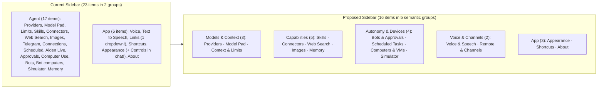

# Settings UI Deep-Dive Audit & Reorganization Plan

> [!IMPORTANT]
> **Executive Diagnosis**: Aiden’s Settings has grown to **23 top-level destinations** (17 dumped into a single `"Agent"` sidebar group) and over **2,400 words of inline explanatory prose**, detached footer paragraphs, static control-less cards, and duplicated controls. Only `Model Pad` and `Connectors` currently use the shared `<InfoHint>` (`(i)`) component (`renderer/components/ui-info-hint.tsx`).

---

## 1. Information Architecture Reorganization (23 → 16 Destinations across 5 Groups)

Currently, `renderer/shared/settings-section.ts` puts 17 items in `"Agent"` and 6 in `"App"`. Several pages are 1-control duplicates, split across groups, or overloaded with unrelated controls:

### Key Consolidations & Moves

| Proposed Group & Destination | What Moves / Merges | Why |
|---|---|---|
| **1. Models & Context** • `Providers` • `Model Pad` • `Context & Limits` | Move **Automatic compaction**, **Model compaction budgets**, and **Prompt cache** out of `Memory` into `Context & Limits` (alongside `Usage limits` and `Spending limits`). | Previously, `Memory` started with 3 massive context/token-budget cards before the user even reached `Use memory` below the fold (`X-7` / `UI-55` in the optimization audit). |
| **2. Capabilities** • `Skills` • `Connectors` • `Web Search` • `Images` • `Memory` | `Memory` now contains **only Memory** (`Use memory` global switch, `Workspaces` switches, and `Memory facts` table). | Makes `Memory` clean, scannable, and immediately understandable. |
| **3. Autonomy & Devices** • `Bots & Approvals` • `Scheduled Tasks` • `Computers & VMs` • `Simulator` | • **Bots & Approvals** unifies `Bots`, `Tool approvals`, and `Controls in chat` (currently misplaced at the top of `Appearance`!) via segmented tabs (`[Bots \| Tool approvals \| Controls in chat]`). • **Computers & VMs** unifies `Computer Use` (This Mac) and `Bot computers` (Lume VMs) via segmented tabs (`[This Mac \| Bot computers]`). | Eliminates hunting across 4 different places (`Bots`, `Tool approvals`, `Appearance`, `Computer Use`) to see what Aiden and Bots are allowed to do without asking. |
| **4. Voice & Channels** • `Voice & Speech` • `Remote & Channels` | • **Voice & Speech** unifies `Voice` (input/dictation), `Text to Speech` (Read Aloud), and `Aiden Live` (`[Voice Input \| Read Aloud \| Aiden Live]`). • **Remote & Channels** adds `Telegram` as a 3rd tab in `Connections` (`[Control this Mac \| Control other Macs \| Telegram]`). | Previously, speaking to Aiden (`Voice`), hearing Aiden (`Text to Speech`), and live voice (`Aiden Live`) were 3 separate sidebar pages split between `Agent` and `App`. |
| **5. App** • `Appearance` • `Shortcuts` • `About` | • **Delete standalone `Links` nav item** (`links-settings.tsx` is a single dropdown that is *already* rendered inside `Appearance → Chat` via `<LinksSettings embedded />`!). • Delete orphaned `assistant-settings.tsx`. | Removes a 1-control duplicate page and keeps `Appearance` strictly focused on visual theme and layout. |

> [!TIP]
> **Zero Broken Deep Links**: `parseSettingsSection` and `SettingsView` will keep accepting all 23 existing `SettingsSection` IDs (`links`, `tts`, `geminiLive`, `telegram`, `approvals`, `botComputers`) and automatically open the consolidated page with the matching tab selected.

---

## 2. Standardizing `(i)` `InfoHint` & Eliminating Static Prose Blocks

Across the 23 pages, we identified **4 categories of text clutter** to eliminate or move behind `<InfoHint topic="...">` (`renderer/components/ui-info-hint.tsx`):

### A. Delete Control-less "Static Explanation" Cards & Rows (Move to `InfoHint`)
1. **`computer-use-settings.tsx` (`FieldSet` `"How it behaves"`, lines 345–359)**:
   - **Current**: Entire `FieldSet` card with zero controls — just a 4-sentence paragraph and a static `Asks once per chat` badge.
   - **Change**: Delete the `FieldSet`. Move the 2-sentence summary into `<InfoHint topic="Computer Use behavior">` on the `"Desktop control"` group header. Also hide `FormFillSpecialistField` when `status.state === "not-downloaded"`.
2. **`bots-settings.tsx` (`FieldSet` `"Always comes to you"` + detached footer, lines 91–106)**:
   - **Current**: 3-row read-only card with lock icons (`Passwords, 2FA codes and money`, `Steps a Bot's rules hand off`, `Using your Mac with Computer Use`) plus a detached 33-word paragraph below it explaining what `"Go ahead without asking"` does when off.
   - **Change**: Move both into `<InfoHint topic="unattended routines">` on the `"Run routine steps without asking"` switch row.
3. **`tts-settings.tsx` (`FieldSet` `"Privacy and storage"`, lines 348–371)**:
   - **Current**: 3 static rows (`Cloud processing`, `Saved audio`, `Voice safety`) with zero controls, plus 6 other separate 1-row `FieldSet` cards on the same page.
   - **Change**: Delete the `"Privacy and storage"` `FieldSet` and move its disclosure into `<InfoHint topic="Read Aloud privacy">` on the main `"Read aloud"` group header. Consolidate the remaining 6 tiny `FieldSet`s into 2 clean cards (`Read aloud` and `Delivery & code`).
4. **`web-search-settings.tsx` (`Privacy and access` card, lines 2064–2102) & `web-page-settings.tsx` (`What leaves this device` row, lines 170–174)**:
   - **Current**: Repeats `routeRecipientSummary` for a second time on the same page; `"What leaves this device"` is a control-less `<Field>` row.
   - **Change**: Delete both static blocks and place their content inside `<InfoHint topic="Web Search">` and `<InfoHint topic="extract mode">`.
5. **`gemini-live-settings.tsx` (Hero `<Callout>` + `"Actions"` `FieldSet`, lines 124–140, 193–233)**:
   - **Current**: Giant top `<Callout>` repeats the page heading; `"Actions"` `FieldSet` has a control-less `"Operate Aiden"` badge row and two cross-link rows.
   - **Change**: Move the hero explanation into `<InfoHint topic="Aiden Live">` on the header, delete the static `"Operate Aiden"` row, and fold `"Global shortcut"` into the main card.
6. **`image-generation-settings.tsx` (Top `<Callout>` `"Separate keys for images"`, lines 242–248)**:
   - **Current**: Full-width banner repeating the same key-isolation note shown in the provider dialog.
   - **Change**: Delete the banner and place it in `<InfoHint topic="image provider keys">` on the `Providers` header.
7. **`telegram-settings.tsx` (`"How to connect"` 6-step list & `"⚠ Security notice"` rows inside Advanced, lines 593–621)**:
   - **Current**: 12 lines of static setup steps and security warnings buried at the bottom of `Advanced Telegram settings`, plus a duplicate `"Enable Telegram bridge"` switch and a card-inside-a-card `
` wrapper.
   - **Change**: Move the setup steps and security notice into `<InfoHint topic="connecting a Telegram bot">` on Step 1; remove the duplicate switch and fix the nested `<FieldSet>`.

### B. Delete Detached Footer Paragraphs Outside `FieldSet`s (Move to `InfoHint`)
- **`limits-settings.tsx` (lines 106–110 & 158–162)**: Delete both 3–4 sentence footer paragraphs (94 words) and attach `<InfoHint topic="usage limit waiting">` and `<InfoHint topic="spending limits">` to the group titles.
- **`memory-settings.tsx` (lines 141–151, 168, 184–187, 219–222)**: Delete all 4 detached paragraphs (165 words) and move their explanations into `<InfoHint>`s on `Automatic compaction`, `Warm caches`, and `Use memory`.
- **`tool-approval-settings.tsx` (lines 94–98)**: Move the 3-sentence footer paragraph into `<InfoHint topic="remembered approvals">` on the `"Always allowed"` group title.
- **`skills-settings.tsx` (lines 126–131 & 180–184)**: Move the 48-word `.agents/skills` / `.claude/skills` / `plugin:name` paragraph into `<InfoHint topic="discovered skills">` on `"Built-in and discovered"`, and delete the redundant `"Skills are off"` paragraph.
- **`mcp-exposure-controls.tsx` (lines 75–77)**: Remove the inline `EXPOSURE_HELP` sentence repeated under every connected MCP server and put a single `<InfoHint topic="model access">` next to the `"Model access"` label.

### C. Progressive Disclosure for Advanced Forms
- **`web-page-settings.tsx`**: Only show the `Cloudflare account ID` and `API keys` pool editor when the user clicks `Set up Cloudflare…` (or when `Extract only the values asked for` is turned on), instead of dumping 25 lines of Cloudflare inputs whenever basic `"Read web pages"` is enabled.
- **`image-generation-settings.tsx`**: Move the always-expanded 5-field `"Add model by ID"` bottom form into an `"Add custom model…"` `<Dialog>` button in the header.
- **`compaction-budget-settings.tsx`**: Collapse the 3-input per-model token budget form behind a `"Manage overrides…"` disclosure/dialog when no overrides are configured.
- **`dictation-shortcut-settings.tsx`**: Replace the 3 tall vertical radio cards for `"Shortcut behavior"` with a compact trailing `<Select>` (`Tap or hold`, `Hold to dictate`, `Press to toggle`).
- **`simulator-settings.tsx`**: Collapse the 5-row `"Helper tools"` npm maintenance section into a `<Disclosure>` summary row, and move `"Auto-show floating device"` into the main simulator card.

### D. Replace Bespoke Info Buttons with Shared `<InfoHint>`
- Replace `<ProviderInfo>` in [`providers-settings.tsx`](file:///Users/sambitbiswas/.gemini/antigravity/worktrees/aiden-macos/reorganize_settings_ui/renderer/components/settings/providers-settings.tsx#L211-L240) and `<RemoteAccessInfo>` in [`remote-access-settings.tsx`](file:///Users/sambitbiswas/.gemini/antigravity/worktrees/aiden-macos/reorganize_settings_ui/renderer/components/settings/remote-access-settings.tsx#L194-L228) with the shared [`InfoHint`](file:///Users/sambitbiswas/.gemini/antigravity/worktrees/aiden-macos/reorganize_settings_ui/renderer/components/ui-info-hint.tsx#L18-L133).

---

## 3. Page-by-Page Copy & Structural Changes Table

| File | Current Visible Copy / Cards | Proposed Change |
|---|---|---|
| [`providers-settings.tsx`](file:///Users/sambitbiswas/.gemini/antigravity/worktrees/aiden-macos/reorganize_settings_ui/renderer/components/settings/providers-settings.tsx) & [`codex-provider-settings.tsx`](file:///Users/sambitbiswas/.gemini/antigravity/worktrees/aiden-macos/reorganize_settings_ui/renderer/components/settings/codex-provider-settings.tsx) | 5 groups, ~20 lines of copy, custom `ProviderInfo`, nested `
` for Chat title generation, 4 text blocks in `Model catalog`. | Use `<InfoHint>`, make `Chat title generation` a 1-line `Field` row with `<InfoHint>`, expand `"More built-in providers"` in the same card, and collapse `Model catalog` to 1 row + `<InfoHint>`. |
| [`limits-settings.tsx`](file:///Users/sambitbiswas/.gemini/antigravity/worktrees/aiden-macos/reorganize_settings_ui/renderer/components/settings/limits-settings.tsx) + [`compaction-budget-settings.tsx`](file:///Users/sambitbiswas/.gemini/antigravity/worktrees/aiden-macos/reorganize_settings_ui/renderer/components/settings/compaction-budget-settings.tsx) | 5 selects + 127 words of prose in `limits-settings`; 3 compaction/cache cards in `memory-settings`. | Combine into **Context & Limits**. Delete 4 detached footer paragraphs; move details into `<InfoHint>`s; collapse per-model compaction budget inputs behind a disclosure/modal. |
| [`skills-settings.tsx`](file:///Users/sambitbiswas/.gemini/antigravity/worktrees/aiden-macos/reorganize_settings_ui/renderer/components/settings/skills-settings.tsx) | 48-word path/collision paragraph + 27-word switch description + 26-word off warning; unsearchable discovered list. | Shorten switch description to 7 words + `<InfoHint>`; move discovered paths into `<InfoHint>`; add search input when `discoveredList.length > 8`. |
| [`mcp-settings.tsx`](file:///Users/sambitbiswas/.gemini/antigravity/worktrees/aiden-macos/reorganize_settings_ui/renderer/components/settings/mcp-settings.tsx) & [`mcp-exposure-controls.tsx`](file:///Users/sambitbiswas/.gemini/antigravity/worktrees/aiden-macos/reorganize_settings_ui/renderer/components/settings/mcp-exposure-controls.tsx) | Repeats `EXPOSURE_HELP` sentence under every connected server row. | Replace per-row `EXPOSURE_HELP` line with a single `<InfoHint topic="model access">` on the `"Model access"` label. |
| [`web-search-settings.tsx`](file:///Users/sambitbiswas/.gemini/antigravity/worktrees/aiden-macos/reorganize_settings_ui/renderer/components/settings/web-search-settings.tsx) & [`web-page-settings.tsx`](file:///Users/sambitbiswas/.gemini/antigravity/worktrees/aiden-macos/reorganize_settings_ui/renderer/components/settings/web-page-settings.tsx) | 30+ lines of repeated privacy prose; standalone `Privacy and access` card; always-open Cloudflare form when `Read web pages` is on. | Delete `Privacy and access` card and `What leaves this device` row (move to `<InfoHint>`); open `ProviderSetupDialog` directly from `Browse providers`; hide Cloudflare form behind `Set up…` until needed. |
| [`image-generation-settings.tsx`](file:///Users/sambitbiswas/.gemini/antigravity/worktrees/aiden-macos/reorganize_settings_ui/renderer/components/settings/image-generation-settings.tsx) | Top `<Callout>` banner + always-open 5-field `Add model by ID` form at bottom. | Move key-isolation note to `<InfoHint>`; move `Add model by ID` into a header button `<Dialog>`. |
| [`memory-settings.tsx`](file:///Users/sambitbiswas/.gemini/antigravity/worktrees/aiden-macos/reorganize_settings_ui/renderer/components/settings/memory-settings.tsx) | Compaction & cache cards push `Use memory` below the fold; 2 detached footer paragraphs. | Keep only `Use memory`, `Workspaces`, and `MemoryFactsSection`; move footer notes into `<InfoHint>`. |
| [`bots-settings.tsx`](file:///Users/sambitbiswas/.gemini/antigravity/worktrees/aiden-macos/reorganize_settings_ui/renderer/components/settings/bots-settings.tsx), [`tool-approval-settings.tsx`](file:///Users/sambitbiswas/.gemini/antigravity/worktrees/aiden-macos/reorganize_settings_ui/renderer/components/settings/tool-approval-settings.tsx), [`app-control-settings.tsx`](file:///Users/sambitbiswas/.gemini/antigravity/worktrees/aiden-macos/reorganize_settings_ui/renderer/components/settings/app-control-settings.tsx) | 3 separate places for permissions/authority; static 3-row `Always comes to you` card; detached footers. | Unify under **Bots & Approvals** (`[Bots \| Tool approvals \| Controls in chat]`); replace static card and footers with `<InfoHint>`s; convert `AppControlSettings` to `FieldSet`/`Field`. |
| [`computer-use-settings.tsx`](file:///Users/sambitbiswas/.gemini/antigravity/worktrees/aiden-macos/reorganize_settings_ui/renderer/components/settings/computer-use-settings.tsx) & [`bot-computers-settings.tsx`](file:///Users/sambitbiswas/.gemini/antigravity/worktrees/aiden-macos/reorganize_settings_ui/renderer/components/settings/bot-computers-settings.tsx) | Static `How it behaves` card; dead `Form fill specialist` row; 3–5 sentence descriptions on every VM row. | Unify under **Computers & VMs** (`[This Mac \| Bot computers]`); delete `How it behaves` card (move to `<InfoHint>`); hide `Form fill specialist` when not downloaded; tighten VM copy with `<InfoHint>`s. |
| [`simulator-settings.tsx`](file:///Users/sambitbiswas/.gemini/antigravity/worktrees/aiden-macos/reorganize_settings_ui/renderer/components/settings/simulator-settings.tsx) & [`device-workspace-settings.tsx`](file:///Users/sambitbiswas/.gemini/antigravity/worktrees/aiden-macos/reorganize_settings_ui/renderer/components/settings/device-workspace-settings.tsx) | 4 `FieldSet`s, 12+ verbose rows, 5 always-visible npm helper rows. | Move `Auto-show floating device` to top card; collapse `Helper tools` into `<Disclosure>`; move SSH requirements into `<InfoHint>`. |
| [`voice-settings.tsx`](file:///Users/sambitbiswas/.gemini/antigravity/worktrees/aiden-macos/reorganize_settings_ui/renderer/components/settings/voice-settings.tsx), [`tts-settings.tsx`](file:///Users/sambitbiswas/.gemini/antigravity/worktrees/aiden-macos/reorganize_settings_ui/renderer/components/settings/tts-settings.tsx), [`gemini-live-settings.tsx`](file:///Users/sambitbiswas/.gemini/antigravity/worktrees/aiden-macos/reorganize_settings_ui/renderer/components/settings/gemini-live-settings.tsx) | 3 separate sidebar pages; 7 `FieldSet`s on TTS (including static `Privacy and storage` card); Hero `<Callout>` + static `Actions` card on Live; 3 tall radio cards for Dictation shortcut behavior. | Unify under **Voice & Speech** (`[Voice Input \| Read Aloud \| Aiden Live]`); collapse TTS into 2 `FieldSet`s + `<InfoHint>`; convert Dictation shortcut behavior to `<Select>`; delete dead `assistant-settings.tsx`. |
| [`connections-settings.tsx`](file:///Users/sambitbiswas/.gemini/antigravity/worktrees/aiden-macos/reorganize_settings_ui/renderer/components/settings/connections-settings.tsx) & [`telegram-settings.tsx`](file:///Users/sambitbiswas/.gemini/antigravity/worktrees/aiden-macos/reorganize_settings_ui/renderer/components/settings/telegram-settings.tsx) | Separate sidebar items; bespoke `RemoteAccessInfo`; Telegram has duplicate switch, card-in-card bug, and buried 6-step guide. | Unify under **Remote & Channels** (`[Control this Mac \| Control other Macs \| Telegram]`); use `<InfoHint>` for @BotFather guide & security notice; remove duplicate switch. |
| [`appearance-settings.tsx`](file:///Users/sambitbiswas/.gemini/antigravity/worktrees/aiden-macos/reorganize_settings_ui/renderer/components/settings/appearance-settings.tsx) & [`links-settings.tsx`](file:///Users/sambitbiswas/.gemini/antigravity/worktrees/aiden-macos/reorganize_settings_ui/renderer/components/settings/links-settings.tsx) | Standalone `Links` nav item duplicates `<LinksSettings embedded />` in `Appearance → Chat`; `AppControlSettings` sits at top of `Appearance`. | Remove standalone `Links` nav item (route `section=links` to `Appearance`); move `AppControlSettings` to `Bots & Approvals`; shorten `Chat` row descriptions with `<InfoHint>`s. |
| [`shortcut-settings.tsx`](file:///Users/sambitbiswas/.gemini/antigravity/worktrees/aiden-macos/reorganize_settings_ui/renderer/components/settings/shortcut-settings.tsx) & [`about-settings.tsx`](file:///Users/sambitbiswas/.gemini/antigravity/worktrees/aiden-macos/reorganize_settings_ui/renderer/components/settings/about-settings.tsx) | Two-story shortcut rows; verbose crash-capture descriptions in `DiagnosticsSettings`. | Place shortcut recorder inline on the right beside the switch; move crash-capture retention details into `<InfoHint>`. |

---

## 4. Implementation & Verification Phases

1. **Phase 1 — Shared Primitives & Navigation (`settings-section.ts`, `settings-view.tsx`)**
   - Update `SETTINGS_DESTINATIONS` with the 5 semantic groups (`Models & Context`, `Capabilities`, `Autonomy & Devices`, `Voice & Channels`, `App`) and consolidated destinations while preserving all legacy `SettingsSection` IDs in `parseSettingsSection` so deep links and assistant navigation continue to work.
   - Replace `ProviderInfo` and `RemoteAccessInfo` with `<InfoHint>`.
2. **Phase 2 — Models, Context & Capabilities (`providers`, `limits`, `memory`, `skills`, `mcp`, `websearch`, `imageGeneration`)**
   - Move Compaction & Prompt Cache from `MemorySettings` to `LimitsSettings` (`Context & Limits`).
   - Apply all `<InfoHint>` conversions, remove static disclaimer cards/rows, and add progressive disclosure for Cloudflare Extract credentials, custom image models, and compaction budgets.
3. **Phase 3 — Autonomy, Devices, Voice & Channels (`bots`, `approvals`, `computerUse`, `botComputers`, `simulator`, `voice`, `tts`, `geminiLive`, `remoteAccess`, `telegram`)**
   - Add segmented tab wrappers where pages are merged (`Bots & Approvals`, `Computers & VMs`, `Voice & Speech`, `Remote & Channels`), or keep any pages separate that you prefer as standalone sidebar items.
   - Apply `<InfoHint>` copy reductions and delete static cards (`How it behaves`, `Always comes to you`, `Privacy and storage`, `Actions`) and dead `assistant-settings.tsx`.
4. **Phase 4 — App Settings, Tests & Docs (`appearance`, `links`, `shortcut`, `about`, `docs/settings-design-system.md`)**
   - Remove standalone `Links` from sidebar nav (keeping `<LinksSettings embedded />` in `Appearance → Chat`), tighten `ShortcutSettings` and `DiagnosticsSettings`, update unit & Playwright tests (`npm run test:settings-design`), and update `docs/settings-design-system.md`.
