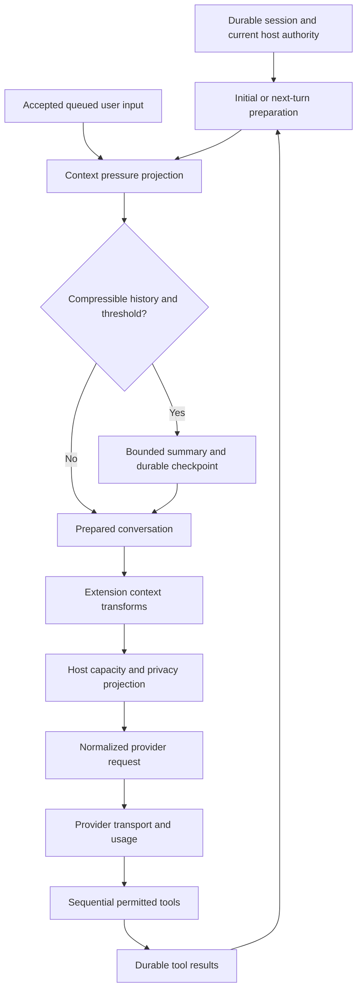
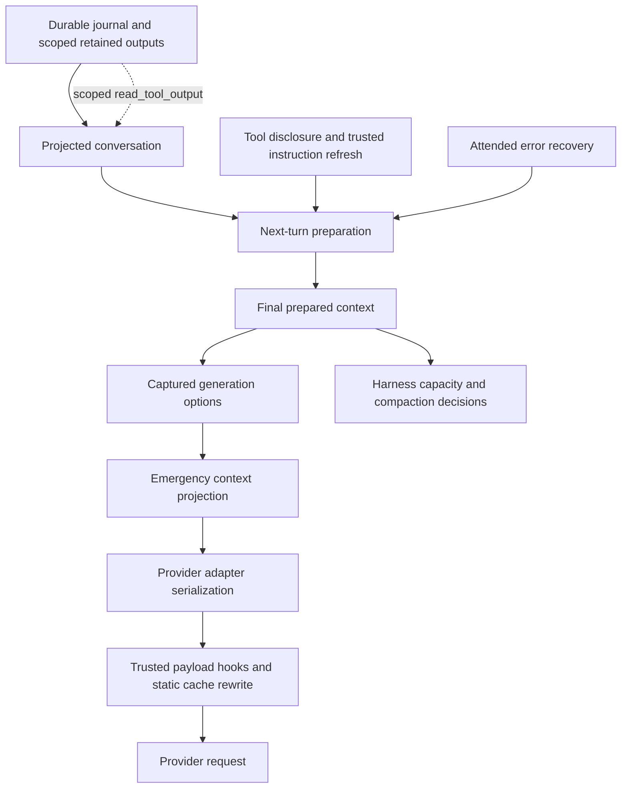

# Aiden pi harness: research, experiments, and improvement record

## Run contract

- User request: preserve arXiv 2609.20804 locally, investigate improvements to Aiden's pi harness using GPT Astra medium sub-agents, append all findings and solutions to this document, validate locally, and iterate for three hours.
- Started: 2026-10-11 19:12:24 UTC. Planned finish: 2026-10-11 22:12:24 UTC.
- Baseline commit: `203a8f2082aaa60c3d22bc8b464a7f29541606dd`. Working tree was clean.
- Runtime: Node 22.22.3. Root pi-agent-core/pi-ai pins: 1.0.3; compatibility harness: 0.87.1.
- Paper: [An Empirical Study of Harness Design for Coding Agents](https://arxiv.org/pdf/2609.20804), v1, September 17, 2026. [Local PDF](papers/2609.20804.pdf), SHA-256 `a39a9e03aaaa877b294a4b702ff07ae09110dcb1a2b0c0196a72ea46e0ec390e`.
- Scope pending user preference: investigate and run offline tests immediately; reversible local implementations may follow explicit scope selection or the stated default. No paid provider evaluation without an explicit budget.
- No publication, PR, dependency upgrade, runtime catalog fetch, deployment, or rollout advancement is part of this research run.

## Evidence and collaboration rules

This is the sole narrative research document. Every sub-agent appends findings, proposals, counterarguments, experiments, exact commands, outcomes, and limitations here. Preserve earlier entries; correct them in a later dated entry. Use an exclusive file lock (`fcntl.flock`) around each append to prevent lost writes. Do not rewrite another contributor's text.

Distinguish paper evidence, repository observations, hypotheses, deterministic replay measurements, and live model outcomes. Offline fixtures cannot establish real-model task success, token billing, or generalization. Cite repository paths and symbols and paper sections/tables. Do not copy extended paper passages: keep the shared paper synopsis below concise, and concentrate detailed writing on original analysis of Aiden.

## Paper synopsis (shared reference)

The study varies context management, planning, and action interfaces across four models and two coding benchmarks. Its strongest context-management benefits occur under tight windows, primarily by preventing overflow. Staged observation elision followed by summarization improves efficiency; recall adds no demonstrated accuracy benefit. Planning and tool-interface effects depend on model and task. Planning and action-space ablations use one context setting, and tool-interface variants also change validation/state support, limiting causal attribution. These results motivate Aiden-specific experiments, not universal defaults or claims about GPT Astra.

## Append-only research and experiment log

### 2026-10-11 19:15 UTC — Initial repository orientation (parent)

Aiden already has native checkpoint compaction, context-pressure calculation, durable tool-output recovery, codemode/tool discovery, planning integration, and offline replay infrastructure. Existing memory records emphasize cross-surface ownership, retained-tail correctness, rollout gates, and distinction between offline tests and credentialed acceptance. The investigation will compare these existing mechanisms before proposing additions.

2026-10-11T19:15:09.644962+00:00

### Planning, action space, and stop conditions — initial audit (GPT Astra medium sub-agent)

**Repository evidence.** `main/services/rpiv-todo/extension.ts` already implements an intentionally selective planning policy: longer work with at least three verifiable checkpoints, updates only when checkpoint state changes, at most one active checkpoint, no completion of partial/failing work. `replay.ts` and `snapshot.ts` reconstruct durable state independently of ordinary conversation context and fail closed on malformed newest checkpoints. Therefore, introducing another planner or a mandatory plan for every request would duplicate shipped behavior and increase context/tool overhead. A useful future experiment compares the current policy against a compact plan reminder after compaction, measuring checkpoint recall and repeated verification; it must first establish whether the current model context actually loses the plan (durability alone does not establish model visibility).

`pi-tool-discovery.ts` already supplies bounded lexical search over the final permitted tool inventory, namespace guidance labeled untrusted, detached bounded schemas, and explicit truncation flags. `pi-codemode.ts` already provides a restricted JavaScript VM, host-mediated effects, tool argument discovery, per-run storage, call/output/time/memory ceilings, pending-effect settlement, usage aggregation, and retained termination signals. This is materially richer than the paper's coarse predefined-tools-versus-bash comparison. Do not infer that replacing Aiden's typed workspace tools with bash would improve Astra outcomes. Permission handling, validation, replay safety, and nested accounting would need to remain identical in any meaningful ablation.

`assistant/tool-loop-guard.ts` ends attended Assistant retries after two consecutive turns containing tool errors, then removes tools for the recovery turn. This is a failure guard for one surface, not a general coding-agent completion policy. `subagents/subagent-child-runner.ts` separately bounds construction/deadline, turns, events, tool calls, output, and protocol size. `subagents/role-catalog.ts` requests concrete evidence and final reports, with fresh/forked context explicit and separate role authority. Existing model/effort selection and turn-limit partial-report behavior are documented in `.memory/subagent-model-effort-2026-10-07.md` and `.memory/issue-202-subagent-turn-budget.md`; do not casually broaden these budgets to mimic a benchmark harness.

**Concrete bounded candidate: silent multi-block codemode elision.** `pi-codemode.ts` emits `[Codemode text output truncated.]` only when a text block is partially sliced. If one or several complete blocks consume exactly `MAX_RESULT_CHARS` (32,000), every subsequent text block is dropped by `else if (remaining > 0)` without a notice. For example, `text("x".repeat(32000)); text("TESTS FAILED");` can lose the decisive trailing observation while returning a successful script result with no truncation signal. This is an observation-integrity bug, not proof of model task-performance gain. Existing `pi-codemode.test.ts` checks a single 50,000-character block and misses the block-boundary case. Proposed fix: track text truncation across all blocks, append exactly one host-owned notice whenever any nonempty text is omitted, retain the data ceiling, and test exact-boundary, multi-block, partial-block, and no-truncation cases against actual sandbox execution. No production edits made yet.

**Validation attempts.** Both `./node_modules/.bin/tsx --test main/services/pi-codemode.test.ts main/services/pi-tool-discovery.test.ts main/services/rpiv-todo/extension.test.ts main/services/rpiv-todo/reducer.test.ts main/services/rpiv-todo/replay.test.ts main/services/assistant/tool-loop-guard.test.ts` and an inline real-codemode probe were attempted. Neither launched: this checkout has no `node_modules/.bin/tsx`. The test command wrote that launch failure to `/tmp/aiden-planning-tools-tests.log`; its shell tail exited zero, which is not a passing test result. Parent notified to coordinate dependency preparation. Findings above remain source-level observations until behavioral execution.

**Prioritized experiments.** (1) Correct explicit output elision first, with deterministic fixtures. (2) Measure plan visibility across real harness compaction before adding reminders; an injected full task list may itself cause unnecessary context pressure. (3) Add offline trace classification for post-edit verification repetitions only when there is independent evidence of unchanged code and identical check scope; do not automatically suppress tests based merely on command-string equality. (4) Keep discovery and typed actions as current defaults; evaluate schema exposure cost and discoverability separately from authority and validation. Real-model success, cost, and completion quality remain unmeasured.


### 2026-10-11 19:24 UTC — Context lifecycle audit, first findings (GPT Astra medium / context_audit)

Scope: context pressure, observation elision, compaction publication, retained tails, output recovery, native/legacy parity. Read `AGENTS.md`, `.memory/compaction-budget-recovery-20260924.md`, `.memory/pi-100-review-fixes.md`, and `.memory/queue-while-compacting.md` before inspecting implementation. No production code changed.

**Observed architecture.** `generation-context.ts::projectNextContextUsage` projects image modality and retains only the newest three Computer Use and browser screenshot results independently; it prices static tools/prompt, conversation estimates, provider usage from the exact provider/model binding, and retained system updates. This is substantially more careful than merely applying a fixed context percentage. Its 20% response reserve (capped by Pi defaults) plus 5% safety reserve and 1,024-token floors must not be replaced with the paper's thresholds without model-specific measurement. `pi-agent-runtime-harness.ts` calls the coordinator from native `prepareNextTurnWithContext` and the managed preflight path; accepted queued user messages enter its projected budget before Pi appends them. The coordinator only invokes projected threshold compaction when both `shouldCompact` and compressible history are present (`pi-compaction-core.ts::checkContextPressure`). A first user prompt with a long tool loop is deliberately treated as active context rather than compressible prior history.

`generation-context.ts::compactGenerationContext` supplies an emergency outbound transform. It first truncates oversized tool text to 32,000 characters, retaining both head and tail. If still over budget it removes oldest complete historical turns (preferring two newest user turns), elides old tool results in the current turn while protecting at least two recent results, then progressively removes older current-turn batches and ultimately replaces an irreducible active payload with a bounded notice. The original journal objects are preserved. Old screenshot stripping happens even below the pressure threshold. Normal native preflight compaction precedes this emergency transformation: Aiden does not yet implement proactive low-pressure observation elision before semantic checkpoint summarization as its ordinary policy.

**Concrete recovery gap to verify.** `tool-output-context.ts::boundedToolOutput` puts a scoped retained-output handle in a textual preview suffix. `generation-context.ts::compactedToolResult` replaces all content with one generic omission notice, losing that suffix and therefore the only model-visible handle for that result. This is not a storage or authorization bypass: `ToolOutputStore` still validates chat, authority hash, available tool name, expiration, and bounds. It is an availability/composability gap between two existing protections. A model cannot reconstruct the random UUID from the tool-call ID and no listing tool is exposed. Plain size truncation retains the tail and usually retains the suffix; full result elision does not. Existing output-store tests prove direct recovery and revocation, and generation-context tests prove pairing and boundedness, but no existing test composes durable preview → pressure elision → actual authorized read.

**Bounded proposed solution.** Preserve a small host-authored recovery reference alongside the omission notice when the original result has one. Prefer a typed host-owned reference if one can survive the journal boundary without exposing unrelated metadata; if using the existing textual marker, preserve only a bounded validated form and treat it as untrusted tool data, never an instruction or authorization token. Keep the current authority checks authoritative; do not add global handle lookup or relax scopes. Extend existing behavioral coverage to create a real stored oversized result, induce pressure, recover a sentinel beyond its preview through the surviving handle, and prove changed authority still rejects. Measure handle retention and output bounds. This can improve recoverability without changing compaction thresholds or making any claim about task success. It should not be sold as paper-proven accuracy improvement: the shared synopsis explicitly notes no demonstrated recall accuracy gain.

**Larger experiment, not recommended as an immediate default.** Separate non-destructive observation projection from emergency history removal, then compare baseline versus elision-before-summary through the actual harness. Use a deterministic budget matrix (8k/16k/32k/128k/272k windows), mixed long outputs, current user constraints, tool-call/result pairs, images, changed system sections, and queued steering. Keep summaries/checkpoints/journal immutable in the projection branch; keep recent and error evidence deliberately. Measure projected tokens, hidden summary request count, checkpoint count, discarded observation bytes, retained task constraints, tool pairs, and recovery-reference survival. A provider usage anchor describes the unprojected prior prefix: a staged projection must adjust or invalidate that anchor correctly instead of assuming the measured prefix still describes the reduced prompt. A naive projection-only change could trigger repeated unnecessary summaries or underestimate the request. Real-model quality needs a later explicitly budgeted replay; offline token reduction alone cannot establish better answers.

**Retained-tail correctness already guarded.** In `pi-compaction-core.ts::run`, oversized-summary recovery reduces history and split-turn prefix separately, preserving prior summaries and split-turn state. It measures complete summary requests, tightens reductions at most three times, checks the journal leaf before publishing, and rolls back an un-installable or cancelled checkpoint only if it remains the active leaf. Existing tests include failed publication rollback, protection of a newer leaf, model ownership after reopen, previous-summary merge, and complete-request budget recovery. These mechanisms are valuable invariants for any elision experiment; introducing a second journal writer would create unnecessary risk.

**Command and limitation.** Prepared an untracked disposable probe at `tmp/research/context-audit-probe.ts` with eight tool results carrying handles and a four-window sweep. `node --import tsx tmp/research/context-audit-probe.ts` failed before execution with `ERR_MODULE_NOT_FOUND: Cannot find package tsx`; checkout dependencies are absent. Node reports v22.22.3. Parent notified to coordinate dependency provisioning; no duplicate install started. No measured recovery failure or test pass is claimed yet.


### 2026-10-11 19:16 UTC — Investigation design and decision boundaries (parent)

The research runs four concurrent workstreams: parent synthesis/cross-surface review; Astra medium context audit; Astra medium planning/tool audit; Astra medium evaluation audit. All active specialists use the requested model and reasoning setting. The first context delegate was interrupted immediately and replaced to apply the explicit model override with a bounded context fork.

The three-hour loop is evidence-driven: identify a candidate; locate current implementation and existing tests; reproduce its failure or measure its baseline; make a bounded local change only when justified; rerun its behavioral suite; cross-review; then broaden validation as dictated by actual changed contracts. Rejected hypotheses and null results are retained. The time window ends at 22:12:24 UTC; an unfinished release or live-provider gate is not silently converted to a pass.

The optional scope questions have not yet received an answer. Working default: reversible local fixes and offline validation. Paid provider evaluations remain excluded without an explicit budget. We do not change provider credentials or read private chats to manufacture a benchmark.

Potential measurements are separated into three levels:

1. Correctness: recovery handles remain usable, tool-call/result pairing remains legal, planning state survives checkpoint/restart, cancellation and authority checks remain intact.
2. Deterministic efficiency: projected input size, summary invocation count under controlled faux providers, output truncation, CPU/wall time, and artifact counts. These are reproducible implementation measurements.
3. Model effectiveness: successful independent task verifiers, billed tokens/cost, end-to-end latency, repeated-seed variability, and task-family interactions. These require live controlled model trials and cannot be inferred from level 1 or 2.

The local PDF has 43 pages. Table 3 was visually inspected after rendering page 7; extraction produces a font warning but the rendered table is legible. Existing policy uses 1.0.3 for active Pi core/AI and a frozen 0.87.1 compatibility boundary: a new paper does not authorize a package upgrade or replacement of journal ownership.

Dependency prerequisite: the checkout initially has no node_modules. Root npm ci is running centrally with output at /tmp/aiden-harness-research-npm-ci.log; agents must not install concurrently. Initial tsx/esbuild failures are environment setup failures, not failing app assertions.

### 2026-10-11 — Evaluation audit: what current replays establish (GPT Astra medium)

Read `AGENTS.md`, `.memory/pi-env-evaluation.md`, `.memory/pi-1.0.3-upgrade.md`, `.memory/pi-1-parity-upgrade.md`, `.memory/pi-100-ci-prerequisites.md`, and the shared report before inspection. Current pins and replay acceptance remain intact; no rollout action was invoked.

`main/services/pi-upgrade-replay-runner.ts` executes seven scenarios with the real session adapter, compaction coordinator, selected surface adapters, and legacy migration code. Its six semantic cases use faux providers; most assistant usage is deliberately set to input=63,950 to trigger a 64,000-window checkpoint. The faux summarizer extracts known literal markers and returns a predetermined structured summary. `continuationCorrect` checks marker retention, expected checkpoint count, model-switch projection rules, and selected Bot/child surface behavior. These are worthwhile executable lifecycle invariants, but they do not measure a real model solving a task after compression. The attachment case checks emergency projection with no pending-reference marker. The `providerObservedMarkers` set is populated but not consumed as an assertion; terminal acknowledgments also repeat the expected markers, so this runner cannot isolate old-history semantic retention from retained-tail availability.

The replay's `turnsUntilNextCompaction` supplies the next usage anchors explicitly (`44,800`, then `63,950`; attachment: `8,000`, then `15,500`). Thus it tests threshold mechanics against controlled anchors, not a naturally observed cadence. `tokensBefore` reflects deliberately inflated provider usage in semantic fixtures, while `tokensAfter` is an estimate of generated context; their ratio mixes measurement bases. Synthetic zero costs and cache counters are not evidence that a production strategy is free or cache-friendly. Duration measures in-process fixture work, and cases run concurrently through `Promise.all`, so per-case duration cannot be treated as isolated latency. The current evaluator validates completeness, schema, nonnegative finite measurements, per-case reduction and aggregate safety gates, but there is no paired candidate/baseline comparison or uncertainty estimate.

`main/services/pi-vcc/evaluation.ts` is explicitly a synthetic annotated corpus: two scenarios, five literal facts each, repeated background filler, and exact substring checks for summary/recall. It exercises the worker, compiler, checkpoint write and recall path. It does not model task repair, conflicting facts, correction precedence, incomplete tool pairs, or successful downstream use of recovered material. `process.resourceUsage().maxRSS` is a process-lifetime high-water mark rather than an isolated per-case memory delta; label it accordingly. The checked-in `docs/testing/pi-vcc-evaluation.json` is historical evidence, not today's measurement.

Commands attempted: `npm run vcc:evaluate` (redirected to `tmp/research-2609.20804/vcc-baseline.log`) failed in its `prevcc:evaluate` build with `esbuild: command not found` because root `node_modules` is absent. The chained direct replay and evaluator test commands therefore did not execute. Reported this prerequisite to the parent to avoid concurrent package installation. Inspected the scripts first: deliberately did not use `test:compaction:evaluate`, which writes an installed-build receipt; direct imports will collect research-only results. `pi-upgrade:advance` is out of scope. Existing rollout tests use isolated temporary roots and fake identities, so they may be run without changing device rollout state.

### 2026-10-11 — Proposed Aiden experiment contract (GPT Astra medium)

A credible claim requires three separate evidence levels: (1) deterministic safety/correctness contracts, (2) synthetic controlled workload efficiency, (3) model-backed task outcomes. Never relabel level 1 or 2 as accuracy evidence. Aiden already has substantial level-1 coverage; the fastest useful addition is a separate research scorecard that makes provenance explicit without changing installed-receipt schemas.

For a paired Aiden evaluation, freeze the repository revision, dependency pins, fixture revision, exact model identifier, thinking level, provider options, tools/schemas, system prompt, window and output reserve, execution timeout, environment image, and task oracle. For each task, reset to an independent identical workspace snapshot for baseline and candidate. Randomize condition order and preserve a task/repetition pair identifier. Disable internet retrieval for public issue-repair tasks to avoid answer leakage. Count all attempted runs, including compaction failures, context overflows, timeouts, provider errors, user-budget stops and infrastructure failures; predeclare which infrastructure failures can be excluded and retain their records.

Start with one intervention at a time. Candidate A: elide selected old tool observations before requesting summarization, preserving the existing durable output references, tool-call pairing, latest user request and pending actions. Candidate B: tighter output bounds/search summaries at observation creation. Candidate C: adaptive planning injection only after sufficient evidence from a separate controlled planning test. Do not simultaneously alter tools, reminders, permissions, context thresholds and model routing; that makes cause unknowable. Tool-interface comparisons must preserve authority, validation and post-edit diagnostics, or explicitly describe the complete interface as the treatment. The paper's planning/tool comparisons are conditional on its fixed setting; they cannot choose Astra defaults for Aiden.

Use a small local corpus covering: an exact identifier only in old history; a superseded decision with both old/new values; a failing test assertion buried in a large tool output; large multibyte output; interrupted tool calls; repeated compaction; provider-window shrink; child fork; Bot/Telegram continuity; and attachment-only first turns. Each has an independent oracle (exact returned value, permission outcome, complete file content, parseable patch, or executable test) rather than expected source strings. Put decisive information both near boundaries and in the middle, not just latest messages. Include cases that need no compression to detect unnecessary churn.

Primary outcome for live repair trials: task oracle pass rate, paired by task and repetition. Secondary outcomes: overflow rate, any safety-contract violation, total provider input/output/cache-read/cache-write tokens, total monetary cost including summarization/retries, wall-clock completion time, tool calls, summary calls, bytes recovered, and recovery utility (recovered content actually needed by the oracle). Report unconditional cost per attempted task and cost per solved task; reporting only solved-run cost causes selection bias. Separate prompt size, cumulative billed input and estimated retained-context size. Record actual provider usage when available and mark estimation explicitly when absent. Stratify by context pressure and task family rather than averaging away a tight-window effect.

For binary success, tabulate paired discordances and use an exact McNemar test for a single prespecified comparison; task-clustered bootstrap intervals can express success/cost uncertainty when repeated trials exist. Report raw counts and intervals, not just percentages or p-values. If trying many candidates, designate exploratory runs and reserve a held-out confirmation corpus; avoid selecting the best noisy result and presenting its exploratory result as confirmation. A three-hour offline run cannot establish general model superiority. An optional later model pilot should begin with a bounded task count and explicit spend ceiling, then expand only if it has enough discordant pairs to address the chosen practical effect.

A practical offline acceptance gate for an implementation is: all touched safety/lifecycle suites pass; old-history-only evidence survives or remains resolvable; dangling tool calls do not reach providers; memory/output bounds hold for Unicode and adversarial shapes; no mutation of durable originals; no extra network/catalog fetch; context estimates fall on tool-heavy cases without damage on small cases; and paired research results retain full provenance. Such a gate permits local engineering confidence, not rollout advancement or a claim of live task-success improvement.

### Codemode observation-disclosure fix — reproduced and locally verified

Parent authorized this narrow local implementation; root dependencies became available through centrally managed `npm ci`. Added a behavioral case in the already-registered `main/services/pi-codemode.test.ts` that executes the real sandbox with 32,000 retained characters followed by `TESTS FAILED` and another text block. Before changing production code, `./node_modules/.bin/tsx --test --test-name-pattern='exact output boundary' main/services/pi-codemode.test.ts` failed with exit 1: expected one truncation notice, observed zero. This establishes the failure in the actual worker/output path, not by inspecting source strings.

Changed only the text projection loop in `main/services/pi-codemode.ts`: inspect every text block even after the payload budget is exhausted, preserve the 32,000-character payload ceiling, and disclose omitted nonempty text exactly once. Empty trailing text does not falsely claim truncation. The expanded fixture covers one complete 32,000-character block, two complete 16,000-character blocks, and an oversized 32,001-character block followed by additional omitted observations. Existing permissions, effect dispatch, cancellation, replay policy, image handling, usage, and termination forwarding are unchanged.

The focused command `./node_modules/.bin/tsx --test main/services/pi-codemode.test.ts main/services/pi-tool-discovery.test.ts main/services/rpiv-todo/extension.test.ts main/services/rpiv-todo/reducer.test.ts main/services/rpiv-todo/replay.test.ts main/services/assistant/tool-loop-guard.test.ts` passed 46/46, zero skipped/failed (2.485 seconds; log `/tmp/aiden-planning-tools-tests.log`). `git diff --check` passed. The codemode suite is already registered in `test:compaction`; no new test file/script required. No shared API, transcript event, or native-client contract changed. This improves honesty of context elision; it does not recover omitted output or establish model success-rate improvement.

### Planning visibility follow-up — distinct from durable storage

Inspection of `llm-client.ts` around `loadDurableTodoSnapshot` confirms that a new run loads the state into `createTodoExtension`; `rpiv-todo/extension.ts` contributes only a static system prompt and a tool, with no context-transform or runtime plan injection. The restored task contents are therefore available through `todo list/get`, but are not automatically re-exposed merely because the extension is constructed. The conversation summary may retain them; that is a separate, model-dependent path. A bounded candidate for later evaluation is a short host-owned reminder when an active durable plan exists but its last todo observation is outside retained context. Avoid inserting raw task metadata, completed tombstones, full descriptions, or an entire snapshot on every turn. First create a fake-model compaction/restart fixture to demonstrate precisely what the provider receives and compare token cost. No change is proposed to the current three-checkpoint eligibility rule without a task-quality evaluation.

The paper's termination analysis motivates measurement, not automatically forcing the harness to stop after a green test. Code changes, new user requirements, test scope, and unresolved failures can all justify repeat checks. A useful offline trace should record last mutation, check identity/scope, result, and subsequent mutation before labeling a repeated verification unnecessary. Command string equality or a completed todo alone is an insufficient oracle.

Codemode final focused verification after adding the oversized-block-plus-trailing-output case: `./node_modules/.bin/tsx --test main/services/pi-codemode.test.ts` passed 12/12, zero failures or skips (2.421 seconds; `/tmp/aiden-codemode-final-tests.log`). `git diff --check` remained clean.

### 2026-10-11 — Offline baseline and stronger continuity oracle (GPT Astra medium)

After the parent centrally installed root dependencies, reran `npm run vcc:evaluate`: successful. Fresh VCC coding measurement was 25,928 estimated tokens before / 6,775 after, 453 ms; multilingual planning was 25,917 / 6,758, 448 ms. All ten fact-in-summary checks and all ten recall checks were true. The process high-water RSS was 249,823,232 then 252,198,912 bytes. These are controlled fixture results, with no paid/provider calls, not model task accuracy or isolated memory comparisons.

Executed direct research-only replay collection using `node --import tsx --input-type=module -e 'import {runPiUpgradeReplayCases} from "./main/services/pi-upgrade-replay-runner.ts"; import {evaluatePiUpgradeReplay} from "./main/services/pi-upgrade-evaluation.ts"; const measurements=await runPiUpgradeReplayCases(); console.log(JSON.stringify({measurements,report:evaluatePiUpgradeReplay(measurements)},null,2));'`. Original baseline: seven passing scenarios; aggregate synthetic reduction 0.99377904735055; emergency ratio 1/7; minimum controlled re-compaction interval 2; no migration failures/no-ops. Do not interpret the 99.38% synthetic ratio as a deployable reduction. Exact rows are in `tmp/research-2609.20804/pi-replay-baseline.json`. Ran `node --import tsx --test main/services/pi-upgrade-evaluation.test.ts`: original suite 13/13 passed.

The parent approved an oracle correction. Changed only `main/services/pi-upgrade-replay-runner.ts` and its existing `pi-upgrade-evaluation.test.ts`. Every semantic replay now starts with a distinct `HISTORY-<case>` decision found nowhere in the latest user request or terminal acknowledgment. The fake summarizer must actually observe that historical marker, and the resulting checkpoint context must retain it. Removed terminal acknowledgment echo of marker expectations. Adjusted repeated-compaction split by one entry to preserve its earlier checkpoint boundary after prepending the historical fact. Receipt shape, production compaction policy, thresholds, dependency pins and rollout state are unchanged.

Added a behavioral negative control: a controlled summary transformation drops the old-only coding decision while preserving other evidence. The test confirms the summarizer received the old fact, exactly one scenario loses continuity, exactly one pending reference disappears, and evaluation rejects both continuity and retention. This reproduces the earlier oracle's real blindspot—recent-message echoes could otherwise hide lost history. The original positive cases still pass. Focused command `node --import tsx --test main/services/pi-upgrade-evaluation.test.ts` now passes 14/14; raw log `tmp/research-2609.20804/pi-evaluation-strengthened-tests.log`. This is stronger fixture validation, not new real-model semantic capability.

Fresh strengthened replay report:

```json
{
  "version": 1,
  "passed": true,
  "caseCount": 7,
  "continuationCorrectRatio": 1,
  "pendingReferenceRetentionRatio": 1,
  "tokenReductionRatio": 0.9937023478343788,
  "emergencyProjectionRatio": 0.14285714285714285,
  "totalDurationMs": 143.79308300000002,
  "totalCostMicros": 0,
  "totalCacheReadTokens": 0,
  "totalCacheWriteTokens": 0,
  "minimumTurnsUntilNextCompaction": 2,
  "noOpAttempts": 0,
  "migrationFailures": 0,
  "failures": []
}
```

Because the fixture changed, do not treat differences from the original token ratio/timing as a policy A/B improvement. Raw strengthened rows: `tmp/research-2609.20804/pi-replay-strengthened.json`. The direct runner does not write installed acceptance receipts; test rollout operations use their own temporary roots and are cleaned up.

### 2026-10-11 — Reusable paired shadow runner proposal (GPT Astra medium)

Proposed, not implemented: a separate research-only `compareContextPolicies(cases, {baseline, candidate})` takes two pure projection functions with identical cloned messages and options per fixture. Each pair records fixture ID/hash, explicit policy revision labels, same-estimator token sizes, removed/truncated counts, emergency outcome, independent evidence/tool-pair/input-mutation oracles, and local duration. The aggregate reports per-pair deltas and `evidenceKind: synthetic-shadow`, never an installed rollout receipt. Fixtures should cover large-output middle evidence, an old-only constraint, latest request, Unicode, and partial tool-call pairs. Deliberately lossy and mutating policies are test negative controls. The default compares the current policy against itself, whose deterministic deltas must be zero. A concrete candidate implementation must be supplied separately; changing context windows is a sensitivity study, not a policy comparison. No dynamic arbitrary-code loading, credentials, private histories, or paid API calls are needed. Parent will decide whether an actual policy candidate warrants this extra module or whether focused behavioral tests are sufficient.


### 2026-10-11 19:17:40 UTC — Recovery fix reproduced and locally verified (context_audit)

Timestamp correction: my earlier entry labeled 19:24 UTC used an estimated clock and is not authoritative. This entry uses the host UTC clock; the run deadline remains 22:12:24 UTC.

After parent completed `npm ci`, `node --import tsx tmp/research/context-audit-probe.ts` successfully reproduced the suspected gap. An eight-result fixture at a 16,000-token window elided six results and retained their tool-call pairs, but exposed recovery handles for only the two unelided results. A 32,000-token window elided three results and lost those three references. At 64,000 tokens no elision occurred. At 8,000 tokens the existing emergency policy removed old complete tool batches, so this narrowly scoped fix cannot preserve references for messages removed entirely.

Implementation (authorized by parent): `generation-context.ts::toolOutputRecoveryMarker` recognizes only the exact complete existing marker suffix, UUIDv4 format, fixed wording and bounded decimal lengths, examining no more than the final 400 characters of each text part. It preserves at most one recognized marker when `compactedToolResult` creates its omission notice. This is syntax recognition, **not proof of host provenance**. Recognized text remains untrusted result data; store lookup still enforces chat, tool, scope, expiry and authority. Neither surrounding output nor appended instructions are copied. Marker production and storage schemas did not change; JSON-rehydrated previews remain compatible.

Behavioral regression added to the existing `tool-output-store.test.ts` composes a real temporary output store, a wrapped command producing oversized output, JSON serialization/reload, pressure elision, and an actual `read_tool_output` lookup of an independently located tail sentinel. Before the production fix it failed with `an elided result must still disclose its recovery handle`; after the fix it passes. It also checks context bounds, completed-call guidance, preservation of original journal preview, foreign-chat/scope rejection and revoked current authority. Existing `generation-context.test.ts` now rejects malformed paths, instruction-extended notices and oversized numeric suffixes under real pressure, while retaining paired tool calls/results. Both suites were already registered; no new test file or test-chain change was needed.

Deterministic probe results (estimated tokens, not billed provider tokens):

| Context window | Baseline projected tokens | Post-transform baseline | Post-transform fixed | Recoverable handles baseline → fixed | Complete messages removed |
| --- | ---: | ---: | ---: | ---: | ---: |
| 8,000 | 32,527 | 4,079 | 4,079 | 1 → 1 | 14 |
| 16,000 | 32,527 | 8,461 | 8,791 | 2 → 8 | 0 |
| 32,000 | 32,527 | 20,494 | 20,659 | 5 → 8 | 0 |
| 64,000 | 32,527 | 32,527 | 32,527 | 8 → 8 | 0 |

The cost is approximately 55 estimated tokens per preserved marker in this fixture. The benefit is recoverability of retained observations, not proven model accuracy. A full-message removal or a semantic summary can still remove a reference; that broader policy is not changed here.

Commands/results: `node --import tsx --test main/services/generation-context.test.ts main/services/tool-output-store.test.ts` passes 40/40; `npx eslint main/services/generation-context.ts main/services/generation-context.test.ts main/services/tool-output-store.test.ts` passes; `git diff --check` passes. `node --import tsx --test main/services/pi-agent-runtime-harness.test.ts main/services/pi-compaction-core.test.ts main/services/pi-session-port.test.ts main/services/pi-legacy-session.test.ts` passes 193/193. `npm run type-check` was started and is pending at this entry. Logs: `tmp/research/context-audit-tests.log`, `tmp/research/context-audit-harness-tests.log`, `tmp/research/context-audit-probe-after.jsonl` (disposable local artifacts). No provider traffic, changed protocol, UI, catalog policy, or production rollout.

### Second planning/tool loop — behavioral plan visibility and repeated-failure probes

Probe artifacts (non-production, ignored scratch): `tmp/research/todo-visibility-probe.ts` and `tmp/research/foreground-retry-probe.ts`. Commands: `./node_modules/.bin/tsx tmp/research/todo-visibility-probe.ts` and `./node_modules/.bin/tsx tmp/research/foreground-retry-probe.ts`; both exited 0. They import the real `PiAgentRuntimeHarness`, `createPiSessionPort`, `InMemorySessionRepo`, `appendPiMessages`, and `convertToLlm`; the todo probe additionally uses `createTodoExtensionRuntime` and `loadDurableTodoSnapshot`. Provider responses come from pi's faux provider, so no provider calls or billing occurred. These are research probes, not new shipped tests or runtime behavior.

**Plan visibility matrix.** The first harness creates a marker task via its real todo tool and durably journals the result. The probe creates a new runtime from the restored journal state and captures actual provider request context, then makes the faux model call `todo list`. A compaction checkpoint is appended through the real session port with controlled summary and retained tail. This deliberately tests projection/recovery, not semantic summary quality or compaction-trigger policy.

| Scenario | Durable task survived | Task visible on first resumed request | Visible after todo list | Requests |
| --- | --- | --- | --- | --- |
| Restart without compaction | Yes | Yes | Yes | 2 |
| Compaction omits task from summary and retained tail | Yes | No | Yes | 2 |
| Compaction summary preserves task | Yes | Yes | Yes | 2 |
| Compaction retained tail preserves task | Yes | Yes | Yes | 2 |

The compacted-without-plan initial context was 143 JSON characters versus 1,302 on ordinary restart. These are fixture character sizes, not token or cost estimates. Result: **no unconditional plan-injection requirement is established**. The current design safely preserves durable task state, and normal restart already exposes it through conversation history. A genuine recovery gap appears only when context compression omits the task and the model does not choose list/get. The probe scripts the list call, so it cannot measure whether Astra independently remembers to call it. It uses one synthetic task to test state transport, not to override the product's three-checkpoint planning eligibility.

**Least-invasive candidate for review.** Extend the host's compaction/restart context with a short hint only when durable pending/in-progress tasks exist and their prior todo observation is no longer represented: “A durable checkpoint plan exists. Use todo list before resuming its unfinished work.” Do not interpolate task descriptions, metadata, or arbitrary stored instructions into system authority. Keep the hint ephemeral, one per relevant context boundary, and include its static cost in budgeting. Completion/deletion should remove it; no-task chats should be byte-identical. A task-count-only hint is potentially sufficient and cheaper than repeated full snapshots, but provider evaluation is needed. Before implementation, determine exact ownership with the compaction agent: extension `transformContext` currently receives messages but no explicit compaction epoch; adding a hint there needs reliable deduplication, bounded authority, and compaction-budget handling. Do not infer “missing plan” from substring matching alone in production. An alternative is a generic static instruction to use `todo list` after uncertainty; that instruction already exists in the extension, so additional wording may be redundant. For this run, retain current production behavior pending review.

**Foreground retry behavior.** The second probe sends five identical calls to a declared tool missing its required `job` argument. The real harness rejected all five before execution, requested six model responses in total, and completed after the scripted final answer: `requests=6, executions=0, errors=5`. A control with the same tool and valid arguments returning `pending` five times also completed: `requests=6, executions=5, errors=0`. `llm-client.ts` applies `advanceAttendedToolErrorState` only inside `if (attendedAssistant)` at its `prepareNextTurnWithContext` hook; the generic runtime does not independently infer repeated-failure termination. This is observed bounded repetition, not proof that every foreground run is unbounded under all external limits.

**Nonintrusive repeated-failure proposal.** Begin with local diagnostics for repeated *pre-dispatch host rejections*: identical admitted tool identity, canonical bounded arguments, and a stable host-owned failure classification (schema invalid, unavailable tool, permission rejection). Do not classify based on raw tool-output strings or error prose, and do not persist argument values or hashes in user-visible telemetry. Reset on changed arguments, successful tool result, new user input, or a changed tool inventory/authority. Do not count successful polling, pending jobs, empty search results, shell nonzero exit statuses, transient provider failures, or unknown post-dispatch mutation outcomes as the same category. Allow one correction attempt, then a short recovery hint; only a higher bounded repeated-identical threshold should trigger a text-only final response. Exact thresholds are policy hypotheses requiring task evaluation, not paper-derived constants. Removal of tools should be per-response and preserve queued user steering; a fresh user request must restore the original admitted inventory.

This design is narrower than copying Assistant's two-error-turn rule into coding chat, which could stop normal test-fix-test work or mixed batches containing a useful success and a failure. Any production implementation must test malformed-argument repetition, repaired arguments, successful pending polling, distinct failures, mixed success/error turns, steering reset, disabled tools, and mutation outcome uncertainty. The current probe demonstrates the absence of an identical-invalid-call guard; it does not demonstrate a user-visible infinite loop, estimate savings, or justify silently suppressing legitimate retries.

### Plan-reminder design review — exact alternatives and lifecycle tradeoffs

`PiAgentRuntimeExtension.systemPrompt` and `volatileSystemPrompt` are both static snapshots (`pi-agent-runtime-harness.ts`, `snapshotExtension`/`composeSystemPrompt`); “volatile” controls placement, not a state-refresh callback. A hint conditional only on the **initial** task state is therefore incomplete: an initially empty run can create a plan and compact later, while an initially active run can clear/complete its plan. Wording that explicitly says “existed at the start” avoids a false present-tense claim but continues spending prompt space after clear and misses the first scenario. Injecting the entire state would also promote workspace-origin labels into a trusted instruction surface unnecessarily.

A dynamic extension `transformContext` can observe the closure's current todo state each request, thereby handling create/clear transitions, but it runs before the host's final capacity/privacy transform. Any injected hint must remain ephemeral, avoid duplicate accumulation, survive the correct context boundary, and be accounted for by the host budget. It should not add false user instructions to persisted history. The existing static `volatileSystemPrompt` field does not solve this. Adding new per-turn prompt APIs is disproportionate to the current evidence.

**Recommended smallest candidate (proposal only):** retain current eligibility and task-state semantics; extend the existing uncertainty sentence in `rpiv-todo/extension.ts` with: “Before creating a replacement checkpoint plan after compaction or resuming earlier work, use list to recover any existing plan; do not recreate unfinished checkpoints merely because their details are absent from current context.” This is a conditional procedure, not a claim that tasks exist. It remains valid after clear, covers in-run compaction even if initial state was empty, adds no raw labels/metadata, and does not tell simple no-plan work to start a plan. A model might still overuse list during resume, so the added tokens and possible extra request must be measured. The current “Use list or get to inspect state after uncertainty” already gestures in this direction; the marginal gain is unproven. A source-regex test of the new sentence would not validate behavior and should not be added. Existing behavioral recovery probes can validate transport, while only a model evaluation can validate adoption and avoided duplicate plans.

No additional production edits were made in this review. Parent received exact wording and alternatives for scope decision. Repeated-failure circuit remains a research-only proposal because its host failure taxonomy, UX, steering semantics, and unknown-effect boundaries require a separate design review.


### 2026-10-11 19:19:03 UTC — Shadow elision integration boundaries (context_audit)

The evaluation agent owns an isolated observation-only experiment under `docs/research/experiments/`; no live compaction order or default is being changed. Source audit identifies these integration constraints:

1. **The emergency transform is not a staged-elision primitive.** `compactGenerationContext` may remove complete historical/current-turn messages and replace the entire active context. Reusing it before semantic compaction would change durable-checkpoint obligations and could discard user context. A shadow projector must leave message count/order, non-result messages, tool-call IDs/arguments, timestamps and error envelopes intact, changing only selected old successful text observations. Preserve image-bearing/error results and recent results in the initial experiment; these are conservative experiment choices, not a universal final policy.
2. **Provider usage anchors cannot be casually invalidated.** `projectNextContextUsage` takes the maximum of raw heuristic totals and exact-model provider-anchored totals. An observation-only projection may lower the first number without lowering the second; report both and preserve the conservative decision. Pretending the old measured prefix describes the new reduced prefix, or clearing usage to show attractive savings, invalidates the experiment. A future production policy needs an explicitly justified adjusted estimate or fresh measurement, including retained system-update costs.
3. **Two native pressure boundaries exist.** `PiAgentRuntimeHarness.runManaged` projects the initial appended-and-durable request; its installed `prepareNextTurnWithContext` hook projects between tool continuations after host instruction/tool disclosure updates. At the latter boundary, accepted queued user messages are appended to the projection even though Pi has not yet incorporated them into its next provider context. A future policy must run the same projection at both boundaries, include queued guidance exactly once, and never publish it as a duplicated synthetic user message. Existing `between-tool pressure includes queued steering before the next provider request` behavior is a useful gate.
4. **Current prompt/tools have separate ownership.** Host preparation updates active prompt/tools before budgeting. `installCompactedMessages` replays the current system message when installing checkpoint content. The final capacity/privacy transform runs after extension transforms; moving it earlier lets an extension expand the actual provider request after the supposedly final budget check. The observation projector cannot substitute for that final safety transform.
5. **Durability is authoritative.** The coordinator owns journal branching, summary publication, leaf fencing, rollback and cancellation. A shadow projector must not call append/move/install operations and must prove its input journal snapshots unchanged. Actual checkpoint count is meaningful only when running through the coordinator with a controlled summarizer; a lower `shouldCompact` from synthetic projection is only a counterfactual decision, not a saved provider call.
6. **Surface parity has limits.** Native host runtime and subagent runtime both use the shared generation-context transform (`subagents/child-agent-runtime.ts`); native and compatibility journal paths are covered by passing focused session suites. The standalone CLI has its own bundled runtime composition and should not be claimed to have identical live ordering from shared source alone. The recovery change alters only provider-bound text and no Remote DTO, activity payload, IPC contract or native-client rendering; no mobile implementation is required for this fix.

Follow-up robustness: the real-store regression now includes a fabricated but syntactically valid marker, an error result with a trailing image part, and a lookup against the fabricated UUID. The marker survives as untrusted data, the error flag remains intact, and lookup is rejected as unavailable. This confirms syntax preservation grants no new authority. Focused suites still pass 40/40. The earlier `npm run type-check` completed with a concurrent evaluation-agent test edit using unsupported `String.replaceAll`; the evaluation agent was notified to correct its test. This was not a context/runtime type failure.

### 2026-10-11 — Executed paired observation-elision shadow experiment (GPT Astra medium)

The parent requested and authorized a concrete research candidate. Created `docs/research/experiments/context-elision-shadow.ts` and retained machine-readable results in `docs/research/experiments/context-elision-shadow-results.json`. The standalone runner uses the same input messages/options for baseline and candidate, records each input SHA-256, and executes the real `projectNextContextUsage` and `compactGenerationContext` for both. Command: `node --import tsx docs/research/experiments/context-elision-shadow.ts > docs/research/experiments/context-elision-shadow-results.json`. It uses no provider calls, private histories, disk journals, installed receipts, or real recovery-store reads.

The candidate only shortens old successful text-only tool observations with an exact bounded retained-output suffix and an earlier matching tool call ID/name. It preserves the two newest tool results globally, errors, nonrecoverable results, small results, multipart/image results, every tool envelope, message ordering/count, all user/system/assistant messages (including tool-call arguments), and recovery suffixes. All evidence is synthetic, and recovery handles are fixture strings rather than actual stored output. The candidate is never imported by production and changes no defaults. Built-in assertions check conservation and nonmutation; four deliberate negative controls corrupt a user constraint, recovery reference, tool call, and error output, and the invariant checker rejects each. Production projector input nonmutation is independently checked.

The matrix contains 14 fixture families × 5 windows = 70 pairs. Fixtures include old recoverable observations with no matching usage anchor, high/low matching anchors, provider switch, Unicode, absent recovery, error outputs, small contexts, orphan results, actual system-section revisions with current static prompt, large accepted queued user content, image results, static-prompt pressure, and a pending tool call. The high-anchor case explicitly requires unchanged projected pressure despite lower heuristic message tokens. This prevents deleting authoritative usage anchors merely to manufacture a favorable result.

Counterfactual preflight `shouldCompact` outcomes (each row is 14 fixtures; not observed model summaries):

| Window | Baseline triggers | Candidate triggers | Trigger avoided | New trigger |
|---:|---:|---:|---:|---:|
| 8,000 | 13 | 7 | 6 | 0 |
| 16,000 | 13 | 7 | 6 | 0 |
| 32,000 | 13 | 7 | 6 | 0 |
| 128,000 | 2 | 2 | 0 | 0 |
| 272,000 | 0 | 0 | 0 | 0 |

Selected 32k-window rows expose why a blanket efficiency claim would be wrong:

| Fixture | Elided observations | Baseline projected tokens | Candidate projected tokens | Existing emergency outcome (baseline → candidate) |
|---|---:|---:|---:|---|
| recoverable-history-unanchored | 2 | 72,298 | 357 | active_payload_reduced → none |
| recoverable-history-anchored | 2 | 120,006 | 120,006 | history_removed → history_removed |
| recoverable-history-low-anchor | 2 | 72,303 | 5,006 | active_payload_reduced → none |
| provider-switch | 2 | 72,303 | 362 | active_payload_reduced → none |
| unicode | 2 | 60,298 | 357 | active_payload_reduced → none |
| no-recovery | 0 | 96,065 | 96,065 | history_removed → history_removed |
| errors | 0 | 72,298 | 72,298 | active_payload_reduced → active_payload_reduced |
| small-context | 0 | 303 | 303 | none → none |
| orphan-result | 1 | 72,291 | 48,323 | active_payload_reduced → active_payload_reduced |
| system-update | 2 | 74,333 | 2,392 | active_payload_reduced → none |
| queued-large-user | 2 | 187,305 | 115,364 | active_payload_replaced → active_payload_replaced |
| mixed-image-result | 0 | 77,098 | 77,098 | active_payload_reduced → active_payload_reduced |
| static-pressure | 0 | 55,297 | 55,297 | active_payload_replaced → active_payload_replaced |
| pending-call | 2 | 72,306 | 365 | active_payload_reduced → none |

Interpretation: unanchored, tool-heavy fixtures exhibit large estimated reductions and sometimes avoid a projected threshold. A 120,000-token provider usage anchor leaves the projected request at 120,006 despite removing 71,941 estimated message tokens; the existing emergency projector still removes history. Lower usage anchors cap the gain. Static prompt and large queued-user pressure cannot be fixed by stale tool elision. Errors, images, small outputs and absent recovery are deliberate no-op controls. At 128k/272k, most fixtures already fit, so these data support conditional experimentation under pressure, not unconditional projection or a bigger-window recommendation.

Important distinction: conservation checks cover the candidate observation transform, before the existing emergency fallback. `compactGenerationContext` may subsequently remove history or replace active content; its results are reported separately and are not represented as lossless. No native preflight or coordinator has been reordered. `counterfactualShouldCompactAvoided` means only a real projection predicate changed on a synthetic request, not that an actual summary call or dollar cost was saved. One-shot local timings are diagnostics; no controlled latency inference is made. Fixture evidence is repetitive and idealized; the result says nothing about a model using recovered information, correction precedence after summarization, live task completion, billing, or generalization.

Engineering implication: a future experiment would need authority-checked retained output, no changes to durable originals, an explicit way to reconcile actual provider usage after accepted projection, and identical staged logic at both initial and between-tool native preflights (including accepted queued messages). It must preserve the final host transform and cancellation/deadline/failure semantics. Keep the candidate research-only until those contracts and bounded model-backed task outcomes are measured.

Validation: `npx eslint main/services/pi-upgrade-replay-runner.ts main/services/pi-upgrade-evaluation.test.ts docs/research/experiments/context-elision-shadow.ts` passed. The newly introduced test initially used `String.replaceAll`, which lint/runtime accepted but root ES2020 type checking rejected; replaced with `split(...).join(...)`, then reran the focused evaluation suite successfully (14/14). No retries or test timeouts were weakened. The experiment assertions passed across all 70 pairs. Independent context-agent review is pending; later amendments will record its findings.

### Third planning/tools loop — discovery scale and CLI parity

`./node_modules/.bin/tsx tmp/research/tool-discovery-probe.ts` exited 0. The probe constructs 511 callable MCP-style tools across 16 frozen namespace records plus the codemode wrapper (512 host inventory entries), exercises real `partitionPiCodemodeTools`, `estimateStaticContextTokens`, `createPiToolDiscovery`, and the codemode worker. Schemas contain query/workspace/limit/kind fields; descriptions repeat representative search guidance. ASCII and multilingual labels/descriptions are synthetic scale fixtures, not sampled production inventories. No tool effects execute.

| Fixture | Deferred / declared tools | Static token estimate before / after partition | Search result bytes (20 tools) | Namespace bytes | Search median / p95 |
| --- | --- | --- | --- | --- | --- |
| ASCII descriptions | 511 / 1 | 107,185 / 210 | 17,528 | 16,757 | 0.445 / 0.887 ms |
| Japanese/emoji descriptions | 511 / 1 | 67,710 / 210 | 16,828 | 15,611 | 0.570 / 7.449 ms |

Search measured 120 calls per fixture. Timings are local microbenchmarks including ordinary runtime noise, not a throughput guarantee or regression against a historical baseline. The estimator divides serialized JavaScript string length by four, so multilingual token estimates are not tokenizer measurements; do not compare them as provider-billed savings. Partitioning already provides a major schema-exposure reduction for these fixtures, while the true codemode declaration still exposes inventory through in-VM discovery as needed. Removing a tool from the current host inventory immediately removed it from subsequent search results. A separate 510-oversized-schema + one-valid-schema fixture returned only the valid tool, with `truncated=true`, 905 result bytes, in 8.339 ms; oversized Unicode schemas were omitted whole. No byte-bound violation or authority reintroduction was observed.

**Reproduced cap inconsistency (proposal only).** With **512 callable tools plus the codemode wrapper**, `text(ALL_TOOLS.length)` succeeds and returns `512`; `text(await searchTools("search_000"))` then returns an error: “Tool discovery inventory exceeds 512 tools.” `pi-codemode.ts` caps the filtered callable array; `pi-tool-discovery.ts` caps the raw `host.tools()` array before excluding `tool_search` and noncallable tools. Additional todo/UI-only tools can therefore reduce discoverable capacity even though they are not exposed by codemode. Aligning these caps requires a clear policy choice: count admitted callable tools consistently and retain a separate raw-inventory work bound, or reject the entire codemode invocation at the same raw limit. Do not silently truncate authority inventories. This is a boundary availability inconsistency, not an observed data leak or evidence that real users commonly reach the cap. Existing tests intentionally reject 513 raw entries, so a fix must update the contract deliberately and cover excluded tools, exactly 512 callables, 513 callables, and collision checks.

**CLI codemode is a different integration.** `packages/cli/src/cli-runtime.ts` delegates to `@earendil-works/pi-coding-agent` `main`; package pins are 1.0.3. CLI onboarding describes upstream `+codemode`; `packages/cli/scripts/build.mjs` bundles its worker. The CLI does not import the desktop `createPiCodemodeTool`/`partitionPiCodemodeTools` pair. `session-parity.ts` gates extension tool calls by workspace access and `mcp.ts` revalidates schemas on dispatch, but this source mapping does not establish identical discovery budgets or nested-tool semantics. CLI dependencies are separate and were absent during this probe; upstream runtime parity was not executed. Desktop measurements above must not be reported as CLI measurements.

**Additional concrete CLI todo recovery gap.** `packages/cli/src/extensions/todo.ts` constructs `createTodoExtensionRuntime({tasks:[],nextId:1})` once and uses the minimal bridge, which registers tools and static prompt only. Its additional event listener updates the widget after tool execution. There is no todo session-start/switch replay listener in this integration. The file header says it reuses the journal-replayed core, but using the core does not itself restore journal state.

Command `./node_modules/.bin/tsx tmp/research/cli-todo-restart-probe.ts` imports the actual exported `createTodoInlineExtension` (type-only upstream imports require no CLI dependency install), captures its ExtensionAPI registrations, creates an unfinished task in one instance, then boots a second instance with the prior todo result available through `sessionManager.getBranch` on session_start. Observed registrations are only `before_agent_start` and `tool_execution_end`; the second instance has zero tasks and `todo list` returns “No tasks.” The first instance had one task. This establishes missing replay in the Aiden extension boundary, not a full packaged CLI acceptance test. Switching sessions without rebuilding the extension may conversely retain previous-session state; that is a source-supported hypothesis still requiring a full lifecycle probe. The desktop's real session-port probe does restore the task, so this is an actual cross-surface difference, more actionable than speculative prompt changes.

Recommended follow-up: inspect the pinned CLI lifecycle API; reconstruct/rebind per-session todo state on session start/switch/branch move via the existing strict `replayTodoState` parser, refresh/remove the widget accordingly, and preserve corrupt-newest fail-closed behavior. Test restart, session switch, branching, clear, compaction, and malformed latest checkpoint with behavioral extension lifecycle fixtures. Avoid sharing mutable state between sessions and avoid adding another custom persistence format. No CLI production changes were made; parent notified for scope and dependency coordination.

### 2026-10-11 — Independent shadow review amendments (GPT Astra medium)

Context-audit review found an oracle-independence gap: the conservation checker and candidate both called the same eligibility predicate. Corrected the research runner with hand-authored expected changed-tool-ID lists for every fixture. It now independently requires exactly `old-1`/`old-2` for ordinary recoverable cases, only `old-2` for the orphan-result case, and none for errors/no-recovery/small/image/static-pressure controls. Changed-result counts now come from actual before/after differences. The error negative control preserves its valid recovery suffix while corrupting the error payload, so it specifically tests error-body preservation rather than accidentally failing only recovery preservation.

Added an `active-tool-loop` fixture without a subsequent user boundary. The real projector reports zero compressible history for it even when observation-only elision changes `shouldCompact`. This is a further reason that counterfactual trigger avoidance must not be called saved summary calls. Matrix now 15 fixture families × 5 windows = 75 pairs, superseding the earlier 70-pair results. Exact raw artifact was regenerated with the same command; fixture oracles and all four negative controls passed.

| Window | Baseline triggers / 15 | Candidate triggers / 15 | Counterfactual trigger avoided |
|---:|---:|---:|---:|
| 8,000 | 14 | 7 | 7 |
| 16,000 | 14 | 7 | 7 |
| 32,000 | 14 | 7 | 7 |
| 128,000 | 2 | 2 | 0 |
| 272,000 | 0 | 0 | 0 |

No production behavior was added, and the usage-anchor caveat is unchanged. These amendments improve the experiment checker, not evidence of real-model task success.


### 2026-10-11T19:21:51.814309+00:00 — Parent review and randomized context probe

Reviewed the three initial patches. The codemode change preserves its payload ceiling while disclosing omitted text. Recovery-marker extraction scans only a bounded suffix and preserves a syntactically constrained opaque reference as untrusted tool data; the store still owns authorization. The replay negative control removes one old-history-only decision and rejects exactly that scenario. These are correctness improvements, not measured live-model accuracy gains.

A new research-only deterministic context sweep generates valid multi-call batches, multiple user turns, large ASCII/CJK/emoji/combining-character outputs, failure results, matching/stale provider identity, and synthetic usage anchors over eight windows. Independent assertions check ordered call/result pairing, unchanged input digest, latest-user retention or explicit fallback, finite estimates, and capacity. The initial probe mistakenly read nonexistent `projection.estimatedTokens`; corrected to the actual `contextTokens` API before interpreting any app results. The first meaningful 1,000-case sweep passed875 and rejected125 at the2,048 window. Inspection shows the probe omitted production admission: Aiden reserves two1,024-token floors, so this window has no input budget and is rejected by `assertGenerationContextCapacity`. This is a probe-precondition error, not evidence that the provider receives oversized prompts. The next version explicitly tests this rejection, then checks admitted windows. Raw initial output remains /tmp/aiden-context-invariant-sweep-initial.json for the API-field mistake; the research result file will hold the corrected sweep.

Root `npm test` is running the registered lanes and preserved modes. The renderer lane has passed2,414 cases; other lanes and CLI/native preserved modes are not yet final. This run does not constitute paid-provider, installed-package, or physical-device acceptance.

### Discovery limit correction — authorized, reproduced, verified

Parent authorized aligning discovery's 512 limit with codemode's callable inventory. Added an existing-suite behavioral case with 512 callable tools plus codemode, an excluded private tool, and tool_search; it checks search succeeds, wrappers/private namespace remain invisible, a 513th callable rejects, and subsequent revocation takes effect. On unchanged production the test failed with “Tool discovery inventory exceeds 512 tools.” Command: `./node_modules/.bin/tsx --test --test-name-pattern='inventory limit counts callable' main/services/pi-tool-discovery.test.ts` (exit 1, 310 ms).

`pi-tool-discovery.ts` now filters current callable tools and the discovery wrapper before applying `MAX_INVENTORY`, matching codemode's bound. It still rejects 513 callable entries rather than partially exposing them, and existing collision/schema/namespace checks are retained. No arbitrary new raw bound was added: the inventory is supplied by the host and codemode already filters that same inventory before counting. This is a host-owned inventory consistency fix, not permission expansion; host.isCallable remains the admission predicate.

`./node_modules/.bin/tsx --test main/services/pi-tool-discovery.test.ts main/services/pi-codemode.test.ts` passed 23/23, zero failures/skips, 2.413 seconds (`/tmp/aiden-discovery-fixed-tests.log`). Existing test:compaction registration covers both files. No new protocol/UI/native fields changed.

### CLI todo lifecycle design — pinned API checked

CLI dependencies subsequently became available through central setup. Inspected installed 1.0.3 declarations and runtime source: `SessionStartEvent.reason` is startup/reload/new/resume/fork; `session_start` fires after load/reload, and `session_tree` fires after branch navigation. `ReadonlySessionManager.getBranch()` returns current-branch entries synchronously. `agent-session-runtime.js` aborts/settles and disposes the outgoing session before creating a replacement, then passes the corresponding start reason. Do not invent session_switch/session_fork post-events: the pinned API uses session_start for those transitions. `getBranch` includes durable historical checkpoints across compaction, which matches the shared replay parser's contract.

Proposed bounded repair (not implemented at this point): register one stable todo tool whose execute delegates to the currently bound runtime; on session_start/session_tree invalidate that runtime, run strict `replayTodoState` against the current branch, and create a fresh runtime only after success. Refresh/hide the existing widget on lifecycle restoration, not only on tool execution. A malformed newest checkpoint must leave todo unavailable with a safe error, never silently fall back to an older task set or reset to empty. Protect against stale asynchronous restore callbacks with a local epoch, even though getBranch is synchronous today. The static prompt and schema can remain shared; there is no new storage format. A new empty session gets fresh IDs; a resumed session preserves its nextId; a branch gets its branch-local latest valid snapshot.

Suggested coverage through the existing bundled `parity-test-api`/`parity.test.mjs` route: reopen persisted task results, startup/new/resume transitions, tree navigation, compaction retained state, monotonically increasing IDs, clear, malformed newest checkpoint, and no widget updates in headless mode. This tests real core state and lifecycle callbacks rather than source strings. A full offline CLI build/runtime suite is required because desktop `tsx` probes do not establish packaged integration. Parent received scoped file/test proposal; no CLI production files changed during investigation.


### 2026-10-11 19:23:22 UTC — Independent evaluation review and cache-aware integration proposal (context_audit)

**Replay oracle review.** The evaluation agent's historical-only sentinel fixes a genuine leakage problem: a decision needed from old history no longer appears in the synthetic terminal acknowledgment. The new regression exercises the real coordinator with a controlled summary that omits that decision. Independent command `node --import tsx --test main/services/pi-upgrade-evaluation.test.ts` passed 14/14. I ran `node --import tsx tmp/research/context-oracle-falsification.ts` with two broader fault injections. Removing every `HISTORY-*` sentinel makes all six semantic replay cases fail, each missing exactly one required reference; the attachment fallback remains correctly unaffected. Retaining the spellings while rewriting decision prose to reject those decisions still passes every case. Therefore the existing `continuationCorrect` score is **syntactic/reference continuity plus controlled surface checks**, not semantic correctness of a model's continuation. Do not claim the new oracle establishes task quality. A brittle negation-word check would not solve that limitation; a future task evaluator must execute meaningful task assertions or use a separately validated semantic rubric.

**Shadow oracle review.** The initial research checker used the same `eligible` helper as the candidate, which risked sharing an eligibility bug. At my request the evaluation agent added hand-authored expected changed tool-call IDs per fixture and compared them with actual mutations. Its error negative control now preserves the recovery suffix while corrupting the error body, proving payload protection rather than merely missing-handle detection. An active-tool-loop fixture now proves `compressibleHistoryMessages === 0`. Independent rerun `node --import tsx docs/research/experiments/context-elision-shadow.ts > tmp/research/context-independent-shadow.json` passed 75 pairs, 15 fixtures and four negative controls. The high-usage anchor fixture reduced message estimates by 71,941 tokens but changed conservative projected context by zero at every window. The active-tool-loop fixture reduced pressure at 8k/16k/32k while having no compressible history: those `shouldCompact` changes cannot represent saved native summaries. Fields have been renamed to `counterfactualShouldCompactAvoided/Introduced` and limitations explicitly say no coordinator calls. I also requested large recent-output and anchor-before-tail cases because small recent outputs would otherwise make the recent-two guard redundant in the fixture, and a usage anchor after all elided content does not cover post-anchor reductions.

**Proposed next integration experiment (no production change).** Use a deterministic observation-only effective-request projection, separate from durable history and emergency fallback. Apply the *same* candidate to initial `runManaged` pressure, between-tool pressure after host prompt/tool refresh, accepted queued guidance, passive pressure estimates where exact options exist, and final outbound context. If only the outbound context is elided, the next raw-journal heuristic can still trip compaction even though the provider reports much smaller input. Persisting summaries or replacing Agent state is not required for a pure observation projection. Preserve current coordinator ownership of checkpoints, summary-budget recovery, cancellation, retries and leaf fences. When pressure remains high, initially summarize original durable evidence; passing already-elided history into semantic summary is a distinct treatment that needs separate evaluation.

The existing host performs a terminal `coordinator.check` after flushing the assistant and separately avoids the between-tool hook for terminal responses. Keep those semantics in the first prototype. Otherwise a staged-elision change would also become a policy change for idle/terminal compaction, confusing attribution. In a long active tool loop, do not advertise summary savings where native preflight already declines compaction due to zero compressible history. Evaluate whether observation reduction preserves completion evidence and reduces emergency removal of active batches instead. Stop, cancelled tools, partial/error results, final user attachments and pending tool calls remain hard controls.

**Cache impact must be measured, not inferred from prompt size.** `pi-cache-warming.ts::PiCacheWarmer.requestStarted` stops the previous warmer and observes the exact normalized real foreground request. A successful worth-warming response freezes that request prefix; refreshes share a bounded expected-savings budget. `llm-client.ts::onCompactionEvent` already stops warming when semantic compaction starts. A future projector must not mutate a prefix already captured by the warmer or create synthetic request-start events. Smaller outgoing prompts may reduce uncached input while invalidating part of a previously reusable prefix. Preserving the newest two results means each result transitions to an omitted form as later results arrive; this shifts the earliest changed portion of the request over a tool trajectory. Deterministic projection and stable marker wording prevent gratuitous churn, but they do not establish a net billing benefit.

The Google explicit-cache owner (`gemini-context-cache.ts::applyToPayload`) keys its cached system/tool/workspace prefix independently of ordinary observation content. Observation-only elision that leaves that prefix unchanged need not invalidate that explicit cache; do not generalize this to every provider's prompt cache. For each proposed live A/B pair, record actual uncached/cache-read/cache-write tokens for foreground requests, hidden summaries and warm refreshes, output tokens, recall calls, elapsed time, and independently evaluated task completion. Count savings only from the complete trajectory. A lower local token estimate or fewer counterfactual pressure triggers is insufficient. Offline precursor: compare serialized-prefix equality and real coordinator summary-call counts with a fake provider, while retaining the conservative usage anchors; label prefix comparison as a structural proxy, not provider cache telemetry.

Rollout proposal: keep the current default; add no setting until a coherent policy exists; first validate the isolated candidate plus real-harness request/checkpoint traces, then run a small explicitly budgeted attended Astra-medium paired evaluation stratified by context pressure and tool-output size. Advance only when quality, completion evidence, authority checks, and measured total cost/latency meet predeclared gates. No paid evaluation, telemetry collection, warmer-policy change or rollout was performed in this run.


### 2026-10-11T19:23:45.785471+00:00 — First broad local acceptance and research sweep (parent)

`npm test` exited0; log `/tmp/aiden-harness-research-full-tests-1.log`. Unit lanes: core-git3,018 total/3,017pass/1skip; runtime-subagents2,996total/2,995pass/1skip; renderer-other2,414/2,414. Combined8,428total,8,426passed,2skipped,0failed. Preserved modes also completed, including standalone CLI79/79 and a32-case native mode with29passes/3skips; other reported preserved groups155,42,2,35,35,31,34all passed. The full run covers the then-current initial fixes; new discovery/CLI work requires subsequent focused checks and final validation. No hosted CI was invoked.

Corrected context-invariant sweep:1,000seeded cases,875admitted and125expected capacity rejections;0unexpected failures. It checked26,229messages in admitted cases.472cases required reduction,364removed history,1,596tool results were elided, and2used explicit fallback. The2,048-token case leaves only1input token because reserve is capped at window-minus-one (correction to prior wording that called this zero input budget); production admission rejects it. Result: `experiments/context-invariant-sweep-results.json`; reproduce with `node --import tsx docs/research/experiments/context-invariant-sweep.ts 1000`. This is structural/immutability evidence for generated valid transcripts, not semantic preservation or provider tokenization evidence.

Root type-check after the initial replay test's ES2020-compatible replacement passed (`/tmp/aiden-harness-research-type-check-2.log`). The first post-edit check had exposed `String.replaceAll`, which is outside this repository's target library; replacing it with split/join preserved the fault-injection semantics. No target/compiler setting was loosened.


### 2026-10-11 19:24:18 UTC — Shadow review completed with mutation probes (context_audit)

The evaluation agent added `large-recent-results` and `anchor-before-tail` fixtures. Independent rerun now passes **85 pairs across 17 fixtures**. The first proves newest-two protection when their payload size would otherwise make them eligible; the second retains a real 5,000-token usage anchor before the elided results and still observes a 71,941-token projected reduction, contrasting the unchanged high-anchor-after-history case. Both are estimates, not provider measurements.

Research-only fault injection used a temporary copy of the experiment with relative imports adjusted into `tmp/research/`; no production file or canonical experiment was mutated. Removing the latest-two guard was rejected with `independent fixture oracle: large-recent-results`. Allowing error results was rejected by the negative-control assertion (`Missing expected exception`), because the corrupted error body retained its recovery marker and would incorrectly be accepted. These mutations demonstrate that candidate eligibility mistakes cannot silently pass merely because the verifier shares a helper. The temporary mutant was removed. `git diff --check` passes. No additional production changes were needed after this review.

### CLI todo lifecycle repair — approved implementation and bundled red/green evidence

Parent approved the reproduced CLI recovery defect. Changed `packages/cli/src/extensions/todo.ts`, added its export to the existing bundled `parity-test-api.ts`, and extended already-registered `packages/cli/tests/parity.test.mjs`. No vendored source or persistence format was added; the CLI imports the original strict `replayTodoState` parser.

The registered todo tool now delegates to a runtime restored for the current session branch. Session start (including resume/new/reload/fork) and session_tree clear the runtime immediately, replay the current branch, and install new state only after validation. A monotonic local restore epoch discards late completions from older lifecycle operations. Until restoration succeeds, tool calls reject with a safe unavailable message. Corrupt newest state therefore cannot silently expose an old task set or permit overwrite with fresh IDs. Shutdown invalidates state and pending restores. Existing TUI widget refreshes after restoration and tool completion; empty/unavailable state hides it; headless mode does not invoke widget UI.

**Before fix:** built the test export with `npm run build` in `packages/cli`, then ran `node --test --test-name-pattern='CLI todo' tests/parity.test.mjs`. Two behavior tests failed: restored task subjects were `[]` instead of two existing checkpoints, and corrupt newest state did not reject todo operations. An early stale-restore case initially passed without a registered restoration handler, so it was strengthened to require tool rejection during pending restoration and preservation of a newly created task in the newer session. This avoids interpreting absence of asynchronous work as race-safety evidence.

**After fix:** a fresh CLI build and the three focused bundled lifecycle tests passed (467 ms). Coverage includes restart/resume, compaction without task prose, branch rollback, clear/reload, new-session ID reset, switch-back isolation, resumed nextId continuity, malformed newest checkpoint, recovery into a valid session, and old asynchronous restoration finishing after a newer session acquired a new task. Subsequent focused additions check headless widget silence and post-shutdown rejection. CLI `npm run type-check` passed. A final rebuild completed successfully and the full CLI suite was launched with log `/tmp/aiden-cli-todo-full-tests.log`; its result will be appended after completion. `git diff --check` passed.

Scope: this fixes the advertised CLI todo's journal lifecycle, not a new capability or UI style. The desktop todo state/schema and remote/native protocol remain unchanged, so no phone implementation change is required. These bundled tests invoke actual extension callbacks and real `SessionManager` journals, but use an in-memory manager and simulated lifecycle dispatcher; packaged interactive TUI acceptance remains distinct. No live model inference was used.

Final CLI validation: `npm test` in `packages/cli` passed **82/82**, zero failures/skips, 22.620 seconds (`/tmp/aiden-cli-todo-full-tests.log`). Final CLI build succeeded. The full root suite predates the latest discovery/CLI patches and remains the parent's final integration check. No claim of live-model improvement follows from these deterministic results.

### 2026-10-11 — Final shadow controls and outcome-provenance audit (GPT Astra medium)

Added two independently requested controls to the research script: `large-recent-results` makes all four observations large and recoverable, so the newest-two preservation rule must work independently of the small-output exemption; `anchor-before-tail` places provider usage before changed observations, testing true reduction in post-anchor additions without erasing the anchor. Matrix is now 17 fixtures × 5 windows = 85 pairs (supersedes 75/70-pair snapshots). The context reviewer independently reran all pairs and deliberately disabled the newest-two guard in a temporary copy: the hand-authored large-recent oracle rejected it. A separate temporary mutation allowing error elision failed the error-payload negative control. Temporary mutated runner was removed. Canonical experiment remains research-only.

Important terminology correction: `isError=false` establishes only that the tool-result envelope is not marked erroneous. It does not prove the executed command exited zero, tests passed, or the task succeeded. Changed the shadow candidate's human-readable label and omission text from “successful” to neutral “result payload”/“non-error envelope”, and added this limitation in the JSON. This is motivated by the actual shell reproduction below, not a speculative concern.

Inspected `coding-tools.ts`, `tool-output-context.ts`, `tool-output-store.ts`, `pi-codemode.ts`, `pi-tool-discovery.ts`, `pi-agent-runtime-harness.ts`, `generation-context.ts`, the related existing behavioral suites, child-shell lifecycle, and native status consumers. The production context omission notice says “result payload” for false `isError`, rather than falsely asserting command success. Recovery markers retain a way to inspect omitted evidence, but do not preserve that evidence inline or certify its semantics.

A real shell reproduction (`node --import tsx tmp/research/tool-command-status.ts`, result `tmp/research/tool-command-status.json`) executes `printf 'TESTS FAILED: expected 2, got 1\n'; exit 7` in an isolated temporary workspace. Direct `run_command` returns the correct failure prefix in text but no `isError`; real Pi `runToolCall` consequently reports `isError:false`; the real codemode worker receives `r.isError:false` and records nested call status `ok`. No provider or network call occurs. The installed Pi `AgentTool` contract explicitly says failed tools must throw or return `isError:true`, rather than only describe failure in content. Whether to fix this historical behavior requires consumer review, since some consumers intentionally distinguish process execution from task success.

The bounded candidate proposal (not implemented by this audit): return `{...textResult(boundedFailureText), isError:true}` only for desktop `run_command` nonzero exit, timeout or output-limit termination, retaining the existing prefix/recovery and normal exit-zero behavior. Cancellation already throws. Do not throw after a completed command merely to obtain the flag, do not rerun it, and do not infer status by parsing untrusted stdout. The authoritative process exit/timeout/output-limit state is already available at the failure branch. This would make native command failure evidence survive compaction's `isError` envelope even when the detailed body is omitted.

Consumer implications: `llm-client.ts` maps `event.isError` to timeline `failed`/`completed`; `renderer/shared/claim-check.ts` only checks failed/blocked/cancelled commands when warning about unsupported success claims. Thus the current unflagged exit-7 command can appear complete and evade that warning. iOS `AidenAgentStepStatus` and Android `AidenAgentStepStatus` already support `failed` and classify it as an issue, so no new wire field/revision is needed; their existing chat/activity behavioral suites still need validation if behavior changes. The attended Assistant's two-consecutive-error-turn guard uses `isError` and would begin counting failed shell attempts, stopping after two consecutive errors; ordinary chat is outside that guard. This is a real compatibility consideration, not an automatic reason to suppress the error flag. Suggested acceptance must explicitly cover it rather than silently changing a retry policy.

Child-shell scope is separate: `subagents/subagent-shell.ts` already journals nonzero exit as `remote_error`, renders exit/outcome/cleanup headers, but returns plain `textResult` to Pi even for failure or unconfirmed cleanup. A desktop coding-tools fix alone would not fix that child mismatch. Its effect-journal/approval/cleanup contract deserves a separate scoped proposal; do not broadly replace helpers or conflate unknown cleanup with ordinary command failure. CLI Bots import the shared pinned coding tool, while CLI subagents use the separate shell gate.

### 2026-10-11 — Real sandbox failure disclosure, durable recovery, and revocation acceptance (GPT Astra medium)

Ran `node --import tsx tmp/research/codemode-provenance-acceptance.ts` with a temporary workspace/store, real shell command, real Pi `runToolCall`, and real codemode VM. The shell emits 7,000 progress lines followed by `FINAL_ASSERTION_FAILED`, exits 7, and is executed exactly once. Durable output wrapping stores its full bounded output. The codemode script stores the returned result in its run-local store, emits more than 32k text, then prints the result: the decisive status/result body is omitted, but the new truncation notice survives. A second codemode execution reads the stored result without rerunning the shell, retrieves the retained-output handle, and a bounded authority-checked `read_tool_output` call reads the final failure marker. Revoking the scope then causes the same read to reject. Initial prototype used a hand-calculated offset that preceded the tail and correctly failed its assertion; corrected it to derive the window from the retained length printed in the recovery suffix (no product defect or flaky retry).

Observed report:

```json
{
  "realCommandExit": 7,
  "topLevelCodemodeIsError": false,
  "nestedIsError": false,
  "omissionDisclosed": true,
  "storedStatusPrefix": "Command exited with error (code 7).\nprogress\nprogress\nprogress\nprogress\nprogress",
  "tailRecovered": true,
  "revokedReadDenied": true,
  "commandDispatches": 1
}
```

This proves disclosure and recoverability for a concrete negative result, while exposing the current command-status mismatch. Top-level codemode `isError:false` alone is expected when JavaScript runs successfully; it is not an aggregate assertion that nested business operations succeeded. Scripts are explicitly instructed to check each nested `isError`, but this cannot work reliably until command execution sets that flag consistently. Automatic aggregation of every nested error into parent failure is not proposed, because a script may intentionally catch and recover from a nested failure.

Existing deferred-discovery acceptance already tests the requested race: discover a deferred MCP tool, complete one effect, revoke its configuration lease in the second call's approval hook, then require only one dispatch and terminal effects `completed` plus `remote_error`. Rather than duplicate that coverage, ran `node --import tsx --test --test-name-pattern='deferred MCP schemas stay outside' main/services/pi-agent-runtime-harness.test.ts`: 1/1 passed. Ran `node --import tsx --test --test-name-pattern='codemode discloses omitted text' main/services/pi-codemode.test.ts`: 1/1 passed. These exercise the real worker/host boundaries without live connectors. No production edits were made for the command-status proposal; parent review is pending.


### 2026-10-11 19:26:48 UTC — Historical-turn pruning performance investigation (context_audit, in progress)

Created `docs/research/experiments/context-compaction-scaling.ts`: 40 matrix cells covering 100/1,000/5,000/10,000/20,000 historical user+assistant pairs, 64/512 characters per message, 16k/64k windows, and zero versus matching synthetic usage anchors. Each sample runs in a fresh Node process with a **30-second SIGKILL wall-clock deadline**, including startup. Transform duration excludes imports, dataset creation and validation. Peak RSS is Node `resourceUsage().maxRSS` (KiB) for the complete process, not incremental transform memory. Exact runtime/OS/CPU, input/output hashes, bounds, removed-message counts and statuses are recorded. A timeout will be a censored observation, never a fabricated duration. The fixture independently checks active-user preservation, bounded output and no input mutation. No model calls.

Early measurements already justify investigating optimization: 64-character unanchored history at a 16k window rose from 32ms (1,000 pairs) to 771ms (5,000 pairs); at a 64k window, 5,000/10,000/20,000 pairs took approximately 718/2,728/11,530ms. These are one-shot local synthetic measurements, not application latency guarantees. The code repeatedly estimates the entire remaining transcript and scans/splices historical turns one at a time, consistent with quadratic work.

**Proposed minimal optimization, not yet implemented:** collect user-turn boundaries once after existing tool truncation/system consolidation, then binary-search the smallest removable oldest-turn prefix that fits the existing `estimatedTotalTokens` callback, preserving the newest two user turns. If no allowed prefix fits, remove the maximum currently permitted prefix and continue existing fallback logic. Commit one array splice after selection. Keep the current estimator, budgets, checkpoint handling and all later fallbacks unchanged. This reduces full estimates/scans from O(turns) to O(log turns) without designing a new token model. Monotonicity is justified at this boundary because system revisions have already been consolidated, all per-message estimates are nonnegative, the provider ratio is fixed and at least one, and dropping the usage anchor falls back to a no-larger raw estimate. Still validate this rather than relying only on reasoning.

Required independent gates before production change: compare full result objects and serialized outbound messages against an untouched baseline implementation across diverse generated histories and every existing behavior fixture; cover leading checkpoint/system messages, no/few users, anchors before/inside/after deleted spans, unmatched provider identity, system patches, tool pairs, Unicode, errors, tiny/custom windows and emergency fallback. Include exact threshold-neighbor budgets. Re-run the same timed matrix and preserve baseline raw JSON. Do not claim overall coding-agent improvement from faster local pruning alone. Parent approval requested before production edits.

### 2026-10-11 — Approved desktop command-status correction, red/green evidence (GPT Astra medium)

Parent approved the bounded desktop `run_command` correction after consumer review. `main/services/coding-tools.ts` now returns the existing bounded failure result with `isError:true` for nonzero exit, timeout, or output-limit termination. It does not throw after completion or rerun effects; normal exit zero and existing cancellation behavior remain as before. Added two behavioral tests to the existing registered `coding-tools.test.ts`: a real exit-7 process that writes a side-effect counter and large output, routed through real Pi `runToolCall` and the real codemode VM; and a real process terminated for exceeding the 10 MiB output cap. Before the source change, both tests failed specifically on missing/false error flags (`tmp/research/command-status-red.log`), demonstrating the API-visible gap. After the source change, all five focused run_command tests passed (`tmp/research/command-status-green.log`).

The exit-7 test independently checks model/programmatic error state, preserved exit-code prefix, bounded/truncation-disclosed output, one command side effect, and that only an explicit retry produces a second side effect. Codemode's own JavaScript execution remains successful when it correctly inspects the nested failure; the nested result is now correctly erroneous. The same real results exercise the existing attended Assistant guard: first failed attempt permits correction, second consecutive failed attempt stops, and exit-zero resets the streak. This intentionally applies existing guard semantics to accurately classified shell failures; it does not add retries or weaken the guard. The output-limit test confirms a normal-looking output prefix cannot suppress authoritative process-limit failure.

Ran existing focused claim-check, Assistant guard, and codemode suites: `node --import tsx --test renderer/shared/claim-check.test.ts main/services/assistant/tool-loop-guard.test.ts main/services/pi-codemode.test.ts` passed 23/23. Focused ESLint passed. No new test file or test-chain registration is necessary because the existing suite is registered. Full coding-tools suite is running; parent owns native failed-command presentation validation. Root/test research type compatibility also passed after adding a non-null assertion to `createInitialSystemMessage` for the known nonempty research prompt (`npx tsc --noEmit -p tmp/research/tsconfig.json`). The standalone shadow script was rerun successfully across all 85 pairs.

Repeated the earlier concrete durable-output/codemode recovery workflow after the fix. Its oracle now requires nested `isError:true`; all other behaviors remain: omission disclosed, exact failure tail recovered, scope revocation denied, one real command dispatch. Result (`tmp/research/codemode-provenance-fixed.json`):

```json
{
  "realCommandExit": 7,
  "topLevelCodemodeIsError": false,
  "nestedIsError": true,
  "omissionDisclosed": true,
  "storedStatusPrefix": "Command exited with error (code 7).\nprogress\nprogress\nprogress\nprogress\nprogress",
  "tailRecovered": true,
  "revokedReadDenied": true,
  "commandDispatches": 1
}
```

Compatibility boundary: desktop/Bot shared coding tools and CLI Bot imports receive this corrected existing result field. Child shell uses its own gate, formatter and effect journal, and remains a separate proposal; no child-shell production edits were made. Native clients already understand failed tool status; parent is extending their existing presentation cases and running focused suites. No protocol revision or model/catalog network behavior changed.

### 2026-10-11 — Command-status complete local suite and child follow-up proposal (GPT Astra medium)

The complete existing coding-tools suite passed: `node --import tsx --test main/services/coding-tools.test.ts`, 58/58 tests, 27.2 seconds, no failures or reruns (`tmp/research/coding-tools-final.log`). The prior entry's full-suite pending status is resolved. No test timeout/retry changes were made.

Separate proposed child-shell alignment: keep its authoritative journal transitions unchanged (`completed` only for confirmed exited+0, `remote_error` for confirmed other outcomes, `unknown` for unconfirmed cleanup), but return an erroneous Pi envelope for non-success/unknown outcomes without throwing after execution. Test the real broker with controlled shell-runner results for exit0, exit7, timeout and cleanup_unconfirmed; require correct model status, existing authoritative journal state, bounded headers, one actual helper call and rejection of attempted one-shot replay. Extend the existing fixture/test file rather than adding duplicate source-contract tests. Cancellation must still throw the original caller reason and settle the existing effect state. Parent review required before code because this is a separate shell implementation; no child edits have been made by this audit.

### SDK/daemon lifecycle follow-up — integration defect caught before completion

Independent parent review asked whether session_start is actually emitted by all consumers. Installed pi-coding-agent 1.0.3 `createAgentSession` constructs the runner but does **not** emit session_start. `AgentSession.bindExtensions` applies headless/UI bindings, awaits that event, then handles optional resource discovery. Interactive mode initializes through bindExtensions; print mode does likewise. `packages/cli/src/daemon-chats.ts` previously constructed a session and prompted directly, although its extension list includes todo. The new deferred todo runtime would therefore remain unavailable in daemon chat unless this caller initializes the lifecycle.

An actual SDK probe (`tmp/research/cli-sdk-todo-startup-probe.ts`) used DefaultResourceLoader, createAgentSession, real extension tools, and an in-memory SessionManager: a tool call before bind rejected as unavailable; awaited `bindExtensions({mode:"rpc"})` enabled creation; a second SDK session over the same journal restored the checkpoint after binding. It exited 0 without any model requests. Added corresponding bundled integration coverage to the existing parity suite; this tests runner startup rather than manually invoking callback handlers.

Also added a **real daemon** test with a localhost-only OpenAI-compatible fixture server. The fixture emits a todo create on one chat turn and a todo list on the next, forcing daemon runtime recreation and journal restoration. Before the daemon patch, the test failed because the actual provider-facing tool observation was “Todo is unavailable until the current session's checkpoint state can be restored.” The standalone SDK bind test already passed. This demonstrated the integration gap rather than inferring it from source alone.

Parent authorized the minimal correction: after assigning `entry.session`, await `session.bindExtensions({mode:"rpc"})`, then recheck current authority before subscribing/prompting. Assigning entry.session first preserves existing finally cleanup on binding or authority failure: emit session_shutdown and dispose. No lazy tool fallback conceals a missing lifecycle.

Audited the complete current daemon extension list before activation: todo is the only session_start handler; memory and MCP own shutdown cleanup; memory/advisor/artifacts use before_agent_start; web search has no session_start handler. Daemon does not load the general interactive provider/onboarding extensions. Thus this change introduces no catalog fetch or new auth/MCP connection on session_start. MCP factory registration already occurs during loader.reload. The SDK's optional resources_discover path has no registered handler in this inventory. Live external MCP acceptance is not claimed.

**Separate preexisting durability distinction.** Installed SDK `AgentSession._handleAgentEvent` emits extension events before message_end journal persistence. Its tool_execution_end callback occurs before the toolResult message_end append. CLI todo's widget therefore shows generation-local/provisional state at execution completion, while desktop todo publishes only after a durable append event. The lifecycle fix does not strengthen SDK fsync/append ordering and must not be described as doing so. After a persistence failure/restart, strict replay restores only actual journaled state; the current TUI may have briefly displayed a task that never became durable. Fixing that presentation/SDK hook distinction requires a separate settled/durable event contract, not moving the same update to message_end (which also runs before persistence). No production change was made for this separate issue.

Build and CLI type-check after the daemon patch passed. Focused SDK/daemon integration result and full CLI rerun are recorded below when complete. An accidental root `npm run build` was also invoked while preparing the baseline and completed successfully; it was not a test result or catalog refresh. Subsequent CLI builds used the explicit packages/cli directory.

Daemon/SDK final verification: `node --test --test-name-pattern='real SDK binding|daemon initializes todo' tests/parity.test.mjs` passed 2/2 after the fix (2.020 seconds). Full `npm test` in `packages/cli` passed **84/84**, zero failures/skips, 24.575 seconds (`/tmp/aiden-cli-sdk-full-tests.log`). CLI type-check and whitespace check passed. SDK-only test uses no inference; daemon acceptance uses a localhost synthetic provider, not a paid or live provider. Error-cleanup ownership was source-reviewed through the existing finally block, not fault-injected in this pass.


### 2026-10-11T19:29:19.192642+00:00 — Proposed improvement portfolio and adoption criteria (parent)

This portfolio separates reproduced defects from ideas that need model evaluation. The final disposition will be appended after review and tests; inclusion here is not a claim that every item shipped.

| Improvement | Concrete benefit and evidence | Adoption boundary |
| --- | --- | --- |
| Preserve output recovery through elision | A real stored result remains addressable after its preview is replaced; scope/revocation tests remain authoritative. | Bounded opaque reference only; no new access, storage, or recall inventory. |
| Disclose all codemode truncation | A later failing observation can no longer disappear at an exact payload boundary without a notice. | Script success remains distinct from success of each nested operation. |
| Align discovery capacity with callable inventory | An allowed 512-tool namespace remains searchable when host-only wrappers exist. | Excluded tools stay undiscoverable; 513 callable tools still reject. |
| Restore CLI checkpoint plans per session branch | Existing completed/pending state and monotonically assigned IDs survive restart and compaction; another session cannot inherit that state. | Strict shared replay; corrupt latest checkpoint blocks mutation; asynchronous restores fenced. |
| Bind daemon extension lifecycle | Headless chat activates the same restored state before prompting. | Existing loaded hooks only, post-bind authority recheck, existing cleanup on failure, no new catalog fetch. |
| Mark failed commands as failed tool outcomes | Actual exit failures/output-limit termination reach Pi, codemode callers, activity, and claim checks accurately. | Returned error envelope, not a thrown retriable execution; no automatic repetition of effects. |
| Strengthen replay loss detection | Expected evidence must come from old history and a deliberately lossy summary fails acceptance. | This is reference retention, not a semantic task-success grader. |
| Batch historical context removal | Eliminate repeated full-history rescans while selecting exactly the same earliest retained turn. | Existing estimator and policy unchanged; exact differential evidence and independent boundary tests required. |
| Stage elision before semantic summaries | Could avoid some hidden summary calls when bulky recoverable observations dominate an unanchored context. | Research-only until effective-request projection is consistent at initial, between-tool, final, meter, and cache boundaries. |
| Make a surviving plan discoverable after compaction | A short conditional recovery instruction could prevent duplicate plans when checkpoint contents leave model context. | Keep as a prompt experiment; current durable list/get already works and model compliance is unmeasured. |
| Detect repeated pre-dispatch failures | Could stop endless identical schema-invalid requests without suppressing successful polling. | Exact tool/arguments/failure class, no success-count heuristic; needs cancellation, retry-policy, and surface design. |
| Evaluate tool exposure independently | Deferred schemas may reduce prompt size while preserving authority and execution semantics. | Compare discovery cost, missing-tool rate, verifier success and complete billing; do not replace typed tools with bash from a coarse benchmark analogy. |

The core staged-elision design issue is not merely choosing a percentage. Aiden's journal holds the full evidence, provider usage may describe a prior representation, and the final request can contain refreshed instructions and accepted queued input. A candidate needs one immutable effective-request projection reused by all budget decisions, plus a clear rule for reconciling measured usage with changed prefixes. Durable checkpoint preparation should continue from original evidence until an independent evaluation justifies changing its input. A final capacity guard must remain after all extension/host transforms. Cache observers must see the request actually sent.

A later live evaluation should have a prespecified practical target, for example lower total cost on tool-heavy long tasks without a meaningful verifier-success regression. It should include failed runs in cost accounting, separate tight and comfortable windows, and hold model/effort/tools/permissions constant within pairs. No observed offline reduction in text length alone establishes that target. The current user question about paid-model budget remains unanswered; all work so far is local/offline except downloading the paper and installing pinned dependencies.

Desktop and native activity consumers already represent `failed` tool status. The command outcome change therefore needs behavioral/native presentation verification but no new wire field or protocol revision. Existing iOS/Android presentation tables now include a failed run_command row; builds are deferred until the context scaling measurements finish to reduce competing CPU load.

### 2026-10-11 — Approved child-shell outcome alignment and guard scope clarification (GPT Astra medium)

Parent separately approved aligning child-shell Pi status with its already-authoritative journal result. Changed `subagents/subagent-shell.ts`: cleanup-unconfirmed returns an error envelope after preserving journal `unknown`; confirmed non-success outcomes return an error envelope after preserving `remote_error`; confirmed exited+0 remains successful/`completed`. The code derives both ordinary terminal journal state and result flag from the same authoritative `outcome`/`exitCode`, not output text. The existing cancellation path still throws its original reason, no effect is repeated, and approval consumption/replay prohibition is unchanged. The unknown branch continues to report unconfirmed cleanup in its model-visible header rather than inventing a definite process result.

Extended the existing shell broker suite with controlled runner outcomes exited0, exited7, timed_out, and output_limit. Independent expected states verify the full prepared→authorized→dispatch_started→terminal progression, Pi envelope flag, preserved status headers, exactly one runner invocation, and rejection of duplicate one-shot execution. Extended the existing cleanup-unconfirmed test to assert its error envelope while preserving unknown/no-retry assertions. Before the source correction, both targeted tests failed on unflagged error outcomes (`tmp/research/child-shell-status-red.log`); focused complete shell/runner/child-runtime validation is now running. These are broker fixtures plus existing runner acceptance, not a claim of new live paid-model behavior.

Clarification to the prior Assistant-guard discussion: its two-error-turn rule sees direct tool-result errors at the top-level turn. A codemode script that successfully handles a nested error intentionally returns a successful outer script envelope; nested command errors do not automatically force that guard to stop. The new desktop test exercises the guard using actual command outcomes and proves direct-command behavior, not aggregate nested-error stopping. No such aggregation is proposed because it would penalize scripts that correctly recover from a failing operation.

### 2026-10-11 — Child-shell local acceptance complete (GPT Astra medium)

`node --import tsx --test main/services/subagents/subagent-shell.test.ts main/services/subagents/subagent-shell-runner-io.test.ts main/services/subagents/subagent-child-runtime.test.ts` passed 36/36 in 28.5 seconds (`tmp/research/child-shell-status-green.log`). This includes existing cancellation/original-abort, one-shot no-replay, cleanup, workspace/authority and native-runner coverage. Focused ESLint on the two changed child-shell files passed. No flaky rerun, increased timeout, or modified retry setting. Parent owns final root type/build/CLI/native cross-surface acceptance; this entry resolves the preceding focused-test pending status.

### Independent review of historical pruning and shell error envelopes

Reviewed other contributors' current diffs without launching benchmarks/builds during the context owner's quiet timing window. **No P0/P1 defect found in the reviewed changes.** This is an independent source review, not an additional test pass.

For `removeOldHistoricalTurns`, the binary search uses user boundaries from the already system-consolidated transcript. The preserved prefix before the first user is constant; removal candidates retain the same last two users; the search upper bound removes at most the earlier user turns. With exactly three users, low equals high and exactly one historical turn is removed, matching the former loop. If every candidate remains over budget, selecting the upper bound matches the former loop's maximal historical removal before later current-turn/fallback stages. If a candidate fits, lower-bound search retains the longest fitting suffix. The call occurs only while the unmodified transcript remains over budget, so starting at one removed turn is correct.

Monotonicity holds for the current estimator: all message-cost terms are nonnegative; static context and pre-first-user prefix stay constant; system updates are consolidated before search; the providerPrefixRatio is fixed and at least one. While the same usage anchor survives, removing older messages only lowers the scaled prefix estimate. Crossing/removing that anchor switches to the unscaled heuristic, which cannot increase the current max of heuristic and scaled estimate. An anchor in the preserved prefix remains in every candidate. This proof depends on the estimator's present structure; a future non-monotone per-boundary penalty must not be added without revisiting the search assumption. Input message identities are retained in candidates, preserving anchor identity lookup.

The new behavioral tests exercise no anchor, an anchor removed with history, and an anchor retained near the end, with explicit expected first-retained turns, preserved system/checkpoint prefix, bounded estimate, no fallback, and unchanged input. I notified the owner to also preserve existing system-update-collapse and two-user/all-over-budget coverage; randomized old/new equivalence is separate evidence owned by the context audit.

For shell outcome changes, desktop cancellation still throws before returning a result; nonzero exit/timeout/output-limit now attach isError to the existing bounded human-readable reason. Child shell still journals cleanup uncertainty as unknown, settled failures as remote_error, success as completed, and consumes one-shot authority before dispatch. The change does not add retries or weaken mutation ownership. The child unknown branch remains distinct from ordinary exit failure. Programmatic codemode can successfully inspect a nested error while its enclosing JavaScript result remains successful; that is the documented two-layer outcome contract, not suppression of nested tool failure.

The existing attended Assistant two-error-turn guard will now count actual shell failures if that tool is admitted on its surface; this is an observable consequence and is exercised by the contributor's focused test. Ordinary foreground coding chat has no such guard, so test-fix-test work is not newly terminated there. The generation timeline prioritizes cancellation, then blocked authorization, then event.isError; cancellation labels therefore remain cancelled. iOS/Android already consume the failed status; added native tests exercise their existing command-failure label rather than introducing a protocol field or client retry behavior. The label “Run command failed a command” is existing generic composition, cosmetically awkward but not a correctness regression in this patch. Native suite execution remains the implementation owner's responsibility.

### 2026-10-11 — Independent CLI todo/daemon lifecycle review (GPT Astra medium)

Reviewed the planning agent's `packages/cli/src/extensions/todo.ts`, daemon `bindExtensions` change, bridge adapter, shared todo replay/reducer contract, and added parity tests. Source-only review during the performance agent's quiet window; no competing build/test was started.

No blocking defect found. The registered todo tool delegates to current restored runtime and retains the shared tool's existing `replay:safe` metadata through object spread. Restoration uses the full current branch's newest successful checkpoint, with shared validation; it does not infer state from a compacted prose summary. A corrupt newest checkpoint cannot regress to older tasks, because shared replay throws and the runtime remains unavailable. Every start/tree restoration first makes state unavailable and clears the widget, then publishes only if its epoch is current. Shutdown invalidates the epoch and state. Pending tool access fails closed. The todo reducer mutates runtime synchronously before its async execute resolves; actual session transitions are governed by Pi session lifecycle rather than a newly introduced independent lock.

Inspected installed CLI Pi SDK lifecycle: `bindExtensions` applies context bindings and awaits `session_start`; tree navigation updates branch/finalized context and awaits `session_tree`. Therefore the new handlers line up with actual SDK event boundaries. The daemon assigns the constructed session to its active entry before awaiting bind, then rechecks authority before inference. Existing `finally` emits session_shutdown and disposes the session, so a bind/authority failure still reaches cleanup. Existing tool-call handlers recheck authority and dynamically resolve workspace access before effects; binding does not itself grant tool authority. MCP setup is performed by the pre-existing loader factory; this patch does not add a background catalog fetch or a new MCP connection policy.

The new tests are meaningful behavior checks: real SessionManager branch/compaction/restart state; newest-checkpoint corruption; new session isolation; overlapping asynchronous restores; real SDK binding before use; and two daemon turns against an offline loopback provider fixture. They distinguish empty restored state from an uninitialized tool. The manual event harness is supplemented by actual SDK integration, reducing the risk of testing invented lifecycle names. Optional gap, not a blocker: shutdown during an unresolved restore is not a separate test, though its same epoch fence is inspected and the test covers shutdown unavailability and stale restoration after a newer start. Fork/new-session coverage relies partly on the SDK lifecycle contract and existing session-transition tests; no claim of physical/native or paid-model acceptance follows from these CLI tests.


### 2026-10-11 19:34:42 UTC — Historical pruning optimization: exact equivalence and bounded timing (context_audit)

**Observed issue and scope.** The baseline's one-turn-at-a-time deletion loop repeatedly rescanned the remaining history. All 40 baseline matrix cells completed within their 30-second process bounds, but 20,000 historical pairs required 11.5–15.5 seconds of synchronous `compactGenerationContext` work. The function executes synchronously in the host request path, so this is a plausible responsiveness hazard for unusually long restored histories, not an observed live-app freeze. Parent approved a behavior-preserving optimization after the reproduction and monotonicity review; no context policy or threshold changed.

**Implementation.** `generation-context.ts::removeOldHistoricalTurns` collects user boundaries once and binary-searches the smallest oldest-turn prefix whose removal satisfies the *unchanged* estimator. It retains everything before the first user, preserves the newest two user turns, and makes one splice. When even the maximum eligible prefix cannot fit, it removes exactly the maximum the old loop would remove and continues the existing later fallback stages. The estimator, system consolidation, usage-anchor ratio, compaction summary ownership, output-recovery marker preservation and emergency classification remain unchanged. Monotonicity at this boundary follows from consolidated system messages and nonnegative fixed-estimator terms: removing turns decreases the prefix or trailing estimate, and removing the anchor switches to the no-larger raw estimate. The planning/tools agent independently reviewed these edge cases. This changes repeated whole-history work from quadratic to O(messages × log turns) in this stage; other fallback stages were not optimized.

**Correctness evidence.** A pre-edit baseline module was captured at `tmp/research/generation-context-before-scaling.ts` (relocated-import SHA-256 `ffb82edac6abc49c6bbd32a4a3b310c1e760a57c7754f93654f386c440645ad5`). `context-compaction-differential.ts` compares full returned objects against that untouched implementation across 1,503 cases: 1,015 cases remove historical messages, 59 use active-payload fallback, and three test exact input-budget neighbors (-1/0/+1). Cases vary anchors at the first/middle/last assistant, mismatched provider identity, leading checkpoints/system/non-user prefix, system section revisions, complete tool/error batches, active oversized payloads, Unicode and zero/few/many user turns. Every result is deeply equal; inputs remain unchanged; outputs fit their budgets. All 40 timing-matrix input/output hashes also match exactly. Three added existing-suite behavioral cases independently assert the maximal fitting retained suffix with no anchor, an anchor discarded inside the removed prefix, and an anchor remaining in the tail, while preserving checkpoint/system/current-user evidence.

**Timing provenance correction.** Other agents' root/CLI builds and coding tests overlapped portions of the initial baseline matrix. Treat both full matrices as single-sample shared-load diagnostics, not controlled speedup estimates. Before making a comparison, parent and other agents held heavy builds/tests and I ran two sequential paired repetitions with reversed order for four representative cells, using the immutable baseline module and current implementation. Unrelated host load was not controlled. Each subprocess still had a 30-second bound. All 16 paired subprocesses completed and corresponding full output hashes matched. No timeout occurred.

Runtime: Node v22.22.3, darwin arm64, OS release 27.0.0, Apple M1 Max. Transform-only durations exclude import, data creation, hashing and validation:

| Historical pairs | Chars/message | Window | Usage | Baseline ms (2 samples) | Optimized ms (2 samples) |
| ---: | ---: | ---: | --- | --- | --- |
| 5,000 | 64 | 16,000 | zero | 761.99, 765.63 | 7.14, 7.17 |
| 10,000 | 64 | 16,000 | zero | 2,735.19, 2,738.34 | 10.64, 13.97 |
| 20,000 | 64 | 16,000 | zero | 11,530.20, 11,507.85 | 20.63, 19.13 |
| 20,000 | 512 | 64,000 | matching synthetic anchor | 15,418.14, 15,682.14 | 22.90, 22.31 |

These reproduce a large local algorithmic improvement but are not a statistically powered latency study or a claim about model performance. Full-process peak RSS maxima were 352,560 KiB in the shared-load baseline matrix and 290,992 KiB in the optimized matrix; these include runtime, dependencies, fixture data and serialization and should **not** be interpreted as incremental memory saved. The paired baseline process imports both module variants, so its RSS is also not a clean memory comparison.

Reproducible research commands/artifacts: `node --import tsx docs/research/experiments/context-compaction-scaling.ts` (40 cells), `node --import tsx docs/research/experiments/context-compaction-differential.ts tmp/research/generation-context-before-scaling.ts` (exact comparison), and `python3 docs/research/experiments/context-compaction-paired.py` (quiet sequential pairs). JSON files with matching names preserve results. Baseline source SHA-256 before relocated imports was `c9b2ad3e0c6b801150d94655c8d16564f6f427de2d728a8dec5fac82ff4f7413`; optimized source SHA-256 is `8f94fac5e7c0cb442ead906c0b19e7b321e63807fd3b50dae384fe10dde0b6f5`. The temporary baseline snapshot is a local experiment input, not an application dependency or runtime vendored copy.

Initial verification: all 40 context/output cases passed before adding the three new behavioral cases; the generation-context suite then passed 36/36 including those cases. Differential and full-matrix comparisons pass, touched TypeScript/research ESLint passes. Broader focused harness/compaction/session verification is running. Parent may resume native builds after the quiet paired run. No paid inference, application settings, Remote contracts, UI or rollout policy changed.


### 2026-10-11 19:35:01 UTC — Pruning verification completed (context_audit)

`node --import tsx --test main/services/generation-context.test.ts main/services/tool-output-store.test.ts main/services/pi-agent-runtime-harness.test.ts main/services/pi-compaction-core.test.ts main/services/pi-session-port.test.ts main/services/pi-legacy-session.test.ts` passes **236/236**. Touched-source and experiment ESLint plus `git diff --check` pass. Parent will own the final aggregate/root typecheck to avoid duplicate long work.

Independent source review of the evaluation agent's error-status fixes found no blocker: foreground command cancellation still throws before constructing a result, and only confirmed nonzero/timeout/output-limit results receive `isError: true`; child shell's `finishUnknown` still records unknown cleanup before return and its terminal guard prevents an overwrite. The `succeeded` predicate exactly matches the previous completed/remote-error journal decision. Shared context projection preserves `isError` and now labels an omitted error result truthfully. This was a source review only during the quiet timing window; no additional runtime tests were launched then.

2026-10-11T19:35:44.368304+00:00

### Independent synthesis review — fourth specialist, production boundaries and evidence limits

Reviewed all current production diffs in generation-context, coding-tools, child shell, codemode, discovery, CLI todo and daemon initialization, plus the changed replay runner and existing behavioral coverage. **No blocking production regression found in this source review.** This is source-level independent review, not another successful test run. I did not launch competing builds or timing probes during the performance owner's measurement work.

The recovery suffix preserves an observation's addressability, not proof of provenance or authority. A tool can already emit marker-shaped text; the new bounded suffix matcher does not authenticate it. That is acceptable here because the preserved text stays inside a tool result and the real read tool still checks chat, scope, available tool name and authority. The 400-character tail and complete fixed-form match prevent retaining arbitrary neighboring instructions; malformed/extended suffix tests already cover the relevant contract. Retention applies when a tool result is elided, not when its entire historical turn is removed, and not after storage expiry. Do not describe the implementation as lossless context or guaranteed recall. Adding global lookup or trusting marker presence would be a different, unsafe design and is not part of this patch.

Discovery now consistently limits the callable inventory. It still filters the host-provided raw list before enforcing 512, so this is not a hard bound on scanning arbitrarily many excluded entries. That scan is also present in codemode's existing callable extraction, and the raw inventory is host assembled; I found no new model-controlled unbounded entrypoint in this diff. A separate raw cap should therefore not be invented solely for symmetry without evidence of an admission path that can supply excessive excluded entries. Existing tests retain collision rejection and private namespace exclusion.

I independently inspected installed pi-coding-agent 1.0.3's AgentSessionRuntime: switchSession, newSession and fork each replace the runtime and supply session_start with the corresponding reason; teardown aborts and settles the old response before shutdown/invalidation. AgentSession tree navigation emits session_tree. This supports the todo integration's chosen events beyond the manually simulated callback tests. The daemon binding fix activates those lifecycle hooks before inference and preserves its authority recheck. The separate provisional-widget-versus-durable-journal distinction already recorded remains a limitation, not something this patch fixes.

**Reproducibility gap sent to parent.** The persistent differential and paired-performance scripts default to `tmp/research/generation-context-before-scaling.ts`, which `git check-ignore` confirms is ignored. Its contents include the recovery-marker fix plus relocated relative imports, so plain `git show` of the initial baseline is not by itself an exact reconstruction. A clean-checkout researcher needs a baseline constructor or exact extraction/patch/relocation recipe with the recorded SHA-256. Preserve the useful existing hashes; do not silently use the optimized candidate as its own baseline. This is a research-artifact reproducibility issue, not a production failure.

**Independent paper check.** Read the locally preserved PDF through pdftotext, including limitations and Appendix A.4. The fixed repeated-call detector is common to all paper conditions; it is not an ablated intervention. Its thresholds cannot be presented as causally validated by the paper's planning or context results. The paper also runs each setting once per task, has only 89 Terminal-Bench tasks, and warns that many individual contrasts are not significant. Transferring family/size trends to Astra, or asserting that removing post-edit checks improves real-world quality, would exceed the evidence. The shared synopsis and current no-default-change disposition are appropriately conservative.

**Useful next research cycles, without new product scope.** First finish exact-head local acceptance and native consumer tests for changed error statuses. Next make the baseline experiment reproducible and run a small clean-room reconstruction check rather than repeating the large timing matrix. Then prioritize fault injection at CLI bind/restore shutdown and authority-revocation boundaries if existing tests do not already establish cleanup; these can reveal lifecycle defects without paid calls. Finally consolidate an experiment ledger distinguishing (a) tested functional correctness, (b) synthetic transform timing/text-size measurements, and (c) unmeasured model success, actual billed cost, cache effects, plan-reminder compliance and latency. Do not use the remaining clock budget to manufacture new defaults or duplicate already successful suites. A later user-budgeted model experiment should preregister tasks, paired model/effort settings and external executable success assertions before adopting staged elision or prompt policy changes.

2026-10-11T19:36:53.066052+00:00

### Native activity acceptance and aggregate type-check follow-up (parent)

The unchanged iOS/Android activity renderers correctly handle the newly accurate failed-command status. Android `:app:testDebugUnitTest --tests sbtbiswas.AidenOnTheGo.AidenChatTest --tests sbtbiswas.AidenOnTheGo.AidenChatProgressTest --max-workers=2 --console=plain` passed **102/102** (75 chat, 27 progress; zero failures/errors/skips). It used Android Studio's bundled JBR and the existing Android SDK; log `/tmp/aiden-harness-android-tests.log`. Gradle emitted existing SDK XML/toolchain and Kotlin warnings but exited 0.

`xcodebuild test -project ios/AidenOnTheGo.xcodeproj -scheme AidenOnTheGo -destination 'platform=iOS Simulator,id=FD028BE8-9229-4FDF-B2C4-804059CF5D11'` with four explicit AidenChatTests selections passed **4/4**: command/subagent activity language, durable Mac activity decoding, activity summaries, and nested codemode identities. Destination was iPhone 17 Pro / iOS 26.2 Simulator. Log `/tmp/aiden-harness-ios-tests.log`; xcresult lives under the local Xcode DerivedData test log. This is simulator/unit acceptance, not physical-device or signing/Keychain acceptance. No protocol revision or native production code change was needed.

Aggregate root `npm run type-check` exposed a new fixture typing issue at generation-context.test.ts:1039: Pi's createInitialSystemMessage returns SystemMessage | undefined even for the nonempty fixture input. The context contributor is correcting that test setup and will rerun type-check. This is recorded as a failed check, not treated as a successful runtime-test substitute.

### Real SDK compaction and branch probe — durable planning versus model visibility

Preserved reproducible research script: [`experiments/pi-todo-compaction-visibility.mjs`](experiments/pi-todo-compaction-visibility.mjs). Run from the repository root after ordinary root/CLI dependency installation and CLI build: `node docs/research/experiments/pi-todo-compaction-visibility.mjs`. Setup commands are documented in the script header (`npm ci`, `npm --prefix packages/cli ci`, `npm --prefix packages/cli run build`). It imports the actual built CLI test API, creates an isolated temporary agent directory and localhost synthetic provider, and removes its temporary files. No paid inference, external model endpoint, real credential, or catalog refresh occurs. This is a research script rather than a new CI test; it complements the registered lifecycle tests without imposing repeated synthetic compaction on ordinary test runs.

The script runs actual `session.prompt`, `session.compact`, and `session.navigateTree`, not a manually appended compaction checkpoint. It creates three distinct pending checkpoints, produces a long intermediate observation, asks Pi to compact, resumes with a synthetic duplicate create, then navigates to the earlier plan branch. The fixture summarizer deliberately omits task subjects, and the resumed fixture deliberately recreates the first subject. This adversarial construction measures transport and state behavior; it cannot establish spontaneous Astra duplication, practical frequency, or prompt effectiveness.

The preserved script exited 0. Observed: two seed requests, one intermediate request, two genuine Pi summary requests, two resumed requests; all three original subjects were absent from the **first actual resumed provider request**. Durable todo state remained three tasks after compaction. The deliberately repeated create produced a fourth task. Navigating back with summarization disabled restored the earlier branch's three tasks. This confirms that the lifecycle fix survives real SDK compaction and branch events while semantic plan visibility can still depend on the summary or an explicit todo list. Resume request serialization remained large (66,917 characters), demonstrating that this fixture is not a claimed context-size optimization. The SDK retained unrelated observations while the deliberately unhelpful summary dropped task prose.

**Counterargument to automatic duplicate rejection:** equal task subjects are not sufficient identity. The same checkpoint text may legitimately apply to different targets, later work, or a new user request. Refusing create merely because a subject matches would impose an unproven semantic constraint and could break intentional planning. There is also no evidence that implicit todo list calls or automatic snapshots would improve real-model outcomes enough to offset extra requests. Production prompt remains unchanged.

**Prompt-cost estimates (original Aiden proposal strings, ASCII fixture; characters/4 heuristic only):** current todo guidance is 1,287 characters (~322 heuristic tokens); the proposed conditional recovery sentence is 228 characters (~57); a fixed active-plan hint is 128 characters (~32). Compact subject/status lines for 3/20/50 representative tasks are 215/1,461/3,681 characters (~54/366/921). Full JSON snapshots including representative descriptions are 2,209/14,743/36,883 characters (~553/3,686/9,221). These are neither provider tokenizer counts nor billing savings. They show why bounded hints or selected status lines deserve comparison before injecting full snapshots every turn.

A future bounded projection could expose only a host-owned task count and at most a few pending/in-progress IDs, with an explicit instruction to call list for branch-local details. Raw subjects/descriptions/metadata remain untrusted task data and must never be elevated to system authority. Any projection must derive from the **current branch** after lifecycle restoration, disappear on clear/completion/new session, and be invalidated immediately on failed restore or shutdown. A cached initial-state hint can be stale after in-run mutations; a post-compaction hook alone misses branch switches. Existing todo exclusion/authority must also suppress the hint so the model is not instructed to call an unavailable tool. No hint should imply permission to act on task text, override the user's latest request, or turn a historical unfinished checkpoint into a mandatory current goal. These lifecycle/authority requirements make the generic conditional prompt sentence the smallest experiment, but its gain remains model-dependent and unmeasured.

2026-10-11T19:37:52.872317+00:00

### Real CLI binding cleanup and revocation fault injection — independent specialist

Parent requested the missing lifecycle failure validation; planning/tools owner confirmed no overlapping parity edits. Created and executed `tmp/research/cli-bind-cleanup-probe.mjs` against the real bundled CLI API with an isolated temporary profile and localhost-only provider. The probe obtains the actual SDK session prototype, wraps binding while still awaiting its real implementation, then injects one of three boundary outcomes: rejection after real session_start restoration, owner invalidation at binding completion, or deletion of the granted workspace before the post-bind authority check.

All three cases passed: exactly one binding, one extension shutdown, one SDK dispose; **zero provider requests**; the journal lease could be reacquired; a subsequent turn could obtain admission. A still-live owner received exactly one chat:error; an invalidated owner received no further event. Thus the added awaited binding and authority fence do not strand resources or continue into inference for these tested failures. This proves cleanup/authority behavior under injected boundary faults, not real external MCP startup behavior. It does not claim that an arbitrarily never-settling extension hook is cancellable.

Extended the existing `packages/cli/tests/parity.test.mjs` suite with the same three behavioral invariants under “daemon releases sessions and authority when extension binding fails or is revoked.” The wrapper executes real SDK startup and shutdown; it does not mock their successful completion. Assertions include observable zero-network, released file lease and next-turn admission, rather than only checking mock calls. Prototype restoration, daemon stop and temporary profile cleanup are retained even on failure. No production source change was needed. The new test passed independently in 5.9 seconds; `git diff --check` passed. Full CLI suite is running at `/tmp/aiden-cli-independent-final.log`; its final outcome will follow. Parent owns simultaneous root and native verification.


### 2026-10-11 19:38:09 UTC — Clean-checkout baseline reconstruction and typecheck correction (context_audit)

Independent synthesis review correctly identified that the earlier differential/paired commands depended on an ignored temporary baseline. This is now reproducible from checked-in inputs: `prepare-context-compaction-baseline.py` reads pinned local commit `203a8f2082aaa60c3d22bc8b464a7f29541606dd`, validates its source SHA-256, applies the checked-in `context-compaction-recovery-marker.patch` in an isolated temporary directory, validates the patched source, and relocates the single import to generate the exact pre-pruning module. The patch contains only the recovery-marker correction, so the paired comparison isolates the pruning optimization. It performs no network/dependency operations and refuses to overwrite differing existing output. Missing pinned Git history fails explicitly rather than fetching implicitly.

Run from the repository root after normal dependencies are installed:

```sh
python3 docs/research/experiments/prepare-context-compaction-baseline.py
node --import tsx docs/research/experiments/context-compaction-differential.ts
python3 docs/research/experiments/context-compaction-paired.py
```

For a direct single baseline timing cell, append `tmp/research/generation-context-before-scaling.ts` after the JSON argument to the scaling script's `--case` invocation; without that final argument it measures current production. The full scaling command measures current production and needs no baseline. Baseline preparation is now documented in every dependent script header. `context-compaction-baseline-provenance.json` records pinned-source SHA `fa3bca66db2eba2c72f99528f35bc5ffc22ee9c109ebcccebdc4d22b6825999c`, patch SHA `9695235eed98f6148ad1dcaea42469b23e9864e201d25b9a14cd0ba3adc250ba`, patched SHA `c9b2ad3e0c6b801150d94655c8d16564f6f427de2d728a8dec5fac82ff4f7413`, and relocated output SHA `ffb82edac6abc49c6bbd32a4a3b310c1e760a57c7754f93654f386c440645ad5`.

Validation: preserved the original baseline as a separate `.preserved.ts`, removed the required path by moving it, recreated it using the preparer, and confirmed byte equality with `cmp`. A second preparation was idempotent. The regenerated module passes all 1,503 differential cases with the identical output-set hash `b64d70c70552d4947f30ab5e033e8f292e04e8db4438bc8eb3f27e7ce0d6639e`. No timing rerun was needed because the module is byte-identical.

The parent's central typecheck found a new test fixture assigning `createInitialSystemMessage` (typed `SystemMessage | undefined`) directly into `AgentMessage[]`. Corrected it by asserting the returned nonempty system message before array construction. This is a fixture typing fix, not a runtime change. `npm run type-check` now passes; generation-context tests pass 36/36, touched-source/research ESLint and `git diff --check` pass. The earlier focused-runtime counts remain valid.

2026-10-11T19:38:39.841051+00:00

### Effective-request architecture and measurement boundaries (parent)

The following diagram summarizes reviewed source paths, not a proposed new runtime. `PiAgentRuntimeHarness` performs a managed initial preflight and a between-tool preparation hook. The latter revalidates current host contributions, incorporates accepted queued user input in pressure projection, flushes the journal, and asks the compaction coordinator to install a durable checkpoint when warranted. Extension context transforms precede the host capacity/privacy transform. Provider hooks and the exact normalized transport observation remain separate boundaries.



This ordering explains why simply adding an elision helper to the final outgoing transform does not establish fewer summary calls: threshold compaction can already have happened against another representation. A staged-elision experiment must explicitly identify which representation supplies threshold decisions and meters, which supplies the durable semantic summary, and which is actually transmitted. The accepted queued user payload and newly disclosed tool schemas must be included before declaring that a request fits. Current changes do not alter this architecture.

Existing accounting already separates `compaction` and `cache-warm` requests. `llm-client.ts` creates compaction models with an `assistantUsageRecord` callback; it does not infer summary cost solely from foreground assistant messages. `PiCacheWarmer` observes actual normalized foreground requests, arms only after reported prompt usage passes economic checks, freezes a worthwhile prefix, revalidates current authority/configuration, and charges completed warm usage even if cancellation races it. It is limited to eligible attended foreground runs. Those properties should be retained in any future elision experiment.

For an Aiden-specific cost experiment, log each candidate's actual input/output/cache buckets, hidden summary requests, warm requests, retries and failed attempts. A shorter retained text estimate can still cost more after invalidating a reusable prefix or adding summary/recovery calls. Provider cache behavior and billed savings remain unmeasured in this offline run. Do not change cache-warming defaults or claim money saved from the synthetic pruning timings.


### Independent acceptance follow-up — 2026-10-11T19:38:40.033585+00:00

Full `npm test` in `packages/cli` after the cleanup/revocation test addition passed **85/85**, zero failures, cancellations or skips, in 53.18 seconds (`/tmp/aiden-cli-independent-final.log`). No rerun was needed. Timing overlapped parent root/native work and is not a performance comparison.

The context owner resolved the baseline reproducibility finding with the checked-in preparation script and recovery-only patch. I independently source-reviewed and ran `python3 docs/research/experiments/prepare-context-compaction-baseline.py`: pinned source, patched source and relocated baseline hashes all verified, ending in `ffb82edac6abc49c6bbd32a4a3b310c1e760a57c7754f93654f386c440645ad5`. It checks an existing baseline instead of overwriting differing content, and performs no network operation. My run verified the existing matching artifact; the owner separately exercised absent-output reconstruction. The earlier reproducibility concern is resolved.

### Research-only tool-loop trace classifier — feasibility and abstention

Preserved executable experiment: [`experiments/pi-tool-loop-trace.ts`](experiments/pi-tool-loop-trace.ts). After root `npm ci`, run `./node_modules/.bin/tsx docs/research/experiments/pi-tool-loop-trace.ts`. It exited 0 in ~0.24 seconds, invoked no model/network service, and executed zero fixture tools. The script contains a small conservative classifier and explicitly labeled hypothetical host-evidence sidecars; no production guard, event schema, telemetry, or retry policy changed.

**Concrete information gap, proved with actual Pi dispatch.** The script passes a missing required argument through real `runToolCall`, then a valid argument blocked by beforeToolCall. Both execute zero effects and their `projectPiRuntimeAgentEvent` tool-end projections are identical: same tool identity and isError=true, without a failure class. `pi-agent-runtime-harness.ts` prepares durable effects only after the host/extension admission hooks; installed Pi validates arguments before calling those hooks. Consequently neither validation rejection nor ordinary host authorization refusal necessarily has an effect row. An absent effect row is not sufficient to distinguish them (or establish that an unrecorded dispatch was impossible). Human-readable error text is untrusted/inconsistent and must not become the classifier's oracle.

Existing `PiRuntimeEventEnvelope` supplies run/session/lane identity, sequence, attempt, turn, and projected event; projected tool events deliberately omit arguments, results, and detailed failures. `DurablePiRuntimeEffect` adds private argumentDigest, replay policy, and prepared/dispatch_started/completed/remote_error/cancelled_before_dispatch/unknown/interrupted states where effects are journaled. Join by run identity and toolCallId, not tool name or callId alone. The probe rejects a foreign-run effect with the same callId as evidence for the current call. Repeated delivery of the same event/callId is not a second attempt.

| Scenario | Conservative result | Available from current safe trace alone? |
| --- | --- | --- |
| Validation rejection | Unclassified error until trusted rejection class supplied | No |
| Authorization refusal | Unclassified error until trusted rejection class supplied | No |
| Settled command-tool failure | Settled tool failure when matching effect is remote_error | With effect data; exact exit/timeout cause still absent |
| Unknown/interrupted/in-flight effect | Unsettled or unknown effect, even if a projected success conflicts | With matching effect data |
| Successful polling | Success; polling label requires host-known observation purpose | No semantic purpose in ordinary event |
| Verification after changed files | Verification after change with a positive change witness | Requires extra local evidence |
| Identical check without change evidence | Verification need unknown, never “wasteful” | Cannot prove unnecessary work |

The synthetic enriched fixtures exercise all eight scenario classifications, changed arguments, changed authority epoch, new user epoch, cross-run identity, and duplicate-event handling. Only distinct consecutive pre-dispatch rejections with an explicit trusted cause and equal bounded in-memory attempt identity/authority/user epochs become **review candidates**. A candidate is not an automatic stop or retry. Unknown effects, settled command failures, successes, and checks without change evidence never become this narrow repeated-rejection candidate. The script intentionally reports no precision/recall or saved-token estimate; its fixture outcomes are design examples, not sampled production ground truth.

**Actionable next step without privacy/replay regression.** First add opt-in research instrumentation at the dispatch boundary for a bounded host-owned failure category (argument validation, authorization refusal, unavailable tool, cancellation, post-dispatch unknown), keeping raw arguments/results/private paths out of renderer-safe events and exported diagnostics. The current library does not expose a stable failure enum in its projected tool-end event, so this likely needs an adapter/upstream contract rather than regex parsing error prose or silently revalidating twice. Argument-equivalence keys for rejected attempts should live only in a bounded run-local cache; do not export existing private argumentDigest values or persist new hashes of possibly secret inputs. Invalidate on user steering, inventory/contribution revision, authority changes, successful progress, and run end. Durable effect policy remains the independent authority for replay; a trace label must never authorize it.

For verification studies, record positive mutation/check provenance locally: a known successful edit or independently observed workspace revision, the exact admitted check scope, and its settled result. External editors, shell commands, network state, generated files, and dependency changes mean “no observed mutation” is not proof of unchanged inputs. Identical command text can validly poll a build, verify a fix, test nondeterminism, or execute side effects. Record unknown when provenance is incomplete, and keep any proposed stopping hint advisory until model-backed task-quality evaluation exists. This is an original Aiden-specific feasibility result motivated by the paper's termination analysis, not a causal claim from the paper.

2026-10-11T19:41:11.023328+00:00

### Independent active-tool-loop optimization review and nonmonotone counterexample

The context specialist found a separate quadratic path in a single active user turn: each individual tool-result replacement rescans the transcript, then each oldest assistant-batch deletion scans and splices again. Historical-turn binary search cannot help a transcript with only one user. Parent requested a design review before any production edit.

**Minimal exact strategy reviewed with owner.** At these phases all system messages have already been consolidated to at most one leading system message. Therefore retained system-update and post-anchor system surcharges are zero. Build integer sums for total non-system message tokens, prefix through the exact surviving usage-anchor object, and tail. Each replacement updates the relevant raw sums by `estimateTokens(replacement) - estimateTokens(original)`, then reevaluates the current `ceil(max(static + total, static + prefix * fixedRatio + tail))` formula. Preserve replacement order and its first fitting stop. Do not accumulate floating scaled deltas, since rounding near the budget could drift. Do not binary-search replacements: deltas can be positive. Replace the protected-index array's repeated shift with a cursor. Rebuild these local sums whenever a later bulk history/batch deletion changes positions or drops the anchor.

Whole oldest assistant-batch removal is different: after system consolidation it only removes nonnegative token contributions, and dropping the usage anchor cannot increase the estimate. Binary-searching assistant boundaries while keeping the prefix before the first assistant and the newest complete batch can match the original earliest-fitting suffix, followed by one splice. The existing estimator callback can evaluate candidates for the first prototype; no new policy or threshold is needed. The extreme fallback's surviving last assistant may contain thousands of parallel tool results, so it must receive the same ordered replacement optimization rather than assuming the final batch is small.

**Executed independent counterexample.** `node --import tsx tmp/research/active-nonmonotone-probe.ts` passed. Eleven real assistant/tool-result pairs under one active user contain a 1,200-character first result, eight one-character results, and two protected 4,000-character recent results. Initial estimate is 2,402 tokens; budget is 2,252. Current production correctly stops after replacing only the first result, at 2,146 tokens. Applying subsequent replacement notices yields 2,189; 2,232; then 2,275 (over budget), growing to 2,490 after the ninth replacement. The probe obtains the notice from actual compaction and prices it with the pinned estimator. A replacement-prefix binary search could therefore miss the earlier fitting state and unnecessarily erase more evidence. This is a deterministic correctness counterexample to that algorithm, not a model-quality or timing result.

**Required adversarial differential coverage.** Include this first-fit-then-growth case; fractional provider ratios at adjacent ceil/budget boundaries; anchors in the preserved prefix, first removed batch and final batch; no/mismatched/zero usage; system revisions plus checkpoint/custom/non-assistant prefix; multiple calls per assistant; one assistant with thousands of parallel results; zero-length/text/image/error/recovery-marker observations; replacement-count equality even when notices are already present; and unchanged input identity/content. Compare complete output and counters against an immutable pre-active-optimization baseline, not only estimated size. No production edit was made by this reviewer.

2026-10-11T19:41:48.925692+00:00

### Second integrated local test run passed (parent)

`npm test` exited **0** after the combined recovery, discovery, codemode, CLI lifecycle, shell-status, replay-oracle and historical-pruning changes. Log: `/tmp/aiden-harness-research-full-tests-2.log`.

- TypeScript lanes: core-git 3,024 tests / 3,023 pass / 1 existing skip; runtime-subagents 2,997 / 2,996 pass / 1 existing skip; renderer-other 2,414 / 2,414 pass. No failures.
- Preserved Node groups passed 155, 42, 2, 35, 35, 31 and 34 tests respectively. Native helper group passed 29/32 with 3 existing skips.
- Bundled CLI suite included the new lifecycle-failure test and passed 85/85. The independent reviewer also ran the complete CLI suite separately at 85/85.
- Whitespace check passed. Root type-check passed after the previously recorded optional-system-message fixture correction.

No failing test was hidden by retries or relaxed timeouts. This is an integrated checkpoint, not acceptance of a later active-turn optimization: that new performance investigation remains research-only and must be validated separately before any production adoption. Browser/manual user acceptance and live paid-model task effectiveness are not inferred from these local suites.


## Active-tool pressure loop: research prototype and adversarial equivalence (2026-10-11T19:46:13.664749+00:00)

Observed a second scaling bottleneck after historical pruning: one current user with many sequential tool batches has no removable historical turns. `context-active-tool-scaling.ts` isolates this shape in fresh Node processes with a 15-second process deadline. The baseline completed 5,000 batches in 5,210 ms (128-character results) and 4,436 ms (4,096-character results); both 10,000-batch cells timed out. These are shared-load, single-sample measurements, and timeout includes startup. The repeated full estimate after every replacement and repeated first-batch splice explain the source-level quadratic work.

The research-only prototype keeps replacement order and evaluates every signed token delta using integer raw total/prefix costs, then applies the original anchored ceil/max expression. Tiny results can grow when replaced: binary search over replacement count would be incorrect. The independent earliest-fit control starts over budget, fits after the first large-result replacement, then would exceed budget again after enough tiny-result replacements. The candidate stops at exactly the same first replacement. Only assistant-batch deletion uses binary search, preserving the prefix before the first assistant and newest complete batch. Costs are rebuilt after deletion, and nonleading system messages force the original full estimator. Production active-path code is unchanged.

Validation: existing 1,503-case exact baseline comparison passed; the new active matrix passed 461 cases, including 448 replacement cases, 263 batch-removal cases and 64 fallback cases. Fixtures include first/middle/last usage anchors, stale identity, fractional ratios, system revisions, parallel result fanout, tiny/large/error/image/recovery payloads, oversized users and the nonmonotone earliest-fit control. Exact full return objects, caller-input immutability and tool-call/result order are checked. New matrix output-set SHA-256: `1ab7e2c298803ff426637bf995508488f39c3fe08bcdd417b45110ccecea17fa`.

Prototype scaling completed all eight cells; 10,000 batches measured 31.68 ms (128 chars) and 33.87 ms (4,096 chars), with whole-process peak RSS up to 378,800 KiB. This is not yet a controlled paired speedup claim and does not establish live model quality, recall, or UI latency. Raw artifacts: `context-active-tool-scaling-results.json`, `context-active-tool-scaling-prototype-results.json`, and `context-active-differential-results.json`.

Reproduction is offline and immutable: run `python3 docs/research/experiments/prepare-context-active-prototype.py`, then `node --import tsx docs/research/experiments/context-active-differential.ts`. Preparation starts from the previously pinned recovery baseline, applies the checked-in historical-only and active-prototype patches in a temporary directory, validates output hashes and refuses to replace different files. The comparison deliberately predates the separate large-array argument-count repair; these active fixtures are below that boundary. Hashes and patches are recorded in `context-active-prototype-provenance.json`.

Independent review remains open on repeated references to the same usage-bearing assistant object: the estimator uses `indexOf`, so removing an earlier occurrence can shift the retained anchor to a later occurrence and potentially break monotonicity for deletion. This is a hypothesis being reproduced, not an accepted invariant; no production active-path change is authorized on the strength of these tests alone.

### Planning/tools audit: bounded transcript scale probe and array consolidation fix

Isolated synthetic child probes used Node `--max-old-space-size=384 --import tsx tmp/research/context-scale-child.ts <batches> history`, with a 30-second parent timeout and per-message before/after SHA256. Before the fix, 20,000 tool/user batches (60,001 messages) and 30,000 (90,001) returned bounded 409-message contexts without fallback or input mutation. At 40,000/45,000/50,000 batches (120,001/135,001/150,001 messages), projection threw `RangeError: Maximum call stack size exceeded` at generation-context.ts system consolidation's variadic `splice`. Those failures retained unchanged inputs. Observed diagnostic durations were roughly75/105/122/146/148ms, respectively, with reported heap55–95MiB; these are failure diagnostics under shared load, not performance claims. One20,000-call parallel-batch probe hit the30-second process timeout and was terminated without output; it establishes neither successful fallback nor an immutable postcondition, and does not isolate the expensive stage.

Parent approved a narrow fix after reproduction. The transformed array is locally owned; replacing its contents with an assigned `[currentSystem, ...nonSystemMessages]` array avoids the engine's call-argument ceiling without changing message order or retained object identities. The existing behavioral suite now has a memory-bounded frozen120,003-message fixture with reused frozen historical messages, a distinct newest user request, and a checkpoint. It asserts a bounded non-fallback result retaining system guidance, checkpoint, and current request, while successful execution against frozen input also checks mutation safety. The focused regression failed before the fix with the reproduced RangeError; `./node_modules/.bin/tsx --test main/services/generation-context.test.ts` then passed37/37. The source SHA256 immediately after this change was52d41318f2a1b966a935a0629f71ac49efebdb0a3ae7749217b0189a917c6657; subsequent independent historical-alias correction work belongs to the context reviewer.

A separate isolated probe, `tmp/research/session-tail-scale.ts`, found another call-argument limit: real InMemorySessionRepo/createPiSessionPort accepts a compaction with120,000 synthetic retained-tail messages, then `buildContext()` throws RangeError at pi-session-port.ts203, `messages.push(...entry.retainedTail)`. The384MiB/30-second isolated process returned the caught error in under one second. This is a confirmed API edge failure, not evidence of ordinary user-session frequency. Proposed bounded correction is loop-based append for retained tails and projected custom messages, with a real session-port behavioral regression; no session-port edit was made at this point, pending parent scope review.

2026-10-11T19:46:59.130504+00:00

### Independent prototype review found duplicate-anchor identity counterexample

Reviewed `tmp/research/generation-context-active-prototype.ts` and the 461-case active differential generator before production adoption. Signed replacement deltas, raw-integer rounding, protected-result ordering, prefix preservation and rebuilds after splices appear correct. The generated differential inputs always create distinct assistant objects, however, so their JSON hashes cannot establish aliasing coverage. Serializing and reparsing a fixture destroys the relevant identity relationship.

**Reproduced blocker to unconditional exact equivalence.** The estimator chooses a usage-anchor object from the last matching usage entry, then locates it in every candidate using `indexOf`. A typed transcript can contain the same assistant object twice. After deleting its earlier occurrence, `indexOf` jumps to its later occurrence and previously unscaled tail becomes scaled prefix. The estimate can increase despite removing messages. Thus the monotonicity proof for binary deletion needs uniqueness of the usage-anchor identity.

`node --import tsx tmp/research/duplicate-anchor-probe.ts` found a concrete active-path divergence: seven assistant text batches after one user; the same 100-character, usage-4,000 assistant object occurs at batch indexes 1 and 4; other assistants have 1,000 characters; the input budget is 2,000. Original active deletion removes one batch and retains seven messages at 1,170 estimated tokens. The research binary prototype removes three batches and retains five messages at 1,889 tokens. Both fit, but the candidate unnecessarily deletes evidence and changes counters. No tools, model traffic, or malformed fields are needed for this typed alias input.

A second independent probe, `node --import tsx tmp/research/duplicate-historical-anchor-probe.ts`, confirms the previously introduced historical binary search has the same rare boundary. Against the immutable pre-scaling baseline, seven user/assistant turns with 100-character assistants and the same usage-4,000 assistant at turns 1 and 4, plus a leading user, budget 1,000: original sequential deletion removes three messages and retains twelve at 912 tokens; the historical binary version removes nine and retains six at 831 tokens. This corrects the earlier unconditional monotonicity claim. Existing randomized matrices did not contain duplicate object identities.

**Minimal repair condition sent to both owners.** Detect whether the selected usage-anchor object appears more than once, and use the original ordered deletion policy for that uncommon case in both historical and active batch pruning. Keep normal unique-anchor binary performance. Do not alter anchor selection or provider accounting merely to make the optimization easier. The replacement aggregate itself remains valid while positions are fixed; rebuilding after deletion handles the new first occurrence. Add explicit alias-preserving behavioral fixtures with independently expected retained messages/counters, rerun full output differential against the original baseline, and preserve planning's nonvariadic system-consolidation fix when applying the prototype. No production edits were made by this reviewer. Adoption remains conditional on repairing and validating this counterexample.

### Planning/tools audit: session-port large-tail reconstruction correction

The separately reproduced session-port call-argument issue predates the historical-pruning optimization: its `buildContext` used variadic pushes both for compaction retained tails and custom-entry projections. Parent approved the narrow correction after review of `.memory/pi-1.0.3-upgrade.md`, `.memory/pi-0871-transcript-pin.md`, `.memory/upgrade-compaction.md`, and the session-port behavioral contract. Both existing-suite tests (120,000 distinct messages each) failed before editing, at the respective variadic pushes. They independently assert checkpoint summary placement, exact tail sequence, absence of pre-checkpoint history through the result length, and the subsequent newest user request; the contract is reconstruction, not automatic pruning.

Production now appends each message in an ordinary loop, preserving order and object identities without passing the entire tail as call arguments. No journal, provider, native protocol, compaction rollback, or UI contract changed. `./node_modules/.bin/tsx --test main/services/pi-session-port.test.ts main/services/pi-compaction-core.test.ts main/services/pi-agent-runtime-harness.test.ts main/services/pi-agent-runtime-harness-finish-turn.test.ts` passed194/194. CLI `npm run type-check`, `npm run build`, and `node --test tests/bundle.test.mjs` passed. Root type-check is delegated to the parent's consolidated validation after context-owner edits settle. Scope-limited `git diff --check` passed. This removes an engine argument-limit crash; it does not promise unlimited-memory session reconstruction or eliminate the separate expensive active-tool-batch projection case.

2026-10-11T19:48:26.175727+00:00

### Independent re-review: alias repair and active prototype acceptance conditions

The context owner repaired both deletion helpers to detect repeated usage-anchor object identity and perform an ordered candidate scan for that case, with one final splice. Ordinary unique-anchor candidates retain binary search. This keeps the original first-fitting policy without modifying provider accounting. The updated prototype also includes planning's array-reassignment system consolidation, avoiding the separate argument-count overflow from variadic splice.

I independently reran `tmp/research/duplicate-anchor-probe.ts` against the updated prototype and `tmp/research/duplicate-historical-anchor-fixed-probe.ts` against updated production history pruning: neither bounded parameter grid found divergence. I also reran `node --import tsx docs/research/experiments/context-active-differential.ts > tmp/research/context-active-independent-review.json`; **466 cases passed**, including 450 replacement cases, 264 batch-removal cases and 64 bounded fallbacks. Baseline SHA-256 `965a130046591bd565b59544f24534a0b0a753665758455f0b1553f379907acd`; candidate `ccf64f0558606e754d385da114bdd8b69589160ea0f0d0d2d00c18cb8f136c8a`; output-set `3a206603c3e86eacaeb0a00c05cc2ce6d1648155f8da74df48c962f534ded05a`. Alias fixtures preserve object identity and have explicit expected removal counts/token totals; the earlier generator-only blind spot is addressed.

Detailed source review found no remaining blocker: raw token contributions are integer-valued; signed deltas update total and anchored prefix, and the original ceiling is reevaluated rather than incrementally approximated. `total - prefix` matches the old integer tail sum within realistic safe-integer transcript sizes. Tool replacements never replace the assistant anchor; both structural deletion stages rebuild its index and sums. Duplicated tool-result identity is safe because each slot receives a new replacement object. A nonleading system message conservatively disables the fast aggregate. The protected cursor visits the same ascending entries and keeps the same newest two results as the former shift loop. Final token output still uses the original estimator.

**Disposition:** the demonstrated alias blocker is resolved. Production adoption is reasonable after verifying the applied source matches this reviewed prototype (allowing only import relocation) and running focused context tests with the explicit alias, signed-growth first-fit, anchor-removal and large-parallel-batch cases. This review does not reclassify synthetic timing as UI responsiveness, paid-model success, or billing improvement. Broad root/mobile tests should not be repeated solely for this source-only estimator optimization unless integration changes require them.


## Independent-review correction and active-path adoption (2026-10-11T19:50:14.167881+00:00)

A real regression was found after the initial green randomized matrix: repeated references to the same usage-bearing assistant object invalidate deletion monotonicity because the legacy estimator uses `indexOf(anchor)`. Removing the first occurrence can move that index to a later occurrence and scale previously unscaled intervening evidence. A seven-turn historical fixture at a 1,000-token input budget originally removed two messages and fit at 912 tokens; the first binary implementation removed eight. Its newly added behavioral test failed with `8 !== 2` before repair. A seven-batch active fixture likewise should remove only one message and fit at 1,170 tokens; the unguarded prototype removed three. These are valid typed in-memory inputs even though normal deserialization makes independent objects.

Both pruning helpers now detect repeated anchor identity and scan candidate cut positions in ascending order, retaining the exact legacy first fit and performing one final splice. Unique-anchor transcripts retain binary search. The independent reviewer also ran a bounded alias grid against the repaired historical path with no divergence. Tests preserve alias references explicitly rather than cloning them through JSON. The expanded historical exact differential passes 1515 cases, including duplicate identities in prefix/history/active positions; output-set SHA-256 `ddba98928c3c3437f9ec0b701a2799d74667e4037f7c2cdc0381e9cec7deff5c`.

Parent reviewed and approved adoption of the active prototype after bounded paired timings. The production code now caches raw integer message/prefix token totals only after system consolidation, updates signed deltas in the original replacement order, reapplies the unchanged anchored ceil/max formula, rebuilds costs after structural deletion, preserves protected-result order with a cursor, and uses guarded bulk assistant-batch pruning. No context policy, recovery authorization, journal ownership, or compaction threshold changes were made. The production source SHA-256 is `3bec63519e0a81202a42d214008edcab6e7f6a1027f21b22b4aac4f84c809b8b`; it differs from the reviewed relocated prototype only in import location and braces around both `else` loops.

The revised immutable active baseline includes BOTH the separate argument-count array repair and historical alias fallback. The checked-in preparation patches/provenance have been updated accordingly, superseding the earlier pre-repair baseline paragraph. Both output modules were renamed aside, regenerated from missing paths, and compared byte-for-byte against the preserved originals. Their exact hashes are in `context-active-prototype-provenance.json`. Production-versus-repaired-baseline active differential passes all 466 cases, identical to the reviewed prototype output-set SHA-256 `3a206603c3e86eacaeb0a00c05cc2ce6d1648155f8da74df48c962f534ded05a` (450 replacement, 264 current-batch removal, 64 fallback cases).

Controlled-as-practical paired run: four active-loop cells, two repetitions with phase order reversed, 16 fresh processes, 15-second per-process cap, coordinated heavy builds/tests held. Every completed pair has the same full output hash. At 5,000 batches/128 characters, baseline 4,072.61/4,132.13 ms versus candidate 18.52/19.51 ms. At 5,000 batches/4,096 characters, baseline 4,275.29/4,291.62 ms versus candidate 18.16/18.05 ms. Runtime/platform and source hashes are captured in `context-active-paired-results.json`; RSS is process-wide and duration is transform-only. Unrelated host load is not controlled, and two pairs are not a statistical study.

Permanent behavioral coverage now includes maximal historical suffixes, alias-preserving historical and active first-fit boundaries, a nonmonotone tool replacement first-fit control, and the independently supplied frozen 120,003-message array-boundary fixture. While adapting the research first-fit fixture to the existing suite's helper/provider setup, a hard-coded token estimate from the other fixture differed (2,088 versus 2,146); the test now checks the intended independent claim: exactly one replacement, no batch removal, unchanged next tiny result, preserved tool pairing and fitting budget. The research fixture retains its own numeric first-fit oracle.

Validation after adoption: `node --import tsx --test main/services/generation-context.test.ts main/services/generation-harness.test.ts main/services/pi-session-port.test.ts main/services/tool-output-store.test.ts main/services/pi-agent-runtime-harness-finish-turn.test.ts` passed 63/63, including 40 generation-context cases. ESLint of touched production/tests and research TypeScript passed; `git diff --check` passed. Root type-check/final aggregate remains parent-owned after this code freeze.


### First-fit fixture estimate clarification (2026-10-11T19:51:01.178832+00:00)

The checked-in shared `read_file` first-fit fixture estimates 2,088 tokens after its one replacement in both immutable baseline and candidate. The independent reviewer's earlier separate fixture used a 2,146-token estimate; transferring that number into the shared fixture failed and was corrected. The research runner now explicitly asserts 2,088 alongside exactly one replacement, zero batch deletion and the untouched following tiny result. This corrects the prior implication that the shared research and permanent fixtures had different estimates; their estimates agree. No production behavior changed.

2026-10-11T19:52:12.654522+00:00

### Aggregate typing correction after scale tests (parent)

The third root type-check failed on `Array.at` in two newly added large-history test fixtures (`generation-context.test.ts` and `pi-session-port.test.ts`). The root TypeScript library target is ES2020 even though local Node supports the method. Replaced the two last-element reads with indexed access; no production logic or compiler target changed. The corresponding runtime cases had already passed. A fresh root type-check is running against the corrected fixtures; full test run three is also underway. This is a test-source compatibility correction, not a runtime performance result.

2026-10-11T19:53:24.178611+00:00

### Final production risk review and real queued-input/disclosure composition probe

Reviewed the current full production diff, including the adopted active/history optimizations and session-port large-tail repairs. The generation-context source reviewed has SHA-256 `3bec63519e0a81202a42d214008edcab6e7f6a1027f21b22b4aac4f84c809b8b`. No new blocking issue found after the alias repair. The session port changes replace variadic push with per-item iteration for checkpoint tails and custom projections; they preserve source order, checkpoint summary placement, subsequent messages and projector invocation count, while removing the engine's function-argument count limit. Local intermediate arrays are not published if iteration throws. Existing large-tail tests use independent indexed message expectations, include both sources, and check the latest user remains last. This is behavioral coverage of the actual RangeError boundary, not a source-shape test.

The changed context logic is synchronous and does not add a cancellation boundary, queued-input API, tool-disclosure authority or journal writer. Existing harness tests separately cover these asynchronous contracts. The useful remaining composition uncertainty is whether a pressured batch, newly accepted steering, and newly disclosed schemas still pass through the actual next-turn preparation and durable checkpoint path together. The context owner confirmed its full-harness timing fixtures do not include queued input/disclosure, so I ran a separate small probe rather than duplicating timings or broad tests.

`node --import tsx tmp/research/harness-queued-disclosure-probe.ts` passed both scenarios using real PiAgentRuntimeHarness, real in-memory session/coordinator, actual browser discovery, generation-context transform and controlled faux inference/summary providers. A first response emits 30 bulky offline evidence tool calls plus the browser gateway. The next-turn host preparation pauses after those effects settle; a uniquely marked user instruction is admitted to the steer queue. Resuming then installs the browser schema, compacts pressured history and executes browser_status. Assertions use actual provider-facing contexts and durable branch entries: the queued marker reaches the provider, the disclosed schema is present, browser_status executes exactly once, and the accepted queued user appears exactly once in the durable branch. Outcome: completed, three foreground provider requests, one checkpoint, five messages in final reconstructed context.

The second variant issues Stop at the same preparation gate after queue admission. Outcome: app_cancelled, exactly one foreground provider request, zero browser_status executions, no installed browser_status schema, no checkpoint and no queued user appended after cancellation. The queued message is correctly not delivered once the run is cancelled; the probe does not claim an accepted receipt guarantees delivery after Stop. Existing 33 settled initial user/assistant/tool-result messages remain reconstructable. No real browser, private chat, external service or paid inference was used.

This strengthens end-to-end composition confidence but does not measure UI latency, arbitrary concurrent platform scheduling, real summary fidelity or model adherence to the queued instruction. No new production code or permanent test was added for these already separately covered contracts; the research-only combined probe and receipts document the specific pressured-path composition. Parent owns the already-running aggregate tests, so this review did not rerun them.

2026-10-11T19:55:29.916667+00:00

### Third integrated test run and corrected root types passed (parent)

After both pruning optimizations, the duplicate-anchor ordered fallbacks, and the nonvariadic context/session reconstruction fixes, `npm test` exited **0** (`/tmp/aiden-harness-research-full-tests-3.log`). TypeScript lanes passed **8,439 of 8,441** cases with 2 existing skips: core-git 3,029/3,030, runtime-subagents 2,996/2,997, renderer-other 2,414/2,414. Preserved Node groups again passed 155, 42, 2, 35, 35, 31 and 34 cases; native helpers passed29/32 with3 existing skips; CLI passed85/85. No test failures or flaky reruns.

`npm run type-check` now exits **0** with the two ES2020 test-fixture corrections (`/tmp/aiden-harness-research-type-check-4.log`). Runtime source is frozen for the next research stage. Further experiments are measuring the real managed lifecycle and looking for counterexamples rather than claiming the isolated compactor timings as end-to-end application latency. The earlier iOS4/4 and Android102/102 acceptance remains applicable to unchanged activity consumers.

### Independent policy review: first-turn compaction eligibility is not equivalent to useful history

Correction to earlier blanket active-loop claims: the zero-compressible-history unit fixtures omit a leading transcript system message. `projectNextContextUsage` sets the count to the last user index, so the real managed harness's leading system makes that count1 even on its first turn. This is an inaccurate history label, but does not prove that the resulting semantic compaction is wasteful. The frozen0.87.1 preparation intentionally splits an active turn: it retains recent assistant/tool batches and sends the current user plus older active evidence through a dedicated `turnPrefixMessages` summary. At a16,000-token model window the coordinator bounds reserve to4,000 and recent retention to6,000. Thus the context agent's100×512-character active fixture has a genuinely reducible prefix; disabling all first-turn summary attempts could discard useful preservation of active evidence and is not recommended on this observation alone. `.memory/compaction-budget-recovery-20260924.md` explicitly records preserving split-turn channels and prior summaries.

Source mapping: generation-context.ts `projectNextContextUsage`; pi-compaction-core.ts `checkContextPressure` and `run` effective-input guard; frozen package `dist/harness/compaction/compaction.js` findCutPoint/prepareCompaction/compactWithRequest; harness `installCompactedMessages`. The current guard only checks channel lengths. A direct real InMemorySessionRepo/port probe (`./node_modules/.bin/tsx tmp/research/compaction-eligibility-review.ts`) with a persisted large system then first user produced summaryRoles=[system], prefixRoles=[], retainedRoles=[user]. The same user-only journal produced empty summary/prefix channels. This shows a concrete eligibility edge, separately from the beneficial active-prefix case. Frozen `serializeConversation` ignores system messages, so a system-only summary channel serializes an empty conversation. A cached previousSummary can still be inserted independently, but there is no new serialized evidence from those system entries.

App-path limits matter: llm-client.ts2844–2846 constructs a live initial system head, while its durability block does not seed that live array into the journal. Ordinary first-turn desktop journals therefore need not contain that head. Child fork projection explicitly strips system messages before initial-message seeding. The edge is accepted by the session API, but ordinary product incidence is not established by this synthetic probe. The context agent is independently checking actual managed-harness controls, including persisted-system variants.

System preservation: `installCompactedMessages` derives the current effective system from the live source and replaces returned system entries with that head. Summarization cannot shrink the current required static policy. Models retaining later system updates are already collapsed at this installation boundary; superseded AGENTS sections should be distinguished from their current effective instructions, which remain. A bounded candidate (not shipped) is to make the projected-preflight effective-input check ignore channels containing only system messages, while preserving every non-system active-prefix/history/checkpoint channel. Do not casually broaden this to manual compaction, provider-overflow recovery, or VCC without their own acceptance cases. No production changes were made in this review.

2026-10-11T19:57:27.685041+00:00

### Reproducible harness probe and independent seeded campaign started

The actual queued-input/disclosure/Stop composition probe is now preserved at `docs/research/experiments/harness-queued-disclosure.ts`. Reproduce with `node --import tsx docs/research/experiments/harness-queued-disclosure.ts`. After moving and pruning unused imports, an initially omitted replay-helper import caused a launch error; adding that import restored both previously recorded passing scenarios. The tracked script then ran successfully, and focused ESLint passed. It uses only faux providers, real in-memory runtime/session infrastructure and offline tool fixtures.

At parent request, started a separate seeded generator rather than rerunning prior matrices. Prepare the immutable original-policy-plus-recovery baseline using `python3 docs/research/experiments/prepare-context-compaction-baseline.py`, then run `python3 docs/research/experiments/context-independent-campaign.py`. The worker is `context-independent-campaign.ts`; incremental machine-readable receipts are `context-independent-campaign-results.json`. Twenty-four seeds each generate 120 transcripts; each transcript is checked at a generated budget and at minus-one/exact/plus-one neighbors of the original policy's resulting token total, for 11,520 planned full-output comparisons. This boundary selection guides input construction only; the oracle remains the independently preserved original sequential policy.

New emphasis beyond the earlier matrices: custom, bash-execution and branch-summary messages before users and interleaved after tool batches; checkpoint prefixes combined with those roles; multiple repeated usage-anchor identities across preserved prefix/history/current positions; section deletions and replacements; usage including cache-read/output contributions; mixed Unicode/image/text observations; variable parallel call batches with error results and recovery markers. Each comparison also checks output alias topology, unchanged input object-pool/slot representation, complete ordered tool-call/result ID-and-name pairs, fitting budget and survival of the active request unless explicit fallback is used. Failure artifacts preserve seed, random state, options, a unique-message pool and slot index map, because JSON cloning a transcript directly would erase aliases.

Each sequential worker has a 512 MiB V8 old-space limit and 45-second wall timeout; the invocation has a 20-minute wall cap. A machine-readable checkpoint is written after each worker. The driver stops at the first discrepancy or worker failure and preserves evidence; it can pause between workers for the context owner's timing window. Timing under shared test load is deliberately not treated as a performance result. The image bytes are illustrative typed payloads used only by the estimator and are not decoded. Initial 12-fixture generator smoke passed 48 comparisons; the main run is still in progress and must not yet be described as complete.

#### Independent follow-up on the approved static-only guard boundary

The context owner's actual capacity-checked managed-harness controls now distinguish the cases: persisted system plus first user generated one empty-conversation summary and pressure rose12,033→12,061 before the same emergency fallback; live-only system generated none. A persisted system plus100 active tool batches generated one empty history summary and one legitimate split-prefix summary, while live-only system generated the legitimate summary alone. These synthetic API controls substantiate a wasted-request edge, not ordinary desktop cost savings.

Independent design review recommends preserving the existing all-empty guard and extending only proactive `requireEffectiveInput` LLM eligibility to channels having no non-system role. The actual engine enum is `llm | vcc`. Do not filter or rewrite individual channels: any custom, branchSummary, compactionSummary, user, assistant, or toolResult message continues through the existing path. In particular, mixed system history plus a useful active prefix remains unchanged, including its current separate history request. A prior checkpoint with only newly persisted system messages should remain untouched by the no-op (no append, no replacement); previousSummary propagation is not redesigned. Manual, overflow and VCC paths remain outside this narrow correction. Context owner implements/tests; this reviewer makes no code edits.


### Independent seeded campaign completed — 2026-10-11T20:00:09.055144+00:00

All **24 seeds, 2,880 generated transcripts and 11,520 full-output/boundary comparisons passed**. No counterexample, timeout, worker failure or rerun occurred. Every child receipt records the same immutable original-policy-plus-recovery baseline (`ffb82edac6abc49c6bbd32a4a3b310c1e760a57c7754f93654f386c440645ad5`) and final generation-context candidate (`3bec63519e0a81202a42d214008edcab6e7f6a1027f21b22b4aac4f84c809b8b`). The receipts and reproducible commands are preserved in `docs/research/experiments/context-independent-campaign-results.json` and its sibling Python/TypeScript runners. The 20-minute cap was not exhausted; worker transform/check totals were about 177.6 seconds under shared load, which is not a performance comparison.

Generated fixture coverage includes 960 checkpoint prefixes, 480 anchors repeated from preserved-prefix positions, 1920 fixtures with repeated anchor identities, and 960 fixtures with multiple independent usage anchors. Across the base and neighboring-budget checks, 11023 exercised result replacement, 7934 removed active batches, 11151 removed historical context, and 1602 used explicit fallback. Per-message event counts for section mutation, Unicode/image observations and custom/bash/branch roles are recorded separately in the JSON and should not be mistaken for independent task counts.

Full result objects and output alias topology matched the original sequential policy in every check. Independent invariants also held: input topology/content unchanged, all ordered tool-call/result IDs and names paired, final estimated request within budget, and active user request surviving whenever fallback was not selected. Focused ESLint for both new research TypeScript scripts and Python syntax compilation passed; the generated Python bytecode was removed. This closes the requested extra generator axes without a new production change. It is bounded deterministic evidence, not proof over every possible JavaScript object graph or evidence of model quality.

Campaign timing clarification: the 177.6-second sum covers each worker’s fixture generation, both implementations, assertions and hashing; it is not isolated transform time.


## Real managed-harness composition corrects the synthetic active-history assumption (2026-10-11T20:02:29.965699+00:00)

The earlier statement that an active-only loop has zero compressible history applies to the bare synthetic fixture, **not all real managed runs**. Real Pi inserts a leading system message. `projectNextContextUsage` reports raw last-user index as `compressibleHistoryMessages`, so the current user at index one yields one even without an older user turn. More importantly, the frozen compaction preparation intentionally supports splitting a long current turn: its user and older completed tool work can form a useful summary prefix while the latest tool batches remain intact. A blanket “no older user means no summary” policy would suppress this useful behavior and is not proposed.

`context-harness-integration.ts` exercises the real `PiAgentRuntimeHarness.runManaged`, real coordinator, real in-memory Pi journal and fake provider(s). Both paired arms differ only in the injected generation-context module. Journal seeding, provider-facing contexts, summary contexts, outcome, foreground/tool/summary call counts, lifecycle ordering, and original durable evidence are checked. Hash normalization removes timestamp fields only; random journal entry IDs are excluded by hashing message payloads. It is not real inference or a model-quality test. Capacity checks run before the harness, matching the caller's static-context gate.

The natural default active100×512-character fixture produced a genuine split-turn summary **before** either transform; both transform input/output hashes were identical. Historical controls likewise summarized before projection. This means the pure emergency-loop benchmark cannot establish ordinary end-to-end gains when the normal coordinator has already reduced context. The managed benchmark therefore separates default-enabled runs from explicit compaction-disabled runs, an existing supported setting/cohort (parent traced `piUpgradeChatBehaviorEligible` in `llm-client` and staged new-chat rollout). No user rollout state is inspected or modified.

### Valid persisted-system edge: empty proactive LLM summary

Before the guard, a first-user fixture with44,000characters of required static policy and4,000characters of active input passed the static capacity gate but projected12,033tokens. With only the live-injected system, it sent zero summary requests and produced the bounded active fallback. Persisting the same leading system caused one hidden summary whose serialized `<conversation>` was empty (1,223instruction characters, no user or tool evidence). Pressure rose12,033→12,061 afterward; the active fallback was still required. A persisted-system active-tool fixture sent that same empty-history summary plus a legitimate31,110-character split-prefix summary with user/tool evidence. The live-only counterpart sent only the genuine summary. All valid cases completed and retained original journal messages. Ordinary product incidence of the persisted-system shape is not established; this is not a widespread token-saving claim.

One exploratory persisted fixture initially passed an executable tool object rather than a serializable Pi tool declaration and therefore failed before the provider; it was corrected to `toToolDeclaration` and is not used as application evidence. An exploratory48,000-character static fixture also bypassed the external capacity gate; the reusable script now checks capacity, and that invalid-for-the-caller configuration is excluded.

Parent approved a narrow correction to `PiCompactionCoordinator.run`: only when proactive `requireEffectiveInput` is set, LLM channels containing no non-system messages return without a hidden request or checkpoint. The existing empty-array behavior remains for all engines. VCC treats its messages as before; manual/overflow operations retain their behavior. Neither channel is stripped when the other contains meaningful input, preserving previous-summary propagation and existing mixed-channel semantics.

Red→green evidence: the real coordinator test originally compacted (`true !== false`), and the real managed test originally sent one unwanted hidden request (`1 !== 0`). Both pass after the guard. Additional behavioral cases prove unchanged explicit manual compaction, prior checkpoint and journal preservation, VCC dispatch/result behavior, and legitimate active-prefix compaction retaining the newest tool result. The latter intentionally continues both existing mixed-channel summary operations; eliminating just its empty history channel remains out of scope.

Focused coordinator/runtime/context suites passed228/228; ESLint passed. Eight post-guard boundary runs (four cells×two transform arms) completed with identical paired request/outcome/journal hashes. Persisted system-only requests dropped1→0, with the same bounded fallback and no checkpoint. Genuine active-prefix summary counts remain1 for live-only system and2 for persisted system. Before/after receipts are `context-harness-boundary-before-guard-results.json` and `context-harness-boundary-results.json`; each records coordinator source hash. Guard source SHA-256: `8b5abd2b7de551619e595a1af4af1ded55d1afbbb4a6c632b584360535e8fe5d`.

Research type-check caught the known nonempty `createInitialSystemMessage` fixture typed as possibly undefined in `context-compaction-differential.ts`; it now narrows with `assert.ok` before insertion. Fixture bytes and outputs are unchanged. Parent retains ownership of final root/experiment type checks.


## Managed-operation paired timings: benefit depends on the compaction cohort (2026-10-11T20:03:27.741679+00:00)

The real managed-harness timing matrix completed all 16 child processes (four cells, two repetitions with reversed arm order). Each had a 30-second wall deadline and a 512 MiB V8 old-space limit; the latter is not a whole-process RSS limit. All paired foreground request hashes, summary request hashes, outcome hashes, full journal-message payload hashes, original-evidence hashes, transform input/output hashes, lifecycle sequences, pressure projections and provider/tool/summary counts matched exactly. Every operation completed with two fake foreground requests and one local echo call. Default-enabled cells issued one fake summary; disabled-summary cells issued none. Coordinated heavy work was held, but unrelated host load was not controlled.

| Managed fixture | Baseline whole operation (ms), repetitions 1/2 | Optimized whole operation (ms), repetitions 1/2 | Interpretation |
| --- | --- | --- | --- |
| Default summary, 1,000 active batches | 523.56 / 540.58 | 537.69 / 515.64 | Summary reduced context first; no demonstrated whole-operation improvement |
| Default summary, 1,000 historical batches | 546.74 / 591.30 | 547.53 / 546.55 | Summary reduced context first; transform cost below 1 ms in both arms |
| Summary disabled, 1,000 active batches | 601.37 / 594.85 | 91.10 / 92.84 | Emergency projection is the bottleneck in this supported cohort |
| Summary disabled, 5,000 active batches | 11,867.70 / 11,850.96 | 314.10 / 311.55 | Large reduction in synchronous transform work, with substantial remaining harness overhead |

The 5,000-batch disabled-summary cell spent 11,590.16 / 11,573.69 ms inside baseline transforms versus 32.82 / 33.77 ms in optimized transforms. The whole managed operation still took about 312–314 ms after optimization: it includes journal seeding, preflight, cloning/conversion, fake provider steps, tool dispatch, journal flush and instrumentation. It excludes fixture/session/harness construction and post-run assertions. Neither figure is live inference latency or a guarantee about user-perceived response time. Timing ratios from the pure function cannot be promoted to end-to-end claims.

This disabled-summary stratum is explicit, not a hidden benchmark policy switch: both arms select the supported disabled setting. Parent traced an existing behavior-disabled/preactivation cohort through `piUpgradeChatBehaviorEligible` in `llm-client`; no user rollout state was read or altered. Default-enabled behavior remains represented by the first two rows.

Reproduce with `python3 docs/research/experiments/prepare-context-compaction-baseline.py`, then `python3 docs/research/experiments/context-harness-paired.py --timing`. Use `--boundary` for the persisted-system controls. Results include runtime/platform, transform-module hashes, current coordinator/harness hashes, per-process RSS and durations in `context-harness-paired-results.json`. Baseline is the pinned recovery-marker baseline; the only paired variation is the injected transform implementation. Both arms use the same final runtime, coordinator and session code. Two repetitions are not a statistically powered study.


## Independent CLI child terminal/ordering probe (2026-10-11T20:09:06.554753+00:00)

A new local fake-provider experiment runs the real isolated CLI worker and SDK, not a mocked child result: `node docs/research/experiments/cli-child-terminal-ordering.mjs` (requires the existing CLI build). All provider traffic targets a temporary localhost server; model configuration, credentials and workspace are synthetic and removed afterward. Two cases completed in approximately two seconds.

**Actionable terminal-status gap:** a provider response ending with `finish_reason: length` and text `Partial findings: the actual fix is` produced `{status: "completed", summary: "Partial findings: the actual fix is"}` after one request. `runCliSubagent` only rejects missing/error/aborted last messages. Desktop `subagent-child-runner` also applies `terminalGenerationLengthError`, so the CLI can present truncated delegated findings as successful completion where desktop fails them. This affects both ordinary CLI delegation and Bot read-only children because both call the same runner. No real model task-quality improvement is established. Proposed narrow correction, pending parent approval: classify terminal `length` as failed/incomplete using the existing child error policy, with a real-worker behavioral test alongside a `stop` success control. Do not add retry or continuation policy. The older `runChild` helper has the same source-level omission, but no production callers were found (only its test API export); that is lower priority and not evidence of another active product failure.

**Ordering observation, not yet a defect:** the second provider fixture emitted two ordered calls, `set_value` then `get_value`. Parent tools recorded `set_value:start`, `get_value:start`, `get_value:end:old`, `set_value:end:new`; the next provider request nevertheless placed results in original call order (`set_value:new`, `get_value:old`). The SDK defaults to parallel tools unless any declares sequential execution, and the isolated worker does not transport execution mode. The desktop root harness explicitly selects sequential execution. Thus transcript ordering is preserved while side-effect ordering differs. Same-batch calls may legitimately be independent, so this alone does not justify changing the CLI execution policy. A substantive next probe must identify a documented dependency/effect contract violated by concurrency or loss of an explicit sequential tool declaration; broad serialization would change latency and behavior beyond paper evidence.

The paper's structured tool-failure rationale transfers to truthful terminal status; its aggregate task scores do not determine whether these particular changes improve Aiden's task success. Production remains unchanged pending a reported reproducer and scope decision.

2026-10-11T20:09:15.947535+00:00

### Build, research typing, and sustained lifecycle check (parent)

Root `npm run type-check` passed against the final system-only guard (`/tmp/aiden-harness-research-type-check-5.log`), and full `npm run build` passed (`/tmp/aiden-harness-research-production-build.log`). No `dist`, catalog refresh, signing, release or deployment was invoked. The standalone research TypeScript check also passed using the root-derived `tmp/research/tsconfig.json` (`/tmp/aiden-harness-research-experiment-types-3.log`). Fourth aggregate test run remains in progress; a subsequent test-only checkpoint-fixture strengthening now reaches the guard instead of returning early.

Started a new research-only same-process lifecycle soak at `docs/research/experiments/cli-daemon-lifecycle-soak.mjs`. It repeatedly runs four real daemon/SDK sessions per temporary workspace: create checkpoint in chat A, create a distinct checkpoint in chat B, resume/list A, resume/list B. The actual loopback provider-facing tool observations must contain only the current chat's checkpoint. Each completed turn must release its file lease and owner subscription and have exactly one extension bind, shutdown event and SDK disposal. Each workspace is removed after daemon shutdown. A fetch guard permits only the synthetic loopback endpoint. No real model, private chat, credential or external service is used.

The 5-second smoke completed three full cycles (12 sessions/24 fake requests), all assertions passed. The full run requests 5,400 seconds with a 30-second idle interval, keeping a bounded incremental JSON receipt. The current cycle may finish after the requested deadline; per-turn cancellation watchdog is20seconds. Post-GC heap and active-resource counts help reveal sustained drift; allocator RSS and first-cycle warmup do not prove a leak. This tests repeated creation/disposal, not one unbounded growing transcript and not paid-provider latency. A running receipt is not acceptance; the final status/counts will be appended when the run ends.


### CLI length-stop boundary review and proposed narrow correction

The tracked terminal/ordering probe now also executes `createBotSubagentTool` with the real shared supervisor and native history store, plus a normal `stop` control. The length case's parent-facing tool text contains `Status: completed` followed by the quoted incomplete sentence. The stop control correctly contains `Status: completed` followed by `Finished`. Each direct or Bot child made exactly one localhost provider request; neither caller automatically retried. The tool envelope itself has ordinary text content and null details: per-task failure/success is communicated inside the formatted report because a batch may contain mixed results. The shared supervisor passes the returned status to its projector and health hook and formats it without independently inspecting provider stop reasons. The foreground CLI extension calls this same runner and supervisor, establishing the ordinary CLI path by source inspection; that extension was not separately instantiated in this probe.

Desktop's existing behavioral test `child runner resets retry failures and treats length stops as terminal failures` in `main/services/subagents/agent-compatibility.test.ts` explicitly expects failed length termination. Its runner handles provider output-limit outcomes and terminal length messages before constructing a completed result. The CLI parity suite covers the real worker's successful tools and Bot formatting but lacks output-limit classification.

Minimal proposed change: include `last.stopReason === "length"` in `runCliSubagent`'s current unsuccessful terminal check, preserving the existing generic failed result, diagnostic policy, usage accounting, abort handling and cleanup. A test should extend the real-worker parity coverage with length→failed, stop→completed, parent-facing Bot report status and exactly one provider request per child. No retries, continuation semantics, new partial-summary policy, global tool isError, or tool ordering changes are needed. The legacy `runChild` export should not drive broader refactoring without an active caller. This recommendation is based on a reproduced truthful-status contract violation, not a claimed model-quality benefit.

2026-10-11T20:11:18.499806+00:00

### Fourth aggregate passed; validation extends to isolated Electron (parent)

The fourth `npm test` completed with exit0, including the system-only proactive guard. Preserved CLI suite remained85/85. The later prior-checkpoint fixture correction passed its narrow check; it changes only the oracle, not production. No failures/flaky reruns were concealed. Research soak lint initially rejected implicit Node globals under the repository's generic JavaScript rules; explicit `node:` imports for process/console/URL/performance/timers resolved all19 lint errors. This is an environment-declaration correction to the research script; the already-running process uses equivalent built-in globals and remains on the recorded production source/bundle hashes.

Using `.agents/skills/testing-aiden-agent-e2e/SKILL.md`, launched the existing isolated Electron foreground-file smoke and two focused Playwright scenarios: compaction commands retain cancellation, and messages queued during compaction survive a failed compaction. The latter scenarios intentionally control the IPC boundary and validate desktop interaction/queue wiring; they do not remeasure semantic summary quality. E2E type-check also runs. These results are pending, not claimed passes here.


### Approved CLI length classification fix and validation (2026-10-11T20:11:35.661106+00:00)

**Correction to the preceding review:** opening the exact desktop test revealed that `child runner resets retry failures and treats length stops as terminal failures` is a legacy source-grep test, not a behavioral test. The previous paragraph overstated its evidentiary strength. Desktop production explicitly implements the failure rule, but that particular test only checks source shape. No source-grep coverage was added.

After parent approval and rereading CLI/subagent memory, the production change adds only terminal `length` to `runCliSubagent`'s existing unsuccessful-response condition. Its generic failed summary and cleanup/usage behavior remain unchanged. The existing registered real-worker parity test now drives both length and stop from the localhost provider, verifies direct child status/summary, runs the actual Bot tool/shared supervisor and checks its model-facing status, and asserts exactly one request per child (no retry). It failed before the fix with actual `completed` versus expected `failed` and the incomplete provider sentence; after the fix the full standalone parity file passed **51/51** in29.74s. Standalone CLI build and TypeScript also passed. Diff whitespace check passed. Logs: `/tmp/aiden-child-length-red.log`, `/tmp/aiden-child-length-parity-green.log`, `/tmp/aiden-child-length-cli-build.log`, `/tmp/aiden-child-length-types.log`. Parent owns independent review/full CLI suite.

Operational disclosure: the first build command mistakenly ran at repository root and completed successfully; the intended standalone CLI build then ran successfully. No catalog refresh or model traffic was invoked and no generated tracked build files appeared. No tool scheduling, shared/native contracts, retries, resource limits, or partial-findings disclosure policy changed. Parent will update implementation memory with the consolidated research status.


### Independent remaining-claim priorities and a falsified IPC hypothesis (2026-10-11T20:13:10.574516+00:00)

The tracked CLI research script now includes malformed provider output with two parallel calls sharing one ID. This **did not** reproduce the suspected worker pending-map collision: only `set_value` executed, one same-ID tool result reached the next provider request, and the child completed in two provider requests. The input was normalized/merged before distinct worker dispatches were observed. An initial fixture assertion expected one request based on the suspected hang and failed with actual two; correcting the oracle to report the observed completed flow produced a passing receipt. This is negative evidence for that exact OpenAI-completions fixture, not proof that every provider adapter rejects duplicate IDs. It does not justify an IPC or scheduling change. The final research receipt also reconfirms length→failed with generic summary, stop→completed, and unchanged parallel-effect ordering.

Priorities after the terminal-status correction:

1. **Truthful failure transport, already actionable:** the real CLI worker/Bot length correction addresses a demonstrated parent-visible lie about completion. Current Pi execution reads explicit `result.isError === true`; the child IPC forwards result objects intact. Root durability records the settled underlying effect before presentation hooks. An extension later changing the model-facing error flag need not change the real-world effect record: a formatting failure after a successful write must not turn that write into safely retryable work. Future tests should assert both facts independently rather than demanding identical statuses at every layer.
2. **Unknown effects remain an authority boundary:** desktop durable settlement maps unresolved non-replay-safe effects to `unknown`, while the shell grant contract explicitly promises no rollback. A model-visible tool failure is insufficient to authorize repeating it. Any research retry intervention must exclude unknown, in-flight and interrupted unsafe effects, even if a later observer guesses the external operation failed. A useful local fault probe would place a synthetic committed effect immediately before lost acknowledgment and independently inspect both effect count and persisted replay state; it should assert no automatic repetition, not automatic rollback. Existing authority/replay tests should be inspected before adding such a fixture. No evidence here supports changing replay policy.
3. **Loop detection remains measurement work:** the existing trace experiment already proves ordinary safe events cannot separate argument rejection from authorization refusal and cannot establish unchanged verification inputs. The CLI parallel-ordering observation adds a confounder: chronological completion and transcript order differ. A loop-study join must use run/turn/call identity, not adjacent result text. Do not add an automatic stop threshold, infer waste from repeated command strings, or assume the paper's fixed stuck detector was causally validated.
4. **Task-quality evaluation requires an independent task oracle:** use small synthetic repositories with hidden acceptance checks and explicit user constraints, not a model's claim of completion or only retained sentinel text. Pair baseline/candidate on the same task, input, provider/version and resource budget, record externally validated outcome separately from terminal harness status, and predeclare overflow/timeout/cancelled/infrastructure-failure categories. Include deliberately wrong patches, missing historical constraints, and truncated answers as negative controls so an all-pass replay cannot conceal an oracle that merely matches canned acknowledgments. Deterministic local replay can validate lifecycle, authority, journal and reporting correctness; real model success/quality/cost remains unmeasured without an explicitly authorized inference evaluation.

No additional production behavior is proposed from these observations. The highest-value next local work is a targeted commit-before-acknowledgment fault boundary if not already represented, rather than another broad suite or speculative loop policy.

### Final independent review of system-only proactive guard

Reviewed the production predicate and all added compaction/runtime cases. The predicate retains all non-system roles, does not rewrite either prepared channel, and preserves manual/overflow and VCC behavior. The initial prior-checkpoint test accidentally stopped at a compaction entry, where upstream preparation returns undefined before the new guard. Reviewer identified this gap; owner added a trailing system update and independently asserted real preparation plus `previousSummary`, so the unchanged-journal assertion now reaches the intended boundary. Manual behavior, useful split-prefix summary beside system history, VCC invocation, and real managed fallback are exercised. No remaining production correctness finding in the reviewed diff. Context owner runs the final suites.

### Plan recovery intervention architecture: actual SDK request lifecycle experiment

New reproducible research artifact: [`experiments/pi-todo-hint-lifecycle.mjs`](experiments/pi-todo-hint-lifecycle.mjs). Run `node docs/research/experiments/pi-todo-hint-lifecycle.mjs` after the root/CLI dependency and CLI build commands in its header. It uses actual bundled SDK sessions and todo extension, fresh temporary directories, a localhost scripted provider, real branch navigation, and tool activation changes; it removes temporary resources. Four strategies each make six identically scripted model requests: before/after creating three tasks, with todo inactive, before/after clearing tasks, and after navigating back to the saved branch. Provider output never responds to the hint, so these are transport/authority/staleness measurements, not model adoption or quality results.

| Candidate | Before create | After same-run create | Todo inactive | Before clear | After same-run clear | Restored branch |
| --- | --- | --- | --- | --- | --- | --- |
| Existing behavior | absent | absent | absent | absent | absent | absent |
| State-conditioned before_agent_start system prompt | absent | absent | absent | present | **stale present** | present |
| Per-request context_with_system system addition | absent | **suppressed** | absent | **suppressed** | absent | **suppressed** |
| Per-request fixed ordinary-context note | absent | present | absent | present | absent | present |

The static hint adds166 characters (168 with separators) when rendered: actual synthetic system text3,287→3,455 characters. Those are character counts, not provider token counts. The dynamic note is converted to a provider **user-role** message by Pi's custom-message converter, leaving system text3,287 characters. No strategy injected private fixture task subjects into system authority, no hint entered the durable journal, and no provider request contained multiple copies. For the ordinary-context strategy, all six request-time snapshot task counts matched the newest non-error todo snapshot on the current durable branch. After actual `navigateTree`, the observer ran after todo restoration and observed three tasks. This verifies the tested ordering; it is not a universal concurrency proof.

A useful negative result prevents a misleading implementation proposal: SDK `context_with_system` is not a working dynamic prompt insertion point under the current Aiden bridge. `aidenExtensionToInlineFactory` returns a systemPrompt from `before_agent_start`; Pi1.0.3's `_installAgentForcedPromptProjection` then runs after extension context transforms, reinstates the exact forced prompt, and filters all system messages while preserving current tools. The SDK source explicitly documents this contract. Instrumented temporary checks saw the hint after the extension hook but not at transform return, model runtime, or provider payload. Appending a later system section, replacing a leading section, and altering leading content all produced this same negative result. This is intended pinned-SDK semantics, not a new defect or justification for monkey-patching the SDK. The final script preserves the suppressed-system arm as an explicit negative control and contains no production changes. An initial script setup attempt used nonexistent `session.setActiveTools`; it was corrected to the documented `setActiveToolsByName` before the completed matrix.

**Authoritative state and epochs.** Desktop todo is reconstructed at generation admission from `loadDurableTodoSnapshot` over the selected journal branch, then held by a generation-local runtime; its durable callback follows durable tool-result message_end. CLI restores through awaited session_start/session_tree and a monotonic restore epoch; shutdown invalidates it, replay failure leaves it unavailable, and later epochs cannot be overwritten by earlier async restoration. SDK tree navigation changes the leaf and refreshes canonical context/tools before emitting session_tree; manual/automatic compaction appends the checkpoint and refreshes context before emitting session_compact. Compaction changes visibility without necessarily changing task state, so a task-state revision alone cannot represent a visibility boundary. Session identity plus branch/restore epoch and latest successful todo checkpoint identity are more meaningful than task IDs alone, which restart per new session and may repeat across branches.

A future dynamic projection must read the current runtime at request time (not retain an old runtime reference), suppress itself while restoration is unavailable or authority excludes todo, and invalidate on session switch/tree/shutdown even if pending counts happen to match. Clear/completion/deletion must remove the present-tense claim. A simple compaction-event latch misses restoration and in-run mutations; an initial-state snapshot misses same-run create and remains stale after clear, as the actual matrix demonstrates. SDK `before_agent_start` alone also misses automatic compaction/retry inside an already active run. A per-request note works mechanically, but its user-role conversion can be mistaken for fresh user steering, and appending it after tool results can affect model interpretation and provider cache reuse. Therefore this transport experiment does not recommend shipping that note. Desktop extension transforms run before the host capacity/privacy transform; any note there still needs capacity accounting and fallback acceptance, while the CLI bridge currently exposes only tools plus static prompt contribution.

**Minimal intervention and measurable pilot.** Prefer the already documented generic conditional recovery sentence as the first experiment: it claims no state, needs no epochs, contains no task text, and applies only before replacing uncertain prior plans. Compare unchanged baseline, that one static sentence, and (only after separate authority/context review) the bounded dynamic informational note. Use fixed scripted transport fixtures for invariants, then a separately authorized real-model evaluation for behavior. Score branch-correct plan recovery, duplicate task creation, unnecessary list calls on no-plan/simple tasks, misuse of completed/deleted tasks, stale hints after clear/switch, task-text authority confusion, provider requests, tokenizer-measured prompt/output tokens, and verified task completion. Stratify summaries that preserve vs omit plan details, retained todo results vs none, same-run vs resumed work, tool disabled/revoked, corrupt latest snapshot, and adversarial task subjects. Pair identical task/summary/branch fixtures across arms; report quality and uncertainty alongside overhead, without treating fewer requests as automatically better. There are no paid-model measurements or claimed task-quality gains in this run.


### Ordering contract decision and lost-acknowledgment coverage closure

Parent independently confirmed the desktop harness deliberately sets `toolExecution: "sequential"`, with an existing behavioral test for that policy; the isolated CLI worker inherits the SDK parallel default. This is an architectural surface difference, not a demonstrated regression from this research patch. A future contract decision could serialize every CLI child tool to match desktop, or preserve parallel observations while serializing effectful tools. Either choice must define dependency semantics and measure its latency tradeoff; preserving transcript result order alone cannot make concurrent writes/reads sequential. No ordering change is approved or made.

Inspection found the proposed commit-before-lost-acknowledgment scenario already has substantive behavioral coverage: `pi-agent-runtime-harness.test.ts`'s nested terminal-persistence failure test commits exactly one synthetic write, injects failure recording its completed effect, catches the script-level error, and still expects host_failed, exactly one provider request, one mutation, and durable unknown. `pi-runtime-effect-store.test.ts` injects a terminal storage-publication failure and verifies local unknown evidence survives restart and recovery acknowledgment. `subagent-shell.test.ts` verifies cleanup-unconfirmed becomes unknown, isError=true, one dispatch, and a second same-approval attempt cannot dispatch. These are complementary runtime/store/approval boundaries. They were read in this cycle, not newly run here; the earlier consolidated suites provide execution receipts. Adding another equivalent permanent test would duplicate an independently checked invariant, so no new test or production edit was made.

Parent independently reviewed the CLI length fix and reports the full standalone CLI suite passed85/85 with no blocker. This supports the narrow status change; it does not resolve the broader cross-surface scheduling policy or establish task-quality gains.

2026-10-11T20:13:43.166301+00:00

### Electron acceptance and CLI terminal-status review (parent)

Focused Electron checks passed without retries: both Playwright compaction cancellation/queued-message scenarios passed in12.4seconds with `--fail-on-flaky-tests`, and `npm run type-check:e2e` passed. `npm run test:foreground-file-tools:electron` passed13 glob shapes, real regex behavior, six cancellations around151–156ms, a deadline with explicit incomplete notice, and zero remaining worker MessagePorts. Exact logs: `/tmp/aiden-harness-compaction-electron.log`, `/tmp/aiden-harness-e2e-types.log`, `/tmp/aiden-harness-foreground-electron.log`. These are isolated-profile local checks, not physical-device or paid-model acceptance.

Independently reviewed CLI child terminal-status correction: only the existing unsuccessful-final-answer predicate now includes provider `length`; established catch/diagnostic/usage/cleanup behavior is retained. Existing registered parity coverage exercises the actual forked worker and loopback SSE adapter, verifies length→failed and stop→completed directly and through real Bot parent formatting, and counts exactly one provider request per child. The generic failed-investigation summary remains unchanged; no automatic continuation or tool ordering policy was added. Full standalone CLI `npm test` passed85/85 after its rebuilt bundle (`/tmp/aiden-harness-cli-final-tests.log`).

Fourth root aggregate counts are8,446 TypeScript cases,8,444passed with2existing skips (core3,034/3,035, runtime2,996/2,997, renderer2,414/2,414). The newly corrected CLI-only length behavior is covered by the later standalone full CLI pass; do not claim the earlier root aggregate ran a later source revision.

### Independent acceptance: CLI length terminal and daemon soak methodology

Reviewed `packages/cli/src/subagent-process.ts` one-line terminal guard and the extended existing isolated-child parity test. Rejecting final stopReason=length routes incomplete answers through the already established generic failed summary; no retry, tool dispatch, authority, usage recording or cleanup behavior is added. Existing cancellation/deadline precedence in catch remains. The test uses the real isolated child executable and loopback provider, contrasts length with normal stop, checks direct child status and Bot-visible status, rejects leaking partial answer prose as a successful summary, and counts exactly one inference per terminal case. This is adequate behavioral coverage for the narrow correction; it does not establish recovery quality from a real truncated model answer or require native DTO changes. Parent/owner retains execution receipts.

Reviewed `experiments/cli-daemon-lifecycle-soak.mjs` without editing its running source. The soak meaningfully checks real awaited SDK binding, one shutdown/dispose per completed turn, workspace/session lease reacquisition, released owner subscriptions, current latest todo observation, and interleaved independent chat restore. All error state is propagated to post-turn assertions; it is not merely a successful process-exit check. The foreign-subject oracle covers the latest provider tool observation, not every message in the complete prompt. The create/list sequence makes stale cross-chat todo state observable, but is not a general information-flow proof. Each cycle replaces its workspace, so it exercises repeated construction/disposal rather than an ever-growing production journal or branch navigation.

Resource receipts intentionally accumulate in the process; any heap slope includes that research bookkeeping as well as runtime caches and potential retained objects. Post-GC values and active-resource counts are diagnostic trends, not proof of absence/presence of a leak. RSS also reflects allocator high-water behavior. The20-second watchdog requests cancellation; it is not a hard kill if cancellation/cleanup itself hangs. Source hashes identify selected source files and the test facade, not the complete dynamically loaded bundle chunk graph. The live run's code predates added lint-only explicit imports; that provenance difference should remain disclosed rather than presented as bit-identical source acceptance. No midrun edits requested.

### Independent source review: final-context budgeting publication

Source inspection confirms a separate ordering issue under investigation by the context owner: llm-client's prepareNextTurnWithContext updates captured generationContextOptions after discovery/AGENTS preparation but before attended-error recovery can remove tools and append recovery instructions. The managed harness updates its own contextProjectionOptions from the returned final context, while the final emergency transform still closes over the earlier options object. This permits the two budgeting surfaces to disagree. The narrow proposed design is to publish/validate captured options once in the final changed-context block, after recovery preparation. `updateGenerationContextOptions` already validates its candidate before assigning fields, preserving atomic publication. Capacity should reflect the actual tool-free recovery context rather than an intermediate tool loadout; oversized final instructions should still reject. Await the owner's managed reproduction and tests before claiming measured effect. No edits by this reviewer.

2026-10-11T20:14:50.918711+00:00

### Effective-request disagreement reproduced after attended tool shutdown (context audit)

Observed source ordering in `llm-client.ts` refreshes the mutable generation-transform options after disclosure/instruction changes, then applies attended two-error recovery, which removes executable tools and appends the prescribed recovery instruction. It does not refresh those captured options after that final mutation. The runtime independently projects the final tools correctly. This is an accounting disagreement, not evidence that a removed tool remains executable.

Reproducible offline artifact: `docs/research/experiments/context-attended-options-recovery.ts`; run `node --max-old-space-size=512 --import tsx docs/research/experiments/context-attended-options-recovery.ts`. The JSON receipt beside it records two real managed Pi runtime arms with in-memory durability, actual attended-error state/recovery helpers, fake foreground and summary streams, and two failing synthetic tool executions. Only the research callback's final option refresh differs. A subprocess with a 30-second wall cap completed successfully.

Both arms complete after exactly three foreground requests and two tool executions; both final provider-facing contexts have no executable tools and include the fixed recovery instruction. Both preserve the original user message in the durable journal. The existing callback order projects 7,772 tokens with zero tools and no pressure, yet the emergency transform estimates 11,796 tokens from stale schemas, removes five history messages, invokes one hidden summary, and writes one compaction checkpoint. Its final provider request loses the original user-intent marker. Refreshing options after recovery retains that original intent, invokes no summary, and writes no checkpoint; the final admission projection remains 7,772. This supplies an independent observable failure and a bounded correction candidate, not merely a private-call assertion.

Limits: the fixture uses a 16k context, a 16k-character tool description, a 26k-character user request, and unreported provider usage to isolate stale static schema cost. Ordinary incidence is unestablished. Automatic semantic compaction is disabled to model the supported pre-activation/behavior-disabled cohort; emergency durable handling still operates. No paid inference, credentials, network, or real tool effects occur. Production is unchanged pending parent review. Proposed minimal correction: refresh the captured generation options only after all prepared-context mutations, preserving existing capacity validation, two-error stopping, and runtime schema removal.

Coverage-review correction: the prior-checkpoint system-only guard test originally ended at a checkpoint and could return before preparing compaction. It now appends a subsequent system update, asserts an actual preparation with the previous summary, and verifies no new checkpoint and preservation of the old summary. The strengthened narrow test passed and the planning reviewer approved the boundary.

2026-10-11T20:15:42.064252+00:00

### Actual adapter payload shape and staged-elision cache prerequisites (context audit)

`context-provider-payload-cache.ts` captures 20 requests from the installed Pi1.0.3 OpenAI Responses and Anthropic adapters, with synthetic native-update capability on/off and five controlled variants: original evidence, older-result elision, accepted user tail, tool disclosure, and trusted system-section revision. The adapters execute their real serialization and stop in `onPayload` before transport; the fetch sentinel observed zero network calls. Results and payload SHA256 receipts are in `context-provider-payload-cache-results.json`. Both this probe and the attended-options probe pass ESLint.

Observed heuristic pressure falls from12,092 to4,172 tokens when four of six old8k-character results are replaced; serialized request size falls from roughly49k to17–18k characters. This is representation size, not tokenizer measurement or a demonstrated bill reduction. Eliding old evidence changes an early payload prefix. Queued input appends later and preserves existing evidence; current trusted revisions and disclosed tools remain present. Native update capability can retain earlier static policy/schema representation, while fallback conversion folds updates into the effective initial prompt or tools. These are synthetic capability strata, not assertions that every deployed model supports a capability.

`commonJsonPrefixChars` is only a byte-shape diagnostic: JSON key order, provider tokenization, cache block boundaries, and provider-specific matching prevent interpreting it as cache-hit tokens. `topLevelPolicyAndToolsUnchangedFromElided` compares only named top-level components; for Responses, a changed system item inside `input` can invalidate an early prefix despite this field being true. The unchanged cache session key likewise does not prove a hit. No cache hit rate, latency, cost, or task-quality gain is claimed.

Adoption architecture: construct one finalized outbound context after accepted queued inputs, disclosure, trusted instruction revisions, and terminal tool guards; derive the candidate elision view without mutating the durable journal. Publish the effective system and executable schemas together with that view to admission, meter, emergency transform, provider conversion, and cache-warmer observation. Tie it to a preparation revision so asynchronous changes invalidate stale candidates before dispatch. Preserve recovery identifiers as untrusted references with separate scoped lookup authority. Retain the provider usage anchor conservatively: modifying old text does not justify deleting measured usage or assuming savings at the next request. Record actual foreground, summary, and warming usage separately and compare quality plus total cost, including any destroyed reusable prefix. The attended-tool reproduction above demonstrates why this final-publication boundary is a correctness prerequisite rather than merely an optimization preference.

### Behavioral seam review for final next-turn context publication

The lowest-churn meaningful seam is the whole production stateful preparation callback, not a helper that merely copies budget fields. Reviewed pi-cache-warming.test.ts's esbuild cancellationHost precedent: it reaches synchronous cancellation using module-initialization mocks. Capturing llm-client's start-time callback through the same mechanism would additionally traverse admission, setup, tool inventory, journal and approval machinery, adding a large unrelated mock surface. Existing Electron fixtures do not isolate this context policy. Parent approved extracting `createPiTurnContextPreparation`, which llm-client calls directly once per generation; it owns awaited custom preparation, attended error streak/recovery, and final budget publication. Existing registered tests call that production callback in a real managed harness.

Reviewed factory/caller diff: custom-model/browser preparation still precedes AGENTS refresh, requestSignal is passed through, the streak advances after successful preparation, onRecovery stays before recovery transformation, unchanged identity still returns undefined, and ordinary non-attended calls add no guard. Final budget validation remains atomic through updateGenerationContextOptions. No new cancellation handling is invented; thrown preparation/publication errors still reach the managed harness's established cancellation/policy classifier. Suggested focused no-change/rejection/streak cases to the owner. The managed regression's retained original request and absence of emergency reduction are meaningful. Its initial summaryCalls=0 assertion ran with semantic compaction explicitly disabled, so that alone cannot prove avoided hidden summaries; reviewer flagged this labeling distinction to the owner.

### Preservation follow-up for earlier scratch experiments

Three earlier scratch-only probes now have self-contained research entry points and setup commands: `experiments/pi-foreground-retry.ts`, `experiments/pi-todo-desktop-visibility.ts`, and `experiments/pi-tool-discovery-scale.ts`. They import the original production modules, use synthetic fixtures, and require no external services. Run each with `./node_modules/.bin/tsx docs/research/experiments/<name>`. Foreground repetition rerun returned6requests/0executions/5errors for invalid arguments versus6requests/5executions/0errors for successful pending polling. Desktop visibility rerun reproduced all four original restart/controlled-summary/retained-tail cases. Discovery rerun retained32KiB output bounds, live revocation, one valid schema after510oversized schemas, and now succeeds at512callable tools with wrapper overhead after the earlier cap fix. ASCII/Unicode median diagnostics were0.426/0.545ms on this shared machine; do not treat those values as a controlled performance comparison. Original scratch timing claims and before-fix receipts remain historical; later tracked scripts reproduce the fixture against the current source, not an automatically reconstructed old implementation.

#### Correction to independent review of hidden-summary assertion

The immediately preceding suggestion that `settings.enabled=false` made the summary-count assertion non-substantive was incorrect. Context owner supplied the actual paired receipt and pointed to the independent emergency path: harness `pendingEmergencyCheckpoint` invokes `coordinator.compact()` after history removal even when proactive automatic compaction is disabled. Source review confirms this at the post-run emergency checkpoint boundary. The preserved old-order receipt has one hidden summary and one checkpoint; final-order receipt has zero. Thus the managed regression's zero summary/checkpoint assertions are meaningful for avoiding unnecessary emergency history reduction, and the earlier caveat is superseded. Factory no-change identity/signal/error propagation and non-attended policy-publication cases were also reviewed and accepted. No further production correctness finding.

2026-10-11T20:17:35.383530+00:00

### Attended final-context publication corrected and behaviorally verified (context audit)

Parent approved extracting the coherent per-generation preparation closure into `main/services/pi-turn-context.ts`, consumed directly by `llm-client.ts`. The factory owns asynchronous preparation, attended consecutive-error state/recovery, and publication of final generation options. Custom tool/disclosure preparation still precedes AGENTS instruction preparation with the same signal; logging stays at the same guard boundary. Unchanged context still returns no update, and preparation exceptions propagate. The correction publishes only after all context mutations, so removed tools stop contributing static schema cost.

The existing registered `assistant/tool-loop-guard.test.ts` suite now runs that actual production callback in a real managed harness. Extraction first retained the old ordering and the test failed with `false !== true` on original intent in the final outbound request (`/tmp/aiden-attended-options-red.log`). Moving final publication after recovery made it pass. Independent oracles require exactly two failed tool executions, three foreground requests, no final executable schemas, the prescribed recovery instruction, original durable and outbound user evidence, zero emergency reductions, zero hidden summary requests, and zero checkpoints. Proactive compaction is disabled in this fixture, but emergency durable-checkpoint handling still invokes the coordinator when history is removed, as demonstrated by the original-order receipt; therefore zero hidden summaries is a substantive regression oracle. No actual effects or paid inference occur.

Focused guard/context/runtime suites pass126/126 (`/tmp/aiden-attended-options-focused.log`); ESLint passes the helper, caller, and test. Added identity/signal/exception and non-attended policy-update cases cover extraction boundaries. Independent planning review approved the source and corrected its initial assumption that disabled proactive compaction also disabled emergency summaries. Parent retains ownership of final aggregate/type/build verification.

Historical reproducibility caveat: early historical scaling receipts with source8f94... and first active prototype52c4... represent earlier snapshots, before later alias and argument-limit corrections. Current checked-in preparation recipes reconstruct the final repaired comparison modules965a.../ccf64... and pinned original policy baselineffb82..., not those early intermediate hashes. The later exact differential and final production receipts are the reproducible adoption evidence. Do not present the current default preparation command as reproducing an earlier intermediate timing snapshot byte-for-byte. The earlier receipts remain labeled single-sample historical observations, including shared-load caveats already recorded.


## Independent adoption portfolio and provenance audit (2026-10-11T20:17:38.439930+00:00)

**Disposition.** Retain the locally implemented correctness fixes: truthful command/child-terminal outcomes, complete truncation disclosure, scoped recovery-reference preservation, callable discovery capacity, branch-local CLI todo restoration plus daemon lifecycle binding, large-array reconstruction, the narrowly scoped empty-summary guard, and the strengthened replay oracle. The context optimizations have unusually extensive exact-output evidence, including independently generated alias-preserving inputs; their complexity is justified by the measured pathological synchronous work. None of these observations establishes GPT Astra-medium task quality, billed savings, ordinary incident frequency, or release/rollout acceptance. “Implemented locally” is the accurate status; this branch has not been published or shipped.

### Corrections that govern interpretation of earlier entries

- Earlier unconditional monotonicity reasoning is superseded by the duplicate-anchor counterexample and ordered fallback. Earlier “active-only means no useful summary” reasoning is superseded by actual split-turn preparation. The accepted algorithms must retain both qualifications.
- The default-enabled managed timing controls did **not** demonstrate an end-to-end gain; the supported summary-disabled stress cohort did. Pure-transform timings cannot characterize ordinary chat latency. Exact output equivalence validates the optimization against the original projection policy, not losslessness of that policy, summary fidelity, or the later coordinator/CLI changes.
- The shadow study ended at85 fixture/window pairs, superseding70/75. The active differential ended at466 and historical differential at1515, superseding461/1503. These counts are overlapping structured checks, not independent task trials and should not be added into a task-success sample size.
- `continuationCorrect` still means reference/surface continuity: preserving a marker while negating its meaning passed the recorded falsification. Likewise `isError:false`, successful codemode JavaScript, and a completed harness run are distinct from a successful user task. The source-grep desktop length test was previously mislabeled behavioral; the later CLI real-worker test is the relevant behavioral evidence.
- Dynamic plan-system insertion is not an approved implementation path: the actual CLI SDK suppresses it under forced prompt projection. The working ordinary-context note becomes a user-role message and has unresolved authority/cache implications. The smallest remaining prompt candidate is the generic conditional recovery sentence, not a dynamic state assertion or duplicate-subject prohibition.
- “Checked-in/tracked” in earlier research entries currently means **preserved under docs/research in the working tree**: `git ls-files docs/research` returns zero and the directory is untracked. It must be included in the eventual reviewed change before claiming repository-preserved reproducibility. A running soak receipt remains running, not passed; it measures repeated short sessions, not unbounded journal growth or complete prompt isolation.

### Ranked next three investments

| Priority | User impact and evidence amount | Implementation risk | Small acceptance experiment and stop criteria | Paid-pilot prerequisite |
| --- | --- | --- | --- | --- |
| **1. Make final prepared context authoritative at every budget boundary.** Close the reproduced attended-recovery stale-options seam first; keep staged elision as a later research client of that contract. | The managed fixture demonstrates original user intent removed and unnecessary durable compaction when removed schemas remain in captured options. This is one controlled causal fixture plus source mapping, not observed population incidence. | A narrow final-publication correction is bounded; introducing an effective-request abstraction or pre-summary elision is materially riskier because it crosses instructions, tools, queued input, capacity and cache observers. | Exercise the actual llm-client callback/production seam with schema removal after error recovery, disclosure plus recovery, trusted-instruction expansion, and a no-change control. Independently assert actual sent tools/system, user-intent retention, unchanged journal, exact effects and summary count, and capacity rejection for a truly oversized final prompt. Reject a test that only reimplements the callback. Stop on any authority expansion, lost queued intent, non-atomic options publication, or changed two-error policy; do not bundle staged elision into this repair. | No inference spending is needed to accept the narrow correctness repair. A later elision pilot needs a complete finalized-request implementation and the quality/accounting gate in investment2; stale usage anchors must not be cleared to manufacture savings. |
| **2. Build a small falsifiable Astra-medium task-outcome and full-cost pilot.** | Highest information value: this entire run has zero live evidence for Astra-medium success, recovery adoption, or economics. Existing replay tests are strong lifecycle evidence but can accept semantically wrong retained facts. | Low production risk if isolated; substantial experimental risk from weak task oracles, selective failures, changing model settings, cache effects and underestimated spend. | Prepare six small synthetic repository tasks spanning old-only constraints, superseded instructions, buried failed tests, output recovery, resumed plans and comfortable-window controls. Each has executable hidden acceptance checks. Before inference, run known-correct patches and deliberately wrong/missing-constraint/truncated artifacts through the oracle; require every designed negative control to fail for the intended reason. Freeze task/model/tool/policy manifests, record every attempted run and all foreground/summary/warm/retry usage, then compare exactly one intervention per pair. Stop preparation if any oracle accepts its wrong control or cost categories cannot be reconciled. Stop a later pilot on safety/authority failure, spend cap, unaccounted provider usage, or insufficient evidence under its prespecified decision rule; retain current defaults when inconclusive. | Explicit user authorization, a hard spend ceiling, exact provider/model identifier and medium effort, permitted data/endpoints, per-run limits, primary outcome and practical adoption criterion are required. No call or credential lookup is authorized by this proposal. Small pilot counts are feasibility evidence, not a powered superiority claim. |
| **3. Evaluate one static plan-recovery instruction before building dynamic reminders.** | Real SDK compaction/branch experiments prove durable state can survive while plan prose is absent. They script duplicate creation/list calls and therefore do not measure spontaneous model mistakes or improvement. Potential impact is avoiding duplicate/replaced plans after genuine context loss. | Small prompt change, but possible unnecessary list calls, revived obsolete work or distraction from latest user intent. Dynamic snapshots/notes carry higher state, authority and cache risk and are excluded initially. | Use baseline versus only the generic recovery sentence on paired plan-visible/plan-omitted fixtures, with branch switch, same-run create/clear, completed/deleted plans, no-plan simple task, disabled todo and hostile task subjects. Scripted requests check transport/invalidation first; authorized real inference then scores branch-correct recovery, verified task result, accidental stale-goal execution and extra calls. Stop on invoking unavailable tools, treating task subjects as authority, pursuing superseded work, or a quality regression. No demonstrated benefit under the prespecified overhead/quality rule means keep current guidance. | Use investment2's bounded authorized pilot; freeze summaries and branch state per pair. No new planning eligibility threshold, duplicate-subject rejection or mandatory list-before-every-turn policy. |

Automatic loop suppression, replacing typed tools with bash, increasing child budgets, changing CLI parallel execution, or changing replay/rollback policy rank below these investments. The paper does not causally validate its fixed stuck detector; present traces cannot classify all failures or infer unchanged verification inputs. Existing lost-acknowledgment tests already establish one effect plus unknown/no automatic replay. No additional production change follows from a repeated command string or reordered completion alone.

### Reproducer preservation audit

Final context baselines are reconstructible from the pinned local commit plus preserved patches; both constructors validate exact hashes and refuse mismatched files. The paper PDF hash independently matches the recorded value. No final production experiment has been shown to require an unreconstructible temporary module. However, the archive is not yet complete for **all historical diagnostic claims**:

- Preserve or explicitly retire the old timing candidates: `tmp/research/generation-context-before-active.v1.ts` has relocated SHA045717826e117ff1f803b9e35dd5fb777d93c3370fa942645e241f6e136f7a4d; reversing its single legacy-harness import gives exactly historical source8f94fac5e7c0cb442ead906c0b19e7b321e63807fd3b50dae384fe10dde0b6f5. `generation-context-active-prototype.v1.ts` matches52c4b85bd8687576aebd7c49f8ba43d4d567799d59f4f58d43c922c2ff4d6956. Current constructors deliberately reconstruct repaired965a/ccf64 stages instead. Current default timing commands use current production and cannot be described as recreating those older candidate revisions. Context owner was notified; no files moved in this audit.
- Unique scratch diagnostics worth preserving as research sources, if their claims remain prominent: `tool-discovery-probe.ts` (schema/search timing matrix), `todo-visibility-probe.ts` (desktop matrix), `context-oracle-falsification.ts` (semantic negation weakness), and `codemode-provenance-acceptance.ts` plus its fixed JSON (combined failure/recovery/revocation flow). Permanent tests cover the main defects but not every reported diagnostic number. Planning owner has now preserved the separate exact rejection-versus-polling matrix as `experiments/pi-foreground-retry.ts`; that closes that specific gap.
- Preserve raw original/strengthened replay rows in `tmp/research-2609.20804/pi-replay-{baseline,strengthened}.json` if the early numeric scorecard is retained, or clearly mark it a historical summarized receipt. Preserve the tiny research typecheck config or document its complete construction (`extends ../../tsconfig.json`, include `../../docs/research/experiments/*.ts`). Neither is needed by production.
- Before final archive, retain the final completed/failed soak receipt and identify the source actually run; its recorded hashes cover selected source/facade files, not all dynamically imported bundle chunks. Research scripts that import `packages/cli/dist/parity-test-api.js` need the documented standalone build and an immutable source/lockfile revision. Current local source plus a timestamp is weaker provenance than a final commit or reviewed source manifest.
- Raw `/tmp` test logs are useful audit receipts, not required runtime inputs. Preserve meaningful red/green failures and final aggregate/native/Electron acceptance summaries without copying profiles, credentials or bulky generated dependencies. Existing scratch bind, scale, alias and queued-disclosure probes are largely superseded by permanent behavioral tests or preserved generators and need not all become permanent artifacts.

This review made no production edits and reran no broad suites or performance matrices. Artifact inspection and hashing do not upgrade synthetic outcomes into model evidence.

Research artifact hygiene: focused ESLint initially found a missing explicit node:console import in the new `.mjs` lifecycle matrix and an unused type import in the preserved discovery script. Both import-only issues were corrected. `./node_modules/.bin/eslint docs/research/experiments/pi-todo-hint-lifecycle.mjs docs/research/experiments/pi-foreground-retry.ts docs/research/experiments/pi-todo-desktop-visibility.ts docs/research/experiments/pi-tool-discovery-scale.ts` then passed. These are research scripts; successful tsx execution is not a claim that they are registered product tests.


### Portfolio audit follow-through: current reproducer closure (2026-10-11T20:18:59.599576+00:00)

Clarification: all work is intentionally local and uncommitted. The research artifacts are **preserved under docs/research**, not yet Git-tracked or committed. The earlier benchmark revisions8f94/52c4 and their single-stage diagnostic numbers are explicitly **superseded historical snapshots**. The accepted final repaired baselines, exact-output campaign and managed timings have their own preserved reconstruction/provenance. No abandoned source version needs promotion merely to keep obsolete speed numbers reproducible; current default commands do not reproduce those obsolete versions.

At parent request, preserved the two remaining unique composition/falsification probes as small research scripts, with ordinary root `npm ci` setup and current-source provenance (Node version plus script, relevant source and lockfile SHA256):

- `node --import tsx docs/research/experiments/context-oracle-falsification.ts` — current replay with every historical marker removed fails all six semantic cases while leaving the attachment control unaffected; contradictory decision prose retaining the marker spellings passes all cases. Independent assertions now encode those observations. The latter is an intentionally exposed semantic-oracle limitation, not a success claim. Receipt: `context-oracle-falsification-results.json`.
- `node --import tsx docs/research/experiments/codemode-output-recovery.ts` — one real temporary Node command exits7; nested Pi outcome is erroneous, outer codemode script succeeds, omitted text is disclosed, the final failure sentinel is recovered through the actual scoped store, and revoked authority rejects lookup. Dispatch count remains one. Receipt: `codemode-output-recovery-results.json`. It reproduces the corrected source, not the obsolete pre-fix error flag.

Both small smokes and focused ESLint passed. No broad test/timing rerun, paid call or production edit occurred. Planning owner separately preserved and reran `pi-foreground-retry.ts`, `pi-todo-desktop-visibility.ts`, and `pi-tool-discovery-scale.ts`; their latest report entries distinguish current reproduction from historical timings and before-fix behavior. This closes the identified unique scratch-script preservation gaps. Raw historical replay JSON and final validation/soak receipts remain archival choices; preserving current executable oracles is more valuable than treating every temporary log as a permanent dependency.

2026-10-11T20:20:47.841448+00:00

### Static Gemini cache and hidden-call accounting boundaries (context audit)

Reproducible probes `context-google-static-cache.ts` and `context-hidden-summary-accounting.ts` plus their JSON receipts record Node22.22.3, installed Pi1.0.3, and audited source SHA256. Commands are `node --max-old-space-size=512 --import tsx docs/research/experiments/<probe>.ts`. No production change was needed for these observations.

The Google probe runs the actual adapter serializer and Aiden `GeminiContextCache.applyToPayload`, intercepting before inference and answering every cache lifecycle request with a local fake fetch. Original content, a changed dynamic-content control, and an appended queued intent share one static reference; independent schema, trusted-policy, and workspace snapshot changes each create a new reference. Across six payloads there are four fake POSTs, then four DELETEs on shutdown; dynamic conversation markers never appear in cache-creation bodies, and inference dispatches remain zero. The changed user content is solely a cache-key isolation control, explicitly NOT a proposed input-elision policy. Cache references replace outbound static policy/tools while dynamic contents remain. The initial probe exposed setup mistakes: this adapter rejects per-call custom fetch before serialization, so a global dispatch sentinel plus onPayload capture was used; cleanup API is shutdown, not dispose. Failed exploratory runs were not counted as results.

Implication: reducing dynamic history does not inherently discard Aiden's explicit Google static cache, while changing effective policy/schema/workspace can create another stored resource. This differs from implicit prefix caching in the Responses/Anthropic observations. Cache creation returns can include usage metadata, but this cache API currently consumes name/expiry rather than emitting assistant usage records. This establishes a lifecycle-accounting instrumentation boundary, not a measured billing discrepancy or asserted provider pricing. A cost pilot should inventory cache-create/delete/failure/expiry counts and any storage duration separately from foreground/summary/warm assistant tokens, with provider-verified pricing before estimating money.

The hidden-summary probe executes `createPiCompactionModels` through registered-model and connection-bound fallback transport branches, each with successful, error, and aborted terminal responses carrying synthetic usage. All six cases dispatch exactly once. Two result reads share one accounting operation, and the terminal result remains pending until that operation finishes. Each receipt preserves44 synthetic tokens and the distinct stop reason; no real billing is measured. Transport rejection without a terminal usage response remains unknown consumption, not zero consumption. Production `usageStore.record` catches persistence failure and logs it, so its promise does not turn an accounting write failure into an automatic summary retry.

Parent approved replacing the old source-grep-only hidden accounting test with this behavioral invariant in the existing registered compaction suite. Compaction+cache-warmer suites pass123/123 (`/tmp/aiden-hidden-accounting-focused.log`); ESLint passes both probes and touched tests. Existing warmer coverage already verifies late usage after cancellation is recorded once, error/aborted/length statuses remain distinct, actual usage-store totals, and no extra tool execution, so duplicate tests were avoided. The obsolete caller-name grep for attended retries was also removed in favor of the new actual managed behavioral regression; automation-contract+guard suites pass11/11.

2026-10-11T20:21:16.080977+00:00

### Soak isolation and interpretation refinement (parent)

Source review confirmed `sharedMemoryRoot(agentDir)` isolates custom temporary CLI agent directories, except when an inherited `AIDEN_CONFIG_DIR` explicitly redirects the shared memory store. The current shell has neither that override nor a Pi agent-directory override (checked only presence, without reading private values). Current soak therefore uses its synthetic temporary memory database. Added an early refusal to the reusable research script when `AIDEN_CONFIG_DIR` is set; this preserves isolation for future reproductions rather than silently inheriting a user's portable profile. The already-running process was launched without that variable, so its branch behavior is unchanged. Focused script lint passes.

Independent soak review identified scope limits: foreign-task exclusion is asserted on the latest provider-facing todo observation, not every historical message; retained receipt rows intentionally contribute a small amount to heap; the20-second watchdog requests cancellation rather than forcibly bounding a hung cleanup; source hashes do not hash the entire lazily loaded bundle graph. Exact bind/shutdown/dispose counts, lease reacquisition and zero outstanding owner subscriptions are the decisive invariants. RSS/heap trends are descriptive diagnostics and cannot establish leak freedom.

2026-10-11T20:22:23.257274+00:00

### Integrated acceptance after final-context publication fix (parent)

`npm run type-check` passed (`/tmp/aiden-harness-research-type-check-6.log`). Fifth `npm test` completed exit0:8,448TypeScript cases,8,446passed with2existing skips (core3,034/3,035; runtime2,998/2,999; renderer2,414/2,414), preserved groups green, standalone CLI85/85. This run includes the actual preparation factory and CLI length classification. The obsolete caller-source-shape retry assertion was removed in favor of the actual managed behavioral test; no assertion was moved to grep the new helper. The later hidden-summary accounting replacement separately passed compaction+warmer123/123; it changes test coverage only.

A fresh `npm run build` also passed with the caller/factory change (`/tmp/aiden-harness-research-production-build-2.log`). Expanded relevant Electron acceptance is now running existing browser-agent, simulator-agent fake-tool and chat-message-queue specs against this built revision, with `--fail-on-flaky-tests`. The selection exercises actual next-turn preparation, tool discovery, approval boundaries and queued guidance; it is not an arbitrary rerun of all UI settings. No live provider, real simulator control, catalog fetch or package release is requested.

2026-10-11T20:22:47.762415+00:00

### Trusted serialized-payload hooks are a separate accounting stratum (context audit)

`context-payload-mutation-boundary.ts` and its receipt combine the real managed runtime, actual Responses serializer, an admitted synthetic extension's beforeProviderPayload hook, and a final host onPayload capture that deliberately stops before dispatch. Both arms project12 context tokens; captured payload size is216 characters normally and40,276 after the trusted hook appends40k characters. Each enters the stream once; extension hook precedes host hook; original input remains present; injected wire-only content is absent from the durable journal. Both terminate provider_failed because the intentional capture throws, and network dispatches remain zero. An initial incomplete fixture omitted the required durability compaction configuration and correctly host_failed before dispatch; that setup failure is excluded from the passing receipt. ESLint passes.

This demonstrates an existing intentional trusted extension capability, not an unauthorized instruction path or newly claimed product defect. A context-level projection cannot be asserted to describe the exact wire payload in the presence of arbitrary later mutation. The host's Gemini cache rewrite runs after extension payload hooks and changes representation again. Pi cache warming already excludes options carrying onPayload, avoiding replay of these opaque transformations. No production restriction was introduced.

Staged-elision rollout should therefore distinguish at least: immutable adapter conversion; declared native system/tool updates; explicit static-cache rewrite; and arbitrary trusted payload mutation. Begin shadow measurement in the first two strata, observe static-cache lifecycle separately, and exclude opaque mutators from savings/admission equivalence claims until their effective payload can be measured. An ephemeral final payload fingerprint can correlate adapter shape with the prepared context revision without persisting prompt text; it is still not a tokenizer or provider billing oracle. A prepared-view generation counter must invalidate on queued intent acceptance, tool disclosure/revocation, or trusted policy changes, and must be checked before dispatch after asynchronous preparation. Existing durable messages and checkpoints remain the source for recovery; transient payload patches cannot silently become user-authored journal evidence.


### Research script lint correction (2026-10-11T20:24:16.873669+00:00)

Central lint found undeclared Node globals in `experiments/cli-child-terminal-ordering.mjs`. Added explicit `node:console`, `node:process`, and `node:timers` imports plus the Node-provided `AbortController` global declaration. Focused ESLint passes. This changes declarations/import spelling only, not the probe behavior; no smoke, production edit, or broad suite rerun was needed. Parent owns the central lint rerun.

Central research type/lint validation identified two additional fixture issues: the discovery script inferred its schema too narrowly and cast an unrelated oversized example schema to that shape; the original SDK compaction-visibility `.mjs` lacked an explicit node:console import under repository ESLint. The discovery fixture now returns `PiDiscoverableTool[]`, allowing legitimate AgentTool schema variation without an incompatible assertion; the console import was added. Focused ESLint on both files passed, and the discovery script smoke passed with the same behavioral bounds/revocation/cap assertions. No production behavior changed. Parent owns the consolidated research TypeScript rerun.

2026-10-11T20:24:25.021120+00:00

### Research fixture type-check corrections (context audit)

Central experiment type checking found three fixture-only gaps: a Google stream call omitted the branded TranscriptContext constructor, a trusted payload hook was synchronous despite its async contract, and projection options received schema-only Tools instead of executable AgentTools. Fixed with normalizeContext, an async hook, and a fixture executable-tool registry whose execute function deliberately throws if called; provider declarations remain separate. The Responses/Anthropic probe also now uses normalizeContext instead of a type assertion. No production code or experiment policy changed.

Reran all three bounded offline probes and refreshed receipts: six Google static-cache rows, two post-projection hook rows, and twenty provider serialization rows all pass their independent invariants; network/inference dispatches remain zero. ESLint passes. Parent owns the central experiment type-check rerun, so runtime smoke success is not represented as proof of tsc completion.

2026-10-11T20:27:35.441805+00:00

### Final provider-fixture type correction verified

The subsequent central check exposed one remaining overly broad fixture annotation: provider serialization fixtures were AgentMessage arrays, whose union permits host-only custom messages, while normalizeContext correctly requires provider Message arrays. All messages in this fixture are already provider-native, so their annotations now use Message[] without casts or filtering. Reran the20-row offline provider probe, refreshed its receipt, and confirmed zero network dispatches. ESLint passes. The complete research experiment check `npx tsc --noEmit -p tmp/research/tsconfig.json` now exits0 (`/tmp/aiden-context-research-types-correction.log`). Production remains unchanged.


### Final integrated checks and continued offline research (2026-10-11T20:27:49.787812+00:00)

Expanded Electron acceptance passed **24/24** in2.2minutes, zero retries, with `--fail-on-flaky-tests`: browser-agent4, chat-message-queue19, environment-devices-agent1. These exercise the rebuilt app and current preparation factory using mock providers/devices. Log: `/tmp/aiden-harness-tool-turns-electron.log`. Root type-check7 and focused ESLint across51 changed/research files passed. Central experiment TypeScript initially found one remaining AgentMessage-versus-provider-Message fixture mismatch; the owner corrected the declaration without casts or filtering, reran the20-row serializer probe and focused lint, and the complete research TypeScript project then passed (`/tmp/aiden-context-research-types-correction.log`). No production edit followed these checks.

The requested three-hour window remains active until22:12:24UTC. Production is frozen unless a concrete new defect is reproduced. In parallel with the90-minute isolated CLI lifecycle soak, the final review is checking integration and stronger durable-state isolation, and preparing six small falsifiable offline task oracles for a future authorized Astra-medium pilot. Those preparations do not authorize paid inference or establish model effectiveness.

### Final integration review and stronger independent daemon isolation oracle

Read the frozen production deltas again across CLI todo restoration, awaited daemon lifecycle binding, child length classification, and llm-client's production turn-preparation factory. No new integration defect found. Todo execution resolves the current runtime and performs its state reduction synchronously before returning; it cannot asynchronously finish a mutation into a later replacement runtime. Restore invalidates availability immediately, and epoch/shutdown checks prevent an older restoration from publishing over a newer session. Widget callbacks remain conditional on actual TUI mode. Daemon binds before inference, then rechecks authority; its existing finally still emits shutdown, disposes the session and releases ownership. The added binding does not newly activate catalog/auth work in the audited installed extension set. A future extension adding session_start side effects needs its own admission review.

The child's length rejection preserves existing cancellation/deadline precedence, usage finalization, process cleanup and generic failed-summary policy. The pi-turn-context factory is created once for each generation; Pi invokes its prepareNextTurn callback only when lastCompletedTurn exists. Therefore initial user admission, initial tool selection and initial AGENTS capacity validation remain on their existing path; the fix changes publication of the final next-turn recovery context, not initial-turn behavior or error thresholds. Preparation still awaits discovery/custom-model changes before instruction refresh, and final validation precedes options mutation. Residual limitations remain those recorded earlier: provisional CLI widget timing is not a durability acknowledgement, arbitrary custom extension startup behavior is not tested, and model completion quality is not measured by scripted fixtures.

The long-running soak's last-tool observation checks can miss a foreign marker elsewhere in the provider history while the last todo result is correct, or a durable task field omitted from rendered tool text. To independently strengthen that boundary without editing/restarting the soak, added [`experiments/cli-daemon-isolation.mjs`](experiments/cli-daemon-isolation.mjs). Run `node docs/research/experiments/cli-daemon-isolation.mjs` after ordinary root/CLI installation and CLI build. It uses two synthetic chats, four interleaved create/list turns, actual daemon binding/disposal and persisted SDK JSONL journals, plus one localhost scripted provider. Every complete provider message array is checked for absence of the other chat's private user-request and task canaries while retaining the current chat's user canary. Each turn reopens the real session with SessionManager and inspects all successful durable todo snapshots: exact task ID1, own subject, pending status, nextId2, and no foreign user/task marker anywhere on the branch.

The probe completed successfully:8provider requests,8whole-prompt canary checks and6durable snapshot checks; no chat errors. Focused ESLint passed. It complements the soak's lifecycle/resource trend evidence with stronger content/state assertions. This is a sequential synthetic isolation test, not a universal noninterference proof, concurrent-turn stress test, real-model evaluation, or claim that a leakage bug was found. No production code was changed during this review.

2026-10-11T20:30:03.604165+00:00

### Independent final context-path review: one multipart recovery limitation

Re-read final historical/current-batch pruning, integer replacement accounting, duplicate-anchor fallback, system-only proactive summary guard, non-variadic session expansion, and stateful final-context publication. No additional pruning/admission/session regression was established. The alias fallback is correctly selected on repeated object identity, not equal content; active costs are rebuilt after structural deletion, and final reporting still calls the unchanged estimator. Session expansion changes array insertion mechanics while preserving iteration order and message identity. The proactive guard remains scoped away from manual/overflow and VCC operations. The factory is instantiated once per generation and preserves signal/error/unchanged-context behavior.

One bounded counterexample found outside prior generators: a valid recovery marker at the end of an earlier text part can be lost when a later large text part follows it. `truncateToolResult` joins text parts before head/tail truncation, placing the marker in the removed middle; subsequent elision therefore cannot retain it. Probe `tmp/research/recovery-marker-multipart-final-review.ts` compares20ktext+marker alone versus the same part plus20k later text, with two16k recent results. Both elide one old result; the second also truncates once and loses the outbound marker, while original journal data remains intact. Current boundedToolOutput producers return one text part plus optional images, so ordinary app incidence is not established; custom/extension multipart shapes can express it. Parent notified before any production change. This is a limitation of the combined truncation/recovery behavior, not evidence against the pruning speedup equivalence.

Accepted provenance audit: final generation source still matches3bec63519e0a81202a42d214008edcab6e7f6a1027f21b22b4aac4f84c809b8b; paired real-managed receipts also match current coordinator8b5abd2b7de551619e595a1af4af1ded55d1afbbb4a6c632b584360535e8fe5d and harness96ce402e2f62ada87026c69ce8d5dea633f06f3703eaccfea625caf0326680ca. Checked-in preparation patch provenance reproduces original recovery baselineffb82..., repaired historical baseline965a..., and active prototypeccf64.... Final turn factory isb806111b70eada65f066d9333f8f4aa832e90d08b706da1dd969ddcf43274855; current session port is1b617ba296fc23b07ff16c575dcece3d97d12f82ca63d9f662135cacf5dbd77c. Prior early intermediate timings remain explicitly historical/superseded where their exact module is not rebuilt by the current recipe. No broad differential campaign was repeated during this final review.

### Bounded retention diagnostic alongside the long daemon soak

Investigated the long-soak post-GC heap trend without touching its process. At the inspected39-cycle checkpoint, receipt rows serialized to9,277bytes; that bookkeeping alone is not a demonstrated explanation for the approximately1.5MB rise between later selected cycles. The first recorded heap was60,550,568bytes and cycle39 was60,250,816bytes, so the trajectory also contains startup/warmup variation rather than a simple monotonic rise from process start. Constant resource counts do not settle heap ownership.

Source review found one concrete profile-count-dependent retained map: `packages/cli/src/usage-ledger.ts` keeps the final settled Promise in module-global `tails` for each agentDir and never removes the key. The soak intentionally creates a new agentDir every cycle, while an ordinary fixed-profile daemon uses one key. The Promise resolves void, so this observation alone does not imply retained chat/session graphs or explain the full measured slope. By comparison, provider-credentials' writer map removes its settled tail, and the SDK extension-module cache clears when cwd changes; the latter is not an obvious accumulating per-cycle cache in this fixture. No production change is proposed from these observations alone.

New preserved diagnostic: [`experiments/cli-daemon-lifecycle-retention.mjs`](experiments/cli-daemon-lifecycle-retention.mjs), run with `node --expose-gc docs/research/experiments/cli-daemon-lifecycle-retention.mjs` after CLI build. It instruments real SDK binding with weak references to synthetic sessions, session managers, agents and extension runners, then imports the preserved soak with its own temporary profile/output and a30-second/zero-interval configuration. It does not dump heaps, inspect private data, or interact with the90-minute process. Instrumentation restores the prototype and deletes its temporary data afterward.

The separate run passed16cycles,64completed turns and128loopback requests, with64binds/shutdowns/disposals. Its receipt rows were3,430JSONbytes. Recorded heap grew from60,805,864bytes at the first cycle to63,840,496bytes at the last cycle. After complete cleanup, forced GC and idle boundaries of0/1,000/5,000ms, all64observed objects in **each** category (session, manager, agent, runner) had been collected: zero surviving weak references. Active resources were empty. Corresponding heapUsed values were63,407,648 /63,400,208 /63,400,536bytes, approximately flat over the final idle window. RSS was192,921,600bytes and is not used as a leak oracle. Focused ESLint passed.

Interpretation: this fixture provides evidence against retention of completed whole SDK session graphs, and confirms deterministic resource cleanup under the measured lifecycle. It does not prove that every cache, module registration, string, allocator structure or per-profile map is bounded. The usage-tail map is a real retained contributor, but its byte contribution was not measured; attributing the remaining growth to it or to benign warmup would overclaim. The quantitative source of the residual post-warmup heap variation remains unresolved. Future diagnosis could compare repeated use of one fixed profile against many profiles and measure object retainers in an explicitly synthetic process, keeping that separate from ordinary-session leak claims. No production edits or long-soak restarts were made.

2026-10-11T20:34:21.980322+00:00

### Supported MCP text-only recovery case confirmed and corrected

Parent identified a current producer composition, superseding the earlier custom-multipart-only incidence limit: executeMcpAgentTool returns a32k-character retained-output preview plus validated image; projection for a text-only model appends an image-omission notice as another text part. Joining those parts crosses the32k truncation threshold and places the recovery marker before the notice, so later full elision previously lost it. An actual scoped ToolOutputStore +markToolOutputSource +executeMcpAgentTool regression reproduces the missing-handle failure in the existing registered store suite. The fixture uses a valid1x1 PNG and24k context to isolate payload elision while retaining all call/result groups. A first16k fixture legitimately removed batches and was adjusted rather than weakening the retention oracle.

Authorized correction in truncateToolResult: if the selected complete bounded marker ends an earlier part rather than the joined text, remove that selected occurrence, reserve its length inside the32k budget, truncate the remaining text, and append the marker as the final suffix. Existing final-marker truncation is unchanged. The reference remains untrusted and lookup authority remains in the scoped store. The regression verifies actual recovery beyond the preview, one bounded marker, preserved image-omission notice, no outbound image,32k text cap, unchanged original journal, and revocation denial. Generation/store/MCP/codemode/compaction/session/factory suites pass191/191 (`/tmp/aiden-context-final-marker-focused.log`), root `npm run type-check` passes (`/tmp/aiden-context-final-marker-types.log`), and focused ESLint/diff checks pass. Production source now hashes873cabae72d8caa85960aafb941c975d8848fb67d26224decab7fb0ecb241173.

A useful oracle correction: the old active differential generator already contained some image/text combinations. It missed the recovery bug because both compared implementations lost the marker. Running final behavior against the old buggy baseline correctly stops at mixed-11: two retained markers raise estimatedAfter from42,058 to42,316, with20 elisions in both. `context-active-final-marker-differential-results.json` records that intentional mismatch, not a pass. No oracle was weakened.

Final reproducible optimization comparisons now apply the SAME correctness repair to both arms. Run `python3 docs/research/experiments/prepare-context-final-marker-baseline.py`; its checked-in patch and provenance validate outputs629adad876fd24c73c1c5a01635643f7d11fc1e97fbb197c8cc608f999b64910 (original sequential baseline), cf1f93c31c978de927265bc613bd082da75688b4781206b6e268f8ff38c7dc5d (pre-active baseline), and839a4346a4269635185219fb4f3f04e7d77e85510e88a4fd6cc6349769fd2acc (prototype). It preserves every old module and receipt, refuses conflicting existing outputs, uses only pinned local git/patch material, and reconstructed a deliberately missing corrected baseline byte-identically after safe backup.

Then run `node --import tsx docs/research/experiments/context-active-differential.ts tmp/research/generation-context-before-active-final-marker.ts main/services/generation-context.ts` (466/466 pass) and `node --import tsx docs/research/experiments/context-compaction-differential.ts tmp/research/generation-context-before-scaling-final-marker.ts main/services/generation-context.ts` (1,515/1,515 pass). Receipts have distinct final-corrected names. Equality here isolates optimization mechanics with matching recovery behavior; it does not erase the intentional correctness delta. Earlier paired timing and11,520-case receipts remain evidence for pre-multipart source3bec, clearly dated, and no expensive timing rerun is claimed. Independent campaign owner is coordinating a separate final corrected-baseline campaign.


## Six executable synthetic task fixtures and frozen pilot design (2026-10-11T20:34:29.298687+00:00)

Investment2 now has concrete, small artifacts under `docs/research/experiments/task-quality-fixtures/`: six workspace snapshots, six independent executable `oracle.py` files, six known-correct implementations, twelve targeted wrong implementations, initial starter implementations, task/context specifications, and a host-only pilot manifest. The41 frozen source/specification files total approximately25KB; repetitive observations are represented by exact expansion recipes rather than large checked-in text. These are synthetic repository snapshots, not model-generated solutions or a generic evaluation framework. All remain intentionally local/uncommitted.

Run with the Python standard library only:

```sh
python3 docs/research/experiments/task-quality-fixtures/validate.py
```

Final result: **six positive controls accepted, twelve targeted wrong controls rejected for their specified behavioral failure, and all six starters rejected**. Each runs in a fresh Python interpreter against a temporary workspace; the final24-control round took about1.04seconds. The JSON receipt is `validation-results.json`; it records exact assertion failures, candidate/file hashes and expanded-observation hashes. No model/provider calls, credentials, dependency install, production edits or rollout changes occurred. An assertion failure is required for every negative control: an import/setup crash does not count as a successful falsification. Repeated control checks while freezing the manifest do not constitute independent efficacy samples.

| Task | Independent acceptance meaning | Targeted negative controls | Important limits |
| --- | --- | --- | --- |
| Old-only constraints | CSV behavior preserves the explicitly historical audit ordering/duplicate requirement; comma/newline/Unicode fields round-trip; input stays unchanged. | Sorting/deduplicating events; naive unquoted output. | Finite cases and one CSV dialect; cannot prove the model remembered rather than inferred the requirement. |
| Superseded instructions | Exact boundary outputs follow the later7500-cent cutoff and removal of membership exemption, overriding the earlier5000-cent rule. | Old cutoff retained; obsolete member discount retained. | No invalid-input/currency/general instruction-hierarchy claim. |
| Buried failed tests | Retry schedule retains100/200/400/800ms initial behavior and never exceeds800ms in later tested retries, regardless of printed success text. | Uncapped exponential delay; replacing all delays with the cap. | Requirement is also in original user history, so correct repair alone cannot prove reading the buried failure. This is task outcome evidence, not attention attribution. |
| Output recovery | Correct active release per channel, distinct channels, and unknown-channel rejection; plausible archived identifiers fail. | Archived releases selected; unknown channel silently routes to production. | Static synthetic catalog; correct code does not by itself prove a recovery call or validate real storage authority. Future host adapter must exercise actual scoped recovery. |
| Resumed plans | Label behavior is correct and an out-of-band plan receipt preserves exact branch task IDs/subjects, completes remaining tasks and retains nextId. | Correct code plus newly numbered replacement plan; completed plan receipt plus still-broken code. | The current receipt is synthetic. Future receipt must come from strict host journal replay, never model-authored JSON. The task explicitly forbids adding/replacing/deleting checkpoints, so exact IDs/subjects are a task requirement rather than an invented universal planning rule. |
| Comfortable-window control | Overlapping half-open ranges merge, merely touching ranges stay separate, nested/duplicate ranges normalize, empty input works and caller input order is unchanged. | Merging touching ranges; sorting input in place. | Finite ordinary cases; no scalability/invalid-range proof or assumption that zero tools is preferable. |

The oracles call implementations and compare independently specified behavior; they do not grep source, trust assistant prose, or reward retained marker spellings alone. The resumed-plan controls deliberately separate correct code from correct plan continuity. Its user instruction was tightened during preparation to explicitly require unchanged task subjects/IDs and no added/deleted checkpoints, avoiding an oracle that silently imposed an unstated constraint. The final frozen round includes that clarified contract.

The buried-test observation expands to86,866ASCII bytes with its decisive failure at offset40,600. The retained catalog expands to86,600bytes with decisive rows at offset43,200. Both independently fail to expose decisive text in a16,000-character head plus16,000-character tail. This validates fixture placement only, not Aiden's live preview policy. A future output-recovery adapter must seed a real `ToolOutputStore`, expose its actual scoped handle, verify the decisive rows are absent inline and retrievable, and keep the full data outside agent-readable workspace paths. The task specification's host-only recipes and controls must never be dumped into the model prompt. Valid settled tool-call/result envelopes and final capacity admission are also prerequisites; the current offline validator does not simulate those adapters.

`pilot-manifest.json` freezes all41 source/specification hashes, task ordering, two paired repetitions per task (24 planned **task runs**, not24 provider requests), separate outcome/accounting fields, artifact visibility, reset policy and stop criteria. SHA256: `2d75410daa34cc3aabfa2df387c6d81ed694830f8121158f948f1526b49fc3f2`. It requests the user-named GPT Astra family with medium effort, while exact provider/model/version remain null pending approval. The one intervention, exact harness/options/tools, context limits, practical adoption criterion, hard spend ceiling, endpoints and per-run resource caps also remain unresolved. A new explicitly approved resolved manifest is required before any inference; neither family-name guessing nor catalog requests may fill those fields automatically. The offline manifest itself does not authorize spending.

Before a future run, protect oracle/control files outside all agent-readable paths and run the verifier in a separate protected environment after the turn. Python `-I` in this benign-control runner isolates imports/environment; it is **not** a security sandbox for untrusted generated code. Every constraint must initially be available in permitted user history or scoped evidence so the fixture is not an impossible hidden-fact task. Keep baseline/candidate initial snapshots identical and record actual pressure instead of assigning every task a contrived tight-window label. Capture foreground, summary, warm, retry and failed-attempt usage separately; a fresh workspace or chat ID does not prove a cold provider cache.

Pilot stop rules include no admission until authorization/adapter gates are met, immediate stop on authority or artifact-isolation failure, hard spend/resource stops, and diagnosis of unaccounted usage/adapter failures without silently replacing failed attempts. If paired outcomes are inconclusive or have too few discordances, retain current defaults and require new authorization for expansion. This small corpus can falsify particular proposed semantics and test evaluation feasibility; it cannot independently establish general Astra-medium quality or authorize rollout.


### Independent six-task offline oracle review (planning/tools audit)

Scope: reviewed all six task contracts, executable behavioral oracles, authored controls, `validate.py`, and the frozen pilot manifest. This is preparation for a future approved experiment, not a model benchmark or an improvement claim. No model calls, production edits, external traffic, or private inputs were used.

The oracles call candidate public APIs against independently specified expected outputs; they do not grep source or merely compare an exported list against its own guard. Negative controls require behavioral assertion failures, rather than accepting import/setup failures as successful rejection. The manifest separates model-visible task material from host-only recipes, preserves user-message temporal order, requires real scoped output/plan adapters, and explicitly denies inference until model/budget/intervention/verifier gates are resolved. Assertions and authored controls cover finite examples only, as documented.

Three additional counterexamples were executed through the actual oracles with fresh temporary candidate workspaces and a ten-second subprocess bound. All three incorrectly returned exit 0 and `accepted: true` under the initially reviewed fixtures:

- `old_only_constraints`: standard `csv.writer` emits CRLF for nonempty rows, with a special-case empty export returning `id,label\n`. It passes roundtrip/order/empty assertions despite the explicit LF output contract. Fix should assert simple-row framing or equivalent record separators without rejecting legitimate carriage returns inside quoted data.
- `superseded_instructions`: `return 0 if subtotal_cents >= 7500 else 499.0` passes because integer type is checked only at the free-delivery boundary. The API explicitly requires integer cents at all tested values.
- `comfortable_window_control`: the correct implementation wrapped to convert every returned endpoint to `float` passes list equality, although the API explicitly requires integer ranges. Python numeric equality obscures output type.

These are research-oracle gaps, not Aiden production defects. The fixture owner was notified to add the three targeted negative controls, strengthen output assertions, and explicitly revise frozen hashes/results. This review made no changes to the owner’s fixture files.

Two future-admission limitations remain distinct from those concrete gaps. First, Python `-I` is import isolation, not a security boundary: candidate module code runs inside the verifier interpreter and can observe its argv, including the receipt path. Merely moving verifier files outside the copied workspace cannot protect against arbitrary candidate execution. The manifest already correctly requires a separate protected verifier environment before a live pilot; that environment must prevent candidate code from tampering with verifier control flow, expected answers, or host receipts, rather than simply changing directories. No exploit was executed against a real receipt.

Second, the resumed-plan final receipt proves the asserted final IDs, subjects, completion state, and next ID. It does not independently establish the whole user instruction forbidding transient add/replace/delete operations. A future host adapter must inspect trusted mutation events and enforce an allowed-operation history, or narrow its outcome wording to final continuity. Strict final replay and an immutable receipt prevent ordinary result fabrication, but do not alone prove an absence of forbidden intermediate actions. Authored offline plan receipts remain synthetic; they must not be presented as SDK replay evidence.

No unavailable task constraints were identified in the proposed model-visible projection: API requirements and earlier user constraints are supplied; buried/recovery facts have explicit scoped host recipes. The actual adapter is still a gate, so the current control results do not establish valid transcript admission, recovery authorization, or causal use of historical evidence. The manifest’s tiny-corpus/inconclusive-result restrictions are appropriate.


### Aggregate acceptance on the final multipart-recovery revision (2026-10-11T20:38:00.658103+00:00)

Sixth full `npm test` exits0 on generation-context SHA873cabae72d8caa85960aafb941c975d8848fb67d26224decab7fb0ecb241173. TypeScript groups total8,449cases:8,447passed and2existing skips (core3,035/3,036; runtime2,998/2,999; renderer2,414/2,414). Preserved Node groups155,42,2,35,35,31,34 all pass; native-helper group29/32 has3existing skips; Rust helper tests pass; standalone CLI85/85 passes. No failed cases, retries, raised timeouts or weakened assertions. Log `/tmp/aiden-harness-research-full-tests-6.log`. This run supersedes the fifth aggregate for final-source acceptance. Earlier native and Electron tests remain evidence for their covered unchanged contracts; they did not specifically exercise the newly added MCP multipart fixture, which is covered by the actual-store behavioral test and this aggregate. Production build3 is running separately.

### Independent final-marker campaign and oracle-falsification correction (2026-10-11, synthesis agent)

The equally corrected original-policy baseline and final production optimization match on all **11,520 exact-output checks across 24 independently seeded batches (2,880 generated transcripts)**. Run `python3 docs/research/experiments/prepare-context-final-marker-baseline.py` then `python3 docs/research/experiments/context-independent-campaign.py --final-marker`. New receipt: `context-independent-campaign-final-marker-results.json`; original receipt remains untouched and historical. Final production SHA `873cabae72d8caa85960aafb941c975d8848fb67d26224decab7fb0ecb241173`, equally corrected original baseline SHA `629adad876fd24c73c1c5a01635643f7d11fc1e97fbb197c8cc608f999b64910`. The generator changed only baseline-path plumbing and explanatory header; removing those changes recreates the original recorded generator SHA. Both arms include the supported multipart recovery correction, so this comparison isolates optimization equivalence rather than requiring legacy marker loss. This is finite synthetic correctness evidence, not a proof for every transcript, timing benchmark, or Astra task-quality result.

Independent fixture review falsified three initially accepted wrong candidates: CRLF record framing despite LF contract, float delivery fees, and float merged-range endpoints. I reproduced all three and added a fourth analogous falsifier: retry delay returns a float only at attempt 2, which the original sparse type check missed. All four passed their old oracle before revision and fail the revised behavioral oracle at their intended assertion. CSV framing is checked on rows without CR field data (allows quoted records rather than mandating one serialization style); numeric type checks cover every already sampled numeric result. Controls now total **6 known-correct accepted and 22 wrong/starter rejected**, zero model calls, via `python3 docs/research/experiments/task-quality-fixtures/validate.py`. These are authored finite falsification controls, not accuracy estimates.

The offline frozen manifest is explicitly revision 2, SHA `5a9399fa8fd639399b09517ec7a757256a90213eb2ee215fe2ab965b2488d344`, superseding the earlier recorded offline manifest; unresolved model, budget and intervention fields remain unresolved and inference unauthorized. Its future resumed-plan admission now requires checking the host mutation-event history against the no-add/replace/delete instruction: a matching final receipt alone cannot exclude a deleted/reinserted checkpoint. The current task oracle claim is correspondingly limited to final continuity, with synthetic receipts. Separate protected verification remains a prerequisite; Python `-I` is not a security sandbox. No production behavior changed in this cycle.


### Final-source build acceptance (2026-10-11T20:40:36.567484+00:00)

`npm run build` completed exit0 after the multipart MCP recovery correction (`/tmp/aiden-harness-research-production-build-3.log`). This is an ordinary production bundle build, not `dist`, installer signing, deployment or a models.dev refresh. No dependency lockfile changed. Final-source full aggregate6, focused191cases, root types and final equally-corrected11,520comparison campaign are now green; the90-minute loopback lifecycle soak remains ongoing.


### Revised oracle review and persistent-profile soak preparation

Independent rerun of `python3 docs/research/experiments/task-quality-fixtures/validate.py` after offline design revision 2 passed six positive controls and 22 negative/starter controls. Reviewed the new strict integer checks, scoped LF framing, explicit superseded-manifest hash, and future trusted mutation-history gate. One additional valid implementation then exposed a false rejection: `csv.writer(..., quoting=csv.QUOTE_ALL, lineterminator="\n")` produces a valid quoted header for empty CSV, but the exact `id,label\n` empty-output assertion rejects it. The API specifies column names and CSV semantics without requiring unquoted encoding. The owner was notified to use parsed empty-header semantics plus LF framing and add a positive quote-all control; final acceptance awaits that correction. No model run occurred.

Prepared `docs/research/experiments/cli-daemon-persistent-soak.mjs` to complement the earlier fresh-profile lifecycle soak. It keeps one synthetic temporary profile, two chat journals, and one loopback provider for the entire run. It creates one checkpoint per chat only at initialization, alternates legal pending/in_progress updates with listing, checks exact stable ID/subject/nextId and current status from actual persisted SDK journal results, and checks foreign task/user canaries against every complete provider message array and both durable branches. Order alternates a/b then b/a. It counts bind/shutdown/dispose, verifies owner callbacks and journal leases release after every turn, records journal byte/entry growth and memory/resource diagnostics, and performs one orderly daemon stop/recreation against the same profile at the midpoint (or a configured cycle during smoke). Sequential interleaving is not concurrent isolation proof.

The fixture declares a 128k context, limits cycles to at most 120 and provider history to 300k serialized bytes, and uses a strict two-request tool/final protocol. Unexpected hidden summaries or extra requests fail this protocol; compaction entry counts are also recorded. It does not force context pressure or establish compaction quality. A 20-second turn watchdog requests cancellation; a 30-second hard watchdog writes failure and exits if cancellation hangs. SIGINT/SIGTERM mark failure and cancel an active turn. Idle cancellation is observed after the bounded idle delay. Hard exit can leave a synthetic temporary directory, explicitly disclosed in the receipt. Normal completion removes all temporary profile data.

The first smoke exposed a research-fixture assumption, not a production bug: successful todo update text is `Updated #1 (...)` and does not repeat the subject, unlike list/create. The initial latest-observation subject assertion rejected it and induced local HTTP500 retries. The corrected oracle requires the subject in full provider history and uses the independent persisted snapshot for update identity/state; list/create still require subject in the latest observation. Also selected pending/in_progress cycling because completed tasks cannot legally reopen. This preserves the real runtime contract rather than weakening durable state checks.

Command: `node --expose-gc docs/research/experiments/cli-daemon-persistent-soak.mjs --duration-seconds 20 --interval-seconds 0 --max-cycles 4 --restart-after-cycles 2 --output docs/research/experiments/cli-daemon-persistent-soak-smoke-results.json`. Result: passed at the explicit four-cycle cap, ten turns, twenty provider requests/full-history checks, ten durable journal checks, one restart, ten each bind/shutdown/dispose, zero compaction entries. Each journal grew from 11 entries after cycle1 to 23 after cycle4; the largest provider request grew from 6,453 to 7,716 bytes. `npx eslint docs/research/experiments/cli-daemon-persistent-soak.mjs` passed. This smoke proves the bounded fixture path, not a thirty-minute result. Parent retains the long-run launch: `node --expose-gc docs/research/experiments/cli-daemon-persistent-soak.mjs --duration-seconds 1800 --interval-seconds 30 --max-cycles 120`. No long run was launched by this agent.


Persistent-soak scheduling update: parent requested an 80-minute run at 45-second intervals to use the remaining research window, replacing the prospective 30-minute launch above. The script now permits at most 5,100 seconds while preserving the 120-cycle cap, 300k-byte provider-history cap, and 20/30-second turn watchdogs. Intended parent command is `node --expose-gc docs/research/experiments/cli-daemon-persistent-soak.mjs --duration-seconds 4800 --interval-seconds 45 --max-cycles 120`. Setup, orderly restart, and final cleanup are explicitly outside the per-turn hard watchdog; the parent must supervise and terminate a stuck process. Duration bounds new cycle admission and is not a universal process deadline. ESLint passed after this documentation/argument-bound change. Long-run launch remains with parent after independent review.

### Independent CSV false-rejection repair and persistent-soak launch review (synthesis agent)

Planning review independently confirmed revision-2 controls, then found a valid alternative serialization rejected by the oracle: `csv.QUOTE_ALL` produces `"id","label"\n` for an empty export, semantically the required CSV header. I reproduced its `empty_header` failure before modifying the oracle. Empty exports now use CSV-parsed header equality plus scoped LF framing; a new `correct_quote_all` control passes alongside the original correct serialization. All **7 valid controls pass and 22 wrong/starter controls fail**. This prevents overfitting acceptance to an incidental encoding. Offline manifest revision 3 SHA `fcbde7d8fe5a33afcb590572f53279f4932cd46bb570e520ab76a887bf0765a7` explicitly supersedes revision 2; the same validator command reproduces the new receipt. No inference authorization or production code changed.

Reviewed `cli-daemon-persistent-soak.mjs` before the proposed 4,800-second run: it reuses one synthetic profile and two durable journals across daemon-object reconstruction, with local scripted provider traffic, exact two-request turns, full provider-history and journal foreign-canary checks, stable checkpoint identity/subject checks, expected latest status, lease reacquisition, zero retained owner subscriptions, and matching bind/shutdown/dispose counts. These are meaningful lifecycle/isolation oracles. The 120-cycle cap, 300k-byte provider-history assertion and per-turn 20-second cancellation / 30-second hard-exit watchdog bound the admitted turns; setup, daemon stop/restart and final cleanup remain outside that watchdog and require parent supervision as documented. Launch is appropriate within these limits; require at least one recorded restart in the long-run acceptance receipt. A daemon-object restart in the same Node process is not an OS-process restart test. This is sequential scripted interleaving, not simultaneous execution, intentional compaction pressure, a model-quality result, or proof of no leak. Source review does not claim the long run has completed.


### Reproducible implementation archive and persistent-journal run (2026-10-11T20:46:41.405035+00:00)

Preserved `experiments/implementation.patch` covering29changed/new source and test files,116,896bytes, SHA25681cdd9350c85cc8f38a0955039457f4e4e3db5ef838dd4c1736c613e22b8c2a6. `experiments/implementation-manifest.json` records each file and both unchanged lockfile hashes. `git read-tree` into a temporary index followed by `git apply --cached --check` verified applicability to baseline203a8f2082aaa60c3d22bc8b464a7f29541606dd; the real working index was untouched. This is local reproducibility evidence, not a commit or hosted CI receipt. Narrative/research artifacts remain separate preserved files.

Independent source review accepted the complementary persistent-profile soak within its documented scope. Parent launched `node --expose-gc docs/research/experiments/cli-daemon-persistent-soak.mjs --duration-seconds 4714 --interval-seconds45 --max-cycles120`, with an admission deadline of22:05UTC, before the requested22:12:24finish. Log `/tmp/aiden-cli-daemon-persistent-soak.log`, incremental receipt `experiments/cli-daemon-persistent-soak-results.json`. Status is currently running, not acceptance. Two synthetic journals persist across turns, and the planned midpoint restart replaces the daemon object in the same process; it is explicitly not an operating-system process restart. Final acceptance additionally requires at least one restart. Per-turn20s cancellation/30s hard-exit watchdogs,300kprovider-history-byte cap and120cycle cap remain; setup/restart/finalcleanup are supervised by parent and not silently represented as covered by the turn watchdog.

Command-format correction for the preceding launch entry: the actual invocation used separate option/value arguments: `node --expose-gc docs/research/experiments/cli-daemon-persistent-soak.mjs --duration-seconds 4714 --interval-seconds 45 --max-cycles 120`. The earlier prose omitted spaces for two options; the running process received the valid arguments shown here.

2026-10-11T20:50:11.257640+00:00

### Context ownership map for future policy work

This diagram summarizes ownership boundaries, not a complete call-sequence trace. The implemented publication fix makes final next-turn tools and instructions available to the captured generation options. A later staged-elision experiment must preserve this agreement and separately account for trusted payload hooks; it cannot equate a context estimate with the final provider wire representation.



The journal remains the recovery source. Transient elision does not rewrite it; a syntactically valid output handle still needs matching chat, scope, tool authority and expiry. Successful task completion remains a separate outcome oracle. Neither a smaller prompt, a retained marker nor a completed SDK call proves that the requested software behavior is correct.


### Final research artifact validation (2026-10-11T21:14:55.597182+00:00)

After the final baseline recipe, isolation/retention/persistent scripts and task-oracle revision3 were preserved, consolidated ESLint passed across54 changed/research TypeScript, TSX and MJS files (`/tmp/aiden-harness-final-artifact-lint.log`). The complete research TypeScript project passed (`/tmp/aiden-harness-final-artifact-types.log`). Every preserved research Python source parses and every JSON receipt/manifest parses. The local paper still hashes to a39a9e03aaaa877b294a4b702ff07ae09110dcb1a2b0c0196a72ea46e0ec390e. All29 source/test files still match the implementation manifest. These checks validate artifact syntax/provenance; they do not substitute for task-outcome oracles or model trials. Both sustained lifecycle runs remain in progress.


### Persistent-journal midpoint restart observed (2026-10-11T21:26:53.570326+00:00)

The live research receipt now records one orderly daemon-object restart and 110 completed turns across the same two journals. Subsequent turns passed complete-provider-history canary checks, exact durable task identity/state checks, lease reacquisition and matching bind/shutdown/disposal counts. This establishes continuation after recreating the daemon object inside the same process in this fixture; it is not a process-crash, OS-restart or live-model claim. The run remains in progress until22:05UTC, and its final cleanup/status must still be checked.


### Ninety-minute fresh-workspace soak completed (2026-10-11T21:39:46.305443+00:00)

The process exited0 and the final receipt is **passed**:20:09:15.127–21:39:15.142UTC,170cycles,680completed sessions/turns,1,360loopback provider requests,680binds,680shutdowns and680disposals. Every cycle checked scoped plan restoration, latest-observation isolation, released owner subscriptions and reacquirable session leases. Receipt: `experiments/cli-daemon-lifecycle-soak-results.json`; log `/tmp/aiden-cli-daemon-lifecycle-soak.log`. The separate whole-history/durable-state isolation probe supplies the stronger canary coverage already described; the long soak alone does not gain that oracle retrospectively.

Post-GC sampled heap ranged58,695,976–62,665,856bytes; first60,550,568, last61,387,176, final-cleanup61,272,432bytes. These are descriptive process diagnostics, not a leak bound. The immediate final-resource snapshot still lists just-closed TCP wrappers; exit0 and completed cleanup are established, while zero live wrappers after another idle tick was not asserted by this script. The independent retention probe did check later idle samples and collected all observed session graphs; neither result proves absence of all caches or retention. The persistent-profile run continues separately until22:05UTC and has already passed its midpoint daemon-object restart.


### Persistent-journal soak completed — 2026-10-11 22:05 UTC

The persistent run exited **0** with a final **passed** receipt. It ran from 20:46:26.167 to 22:05:00.209 UTC: 4,714 seconds, 104 cycles, 210 completed turns, 420 provider requests and whole-prompt canary checks, 210 exact durable-state checks, and one orderly daemon-object restart. Binds, shutdowns and disposals each total 210. It stopped on its duration boundary, not the cycle cap. Each journal ended with 423 entries and 105 successful todo snapshots; maximum sampled request size was 50,831 bytes, below the 300,000-byte bound. No compaction entry or unexpected hidden summary occurred, as intended for this comfortable-window cohort.

The final immediate resource snapshot contains a just-closed TCP server wrapper; cleanup completed and the process exited. Final heap was 60,106,512 bytes. This does not establish leak freedom, simultaneous-chat isolation, process-crash recovery, model quality or compaction effectiveness. The actual measured result is sustained sequential lifecycle and durable-state correctness, including continuation after replacing the daemon object in the same process. Receipt: [persistent run](experiments/cli-daemon-persistent-soak-results.json). Both sustained runs are complete; no research test process remains running.


## Consolidated findings and accepted local changes

This section is the reader-facing synthesis of the append-only record. Earlier entries preserve hypotheses, failed controls and superseded measurements; the final source and validation references below govern acceptance. The research window remains active until 22:12:24 UTC; completion is recorded separately after that boundary.

**Conclusion:** the paper is useful as an experimental framework. The strongest immediately supported improvements to Aiden were correctness and lifecycle repairs, plus faster context pruning under large emergency workloads. The evidence does not justify changing Astra prompts, replacing typed tools with bash, making planning mandatory, or enabling staged elision by default.

### Implemented and tested

| Area | Accepted local behavior | Main implementation |
| --- | --- | --- |
| Final context consistency | Publish generation options after all next-turn preparation, including attended error recovery. The reproduced stale-schema case now retains original intent and avoids an unnecessary hidden summary/checkpoint. | [Turn preparation](../../main/services/pi-turn-context.ts), [caller](../../main/services/llm-client.ts) |
| Context scaling | Replace repeated full rescans with bounded prefix searches and incremental active-result costs, preserving first-fitting policy. Repeated usage-anchor identities retain the ordered fallback. Large transcript reconstruction avoids variadic argument limits. | [Generation context](../../main/services/generation-context.ts), [session projection](../../main/services/pi-session-port.ts) |
| Recoverable output | Keep one bounded recovery reference through full elision and through the supported MCP image-to-text truncation path. Actual store reads still require current chat/scope/tool authority; originals remain intact. | [Generation context](../../main/services/generation-context.ts) |
| Truthful observations | Disclose omitted codemode text at the exact output boundary. Failed desktop/child shell outcomes carry error flags. A length-limited CLI child cannot report successful completion. | [Codemode](../../main/services/pi-codemode.ts), [shell](../../main/services/coding-tools.ts), [child shell](../../main/services/subagents/subagent-shell.ts), [CLI child](../../packages/cli/src/subagent-process.ts) |
| CLI planning lifecycle | Restore branch-local todo snapshots through a stable tool delegate. Await extension binding and recheck authority before inference; invalidate stale restoration and preserve cleanup. | [Todo extension](../../packages/cli/src/extensions/todo.ts), [daemon](../../packages/cli/src/daemon-chats.ts) |
| Compaction eligibility | Skip proactive LLM summaries with no effective non-system input while preserving manual, overflow, VCC and useful-history paths. | [Compaction core](../../main/services/pi-compaction-core.ts) |
| Tool inventory | Apply the callable-tool cap after excluding internal/noncallable entries. | [Discovery](../../main/services/pi-tool-discovery.ts) |
| Evaluation fidelity | Require old-history evidence in replay continuity checks; replace two source-shape checks with real behavioral coverage. Preserve counterexamples demonstrating that marker retention alone cannot establish semantic correctness. | [Replay runner](../../main/services/pi-upgrade-replay-runner.ts), existing behavioral suites |

The complete source/test delta is preserved as [implementation.patch](experiments/implementation.patch), with [file hashes and baseline](experiments/implementation-manifest.json). It applies cleanly to baseline `203a8f2082aaa60c3d22bc8b464a7f29541606dd` in a temporary index. All work remains local and uncommitted. Dependency pins, model catalogs, prompt defaults, protocol revision and rollout state were not changed.

### What the measurements support

- Final optimized context behavior matches an equally corrected original-policy baseline on **11,520 comparisons** across 2,880 generated transcripts and 24 seeds. The separate historical and active comparisons also pass. These are finite behavioral checks, not a proof over every possible input.
- Earlier paired real-managed fixtures showed approximately **11.85 seconds to 312–314 milliseconds** for a 5,000-batch, compaction-disabled workload. Default summarization runs showed **no meaningful overall speedup**. Those timing receipts retain their pre-final-marker source hashes; the final marker correction has correctness/equivalence evidence, not a newly claimed timing measurement.
- Actual recovery tests retrieve evidence beyond the preview and reject revoked or mismatched access. Actual CLI/SDK tests preserve durable plan state across restart/branch changes. The sustained runs add lifecycle evidence, not model task-success evidence.
- Provider-serialization and cache probes show why reduced projected context is not automatically reduced billed cost: implicit prefixes, explicit static caches, hidden calls and trusted payload mutations are separate accounting boundaries.

### Local acceptance

| Check | Result |
| --- | --- |
| Final full root test chain | Passed: 8,447 TypeScript cases, 2 existing skips; preserved Node/Rust groups also pass. |
| Standalone CLI, included in root chain | 85/85 passed. |
| Final focused context/MCP/compaction/session/factory suites | 191/191 passed. |
| Root/research types, production build, 54-file lint, Python/JSON artifact checks | Passed. |
| Native focused checks | Android 102/102; iOS simulator 4/4. |
| Relevant Electron checks | Expanded 24/24, compaction/queue 2/2, foreground-tool smoke; zero retries. |
| Fresh-workspace soak | 90 minutes; 170 cycles, 680 sessions, 1,360 requests; passed. |
| Persistent-journal soak | 78 minutes 34 seconds; 104 cycles, 210 turns, 420 requests, one daemon-object restart; passed. |
| Independent task-oracle controls | Six synthetic tasks; 7 valid solutions accepted and 22 invalid/starter solutions rejected. |

Counts across rows overlap and must not be added into a single test total. Native and Electron checks cover their relevant unchanged consumers and preparation behavior; the final MCP marker correction is covered by the real-store regression and the final full root chain. No physical-device, hosted-CI, signed-release or credentialed acceptance is claimed. The [machine-readable validation summary](experiments/validation-summary.json) records receipt/log hashes and these limits.

### Recommended next step

Use the repaired harness as the baseline for one small, budgeted Astra-medium experiment. The [six-task pilot manifest](experiments/task-quality-fixtures/pilot-manifest.json) freezes the fixture controls and explicitly leaves model/provider resolution, spend ceiling, permitted endpoints, run limits and intervention selection unresolved. Before inference, implement protected verification and host-owned recovery/plan evidence; final plan state alone cannot prove that no prohibited intermediate mutation occurred.

Evaluate one intervention at a time: first a generic static plan-recovery instruction, or staged observation elision after coherent final-request/accounting support exists. Measure independently verified task outcomes and all foreground, summary, retry and cache costs. Keep current defaults if results are inconclusive. The present run contains **no live Aiden/Astra task-quality or billed-cost comparison**.

### Reproduce the decisive offline checks

After ordinary root and standalone CLI dependency installation/build:

```sh
npm test
npm run type-check
npm run build
python3 docs/research/experiments/prepare-context-final-marker-baseline.py
python3 docs/research/experiments/context-independent-campaign.py --final-marker
python3 docs/research/experiments/task-quality-fixtures/validate.py
```

Use the explicit `--final-marker` comparison for final-source equivalence. Older receipts and default historical comparisons intentionally preserve earlier behavior and are not interchangeable with this accepted comparison. The two soak scripts contain their bounded smoke/long-run commands and isolation requirements; reproducing a soak takes its stated wall time. The [local paper](papers/2609.20804.pdf) retains SHA-256 `a39a9e03aaaa877b294a4b702ff07ae09110dcb1a2b0c0196a72ea46e0ec390e`.


## Run completion

Completed at 2026-10-11T22:12:37.348123+00:00, after the requested window beginning 19:12:24 UTC and ending 22:12:24 UTC. Elapsed wall time: 10813.3 seconds. The paper, all specialist findings, accepted fixes, rejected hypotheses, reproduction commands, experiment receipts and final limitations are preserved locally. All requested offline implementation/validation work is complete; no research test process remains running. Future credentialed Astra evaluation is separately scoped in the pilot manifest.

Final status: **research complete; tested changes local and uncommitted**. The plans index and project memory now point to this report as the completed study. No standalone implementation-plan file was created or needs archiving; the research report remains at its stable research path. No PR, publication, release, dependency upgrade, catalog fetch or rollout advancement occurred.


## PR preparation — 2026-10-12

The owner authorized PR creation, exact-head CI monitoring with GPT Luna at max effort, and fixes as needed. The implementation is packaged as separate context, tool-correctness and CLI-lifecycle commits in one PR, with this research record in its own commit. This preserves a single integration target for shared behavioral tests. The original implementation patch, manifests, timing receipts and validation summary remain historical evidence against their recorded source hashes; they are not silently relabeled as validation of subsequent main integration. Python bytecode caches are excluded from publication.

Current-main integration, fresh validation and hosted CI outcomes will be appended below. Live Astra task-quality and billed-cost trials remain outside this PR.

### Gains prepared for PR review

| Scenario | Before | After | Supported gain | Evidence limit |
| --- | --- | --- | --- | --- |
| Managed harness, 5,000 active batches, automatic summarization disabled | 11.851–11.868 s | 311.6–314.1 ms | Approximately 38× faster; 97.4% less elapsed time | Two reversed synthetic pairs, fake inference; timing source predates final multipart-marker repair. |
| Attended recovery with removed tool schema | One hidden summary, one checkpoint, five history messages removed; original intent absent from final request | Zero hidden summaries/checkpoints or removed history; original intent retained | Avoids an unnecessary summary and preserves original task context | Scripted real managed-harness reproduction, not a billed-cost trial. |
| Recovery references through elision and text-only MCP projection | A retained output could become unreachable from its preview | One bounded reference survives, with scoped-store authorization intact | Evidence beyond the preview remains retrievable | Verified behavioral fixtures; no model retrieval-rate claim. |
| Large retained transcript reconstruction | Engine argument-limit failure at 120,000-message scale | Ordered reconstruction succeeds in covered fixtures | Removes a reproducible large-history crash | Does not promise unlimited memory or unlimited context. |
| Resumed/switched CLI plans | Extension could expose empty or stale task state | Active-branch checkpoint restored before use; unreadable state fails closed | Durable plan continuity and stale-restore protection | 90-minute fresh-workspace and 78-minute persistent-journal research soaks passed. |
| Failed shell / length-limited child outcomes | Some unsuccessful results looked successful | Error status agrees with execution outcome | Prevents false success reports | No automatic retry or quality improvement is inferred. |
| Tool discovery and output boundary | Internal entries consumed the callable cap; exact-boundary omissions could lack notice | 512 callable tools remain available; omitted nonempty text gets a notice | Correct usable capacity and truthful truncation | Deterministic boundary tests. |
| Default summarization / live Astra | No live comparison | No live comparison | No demonstrated overall latency, quality, or billed-cost gain | Requires the separately scoped protected live evaluation. |

The numerical timing and attended-recovery rows derive from `context-harness-paired-results.json` and `context-attended-options-recovery-results.json`; historical artifacts keep their original hashes. Unified patch artifacts contain meaningful leading context spaces, so their directory declares `*.patch -whitespace`; production source whitespace checks remain enabled.

### Main integration and local preflight

Merged `origin/main` at `231d25110074973f23276581f706251b9ef3e4e7` without conflicts (merge commit `351869fd6`). This preserves the main branch's newer Bot-memory isolation, schedule approval, CLI speech and other changes. GPT Luna at max effort independently reviewed context/compaction and tool/CLI areas; neither review reported an actionable defect. Fresh merged-source preflight passed 383 focused runtime/tool tests, 86 standalone CLI tests, CLI build/types, root and Electron types, production build, research-artifact lint and source whitespace checks. Logs use `/tmp/aiden-pr-*`.

The first full local lint invocation scanned ignored historical scratch probes in `tmp/research` and reported 32 errors confined to three unpublished probe files. Published research scripts passed their own lint. Repository lint is rerunning with only ignored `tmp/**` excluded; no production lint rules were weakened. Fresh native checks, relevant Electron checks and the full root test chain continue separately; their results and exact-head hosted CI will be recorded in the PR.

### Published PR and completed merged-source local validation

[PR #440](https://github.com/sambitcreate/aiden-agent/pull/440) packages the implementation and evidence. Current-head hosted validation is tracked in the PR checks and description; that live status supersedes any in-progress snapshot below. The fresh [local validation receipt](experiments/pr-local-validation.json) ties logs to source commit `4b21540b845feaff6ee315d540db52419a960618`; its difference from the earlier merge consists only of research documentation and patch whitespace attributes.

- Full `npm test` completed successfully: 8,834 TypeScript cases passed with two existing skips (8,836 total), all preserved groups passed, including 86/86 CLI tests. Independently, 383 focused runtime/tool cases passed.
- Production build, root/Electron and CLI types, CLI build, research lint, and repository lint with only ignored `tmp/**` excluded passed. No production lint rules changed. Source whitespace checks passed.
- Native consumer checks passed: iOS simulator 4/4 and Android 102/102. Android used the already installed Studio JBR/SDK via environment variables. This is not physical-device acceptance.
- Local Electron run passed 23/24 initially. `tests/e2e/chat-message-queue.spec.ts:353`, “Steer queues text guidance without stopping the active response”, completed its assertions but failed teardown because its owned Electron PID remained alive after 35 seconds. One targeted rerun passed in 4.6 seconds with `--fail-on-flaky-tests --retries=0`; this remains a recorded flaky bug, consistent with the earlier entry in project CI memory. No timeout, retry setting or assertion was weakened. The original text log was preserved; the trace/screenshot folder had disappeared before the requested copy, so no preserved trace is claimed. The available evidence does not isolate the stalled shutdown await.

Initial hosted run [38203260071](https://github.com/sambitcreate/aiden-agent/actions/runs/38203260071) passed policy, catalog, desktop static checks, production build, CLI playground, and completed core-git/renderer-other lanes at this snapshot. The Linux CLI job [114661148861](https://github.com/sambitcreate/aiden-agent/actions/runs/38203260071/job/114661148861) failed before build execution when public ECR returned HTTP 429 (“Data limit exceeded”) for the Node base image. This is recorded as a registry failure, not a passing CLI run or a code defect. The final evidence-documentation commit will receive its own exact-head CI run. GPT Luna max monitors checks and alerts this parent task to actionable failures; no merge or release has been performed.
